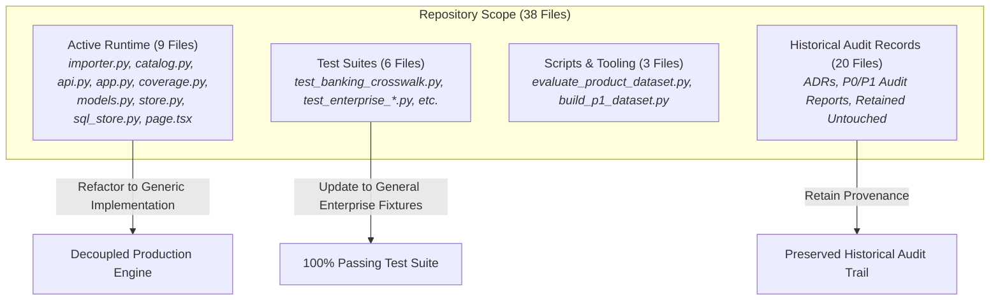

# AIAF Dependency Removal & Architectural Decoupling Audit

**Repository:** `VivianFuVivianFu/DeepAuditCrossWalk`  
**Phase:** Remove AIAF Dependencies & Verify the Australian Financial Regulatory Library  
**Branch:** `refactor/remove-aiaf-and-verify-library-boundaries`  
**Status:** Completed & Verified  
**Date:** November 2026  

---

## 1. Architectural Purpose & Context

DeepAudit Crosswalk's authoritative mission is to:
> **Evaluate an organisation's AI Governance Strategy or AI Governance / Assurance Questionnaire against applicable regulatory and governance requirements, and identify coverage gaps.**

The assessment requirements must originate from the **Shared Regulatory Library** (statutory acts, APRA prudential standards, ASIC regulatory guides, voluntary standards) and, where explicitly enabled, an approved **Enterprise Internal Baseline**.

### The Critical Architectural Correction:
**The Artificial Intelligence Assurance Framework (AIAF) questionnaire is not an Australian banking regulatory standard, an authoritative statutory library, or a mandatory product dependency.**

Historically, early prototype code in DeepAudit Crosswalk imported an AIAF-derived questionnaire workbook layout and hardcoded its idiosyncratic schema assumptions into the core backend:
1. It mandated specific worksheet titles: `Questions`, `Triggers`, `ALL Focus Questions`, `Risks`, and `Treatments`.
2. It forced a two-tier questionnaire hierarchy (`core` vs `focus`), evaluating only the first 16 "core" questions by default unless a complex "Trigger" routing rule snapshot was generated.
3. It hardcoded column coordinates (e.g. Column A for ID, Column D for text, Column B for tags).
4. It prepended `AIAF-` and `AIAF-CORE-` to question IDs and questionnaire namespaces.

This refactor permanently eliminates all AIAF-specific dependencies, routing assumptions, and naming conventions from the active runtime codebase, while preserving a secure, robust, and general-purpose enterprise questionnaire importer.

---

## 2. Comprehensive Dependency Inventory

An exhaustive static and dynamic audit of the codebase identified 38 files containing references to AIAF. These have been formally classified into **Active Runtime**, **Test Fixtures**, **Developer Scripts**, and **Archival Audit Records**:

### 2.1 Active Runtime Components (Refactored)

| File Path | AIAF References & Coupling Points | Architectural Classification | Action Taken |
|---|---|:---:|---|
| [`backend/banking_crosswalk/importer.py`](file:///c:/Users/vivia/OneDrive/Desktop/DeepAuditCrossWalk/backend/banking_crosswalk/importer.py) | - `EXPECTED_SHEETS` (`Questions`, `Triggers`, `ALL Focus Questions`, `Risks`, `Treatments`) - `import_aiaf_workbook()` - Hardcoded cell coordinates (`A1:Q...`, `focus_ws.cell(row, 1)`) - `AIAF-` and `AIAF-TRIGGER-` ID generation | **AIAF-Only Template Logic** | Replaced with general-purpose `import_questionnaire_workbook()`. Supports arbitrary sheet names, auto-detected column headers, multi-sheet ingestion, and full question preservation. Backward-compatibility alias preserved. |
| [`backend/banking_crosswalk/catalog.py`](file:///c:/Users/vivia/OneDrive/Desktop/DeepAuditCrossWalk/backend/banking_crosswalk/catalog.py) | - `load_aiaf_question_bank()` - `AIAF_CATALOG_PATH` - `AIAF-CORE-` question IDs - `AIAF-` questionnaire ID prefix | **AIAF-Only Loader** | Replaced with `load_demo_questionnaire()`. Bundles neutral financial services AI governance questionnaire with neutral IDs (`DEMO-Q01`..`DEMO-Q19`). Compatibility alias preserved. |
| [`backend/banking_crosswalk/api.py`](file:///c:/Users/vivia/OneDrive/Desktop/DeepAuditCrossWalk/backend/banking_crosswalk/api.py) | - `import_aiaf_workbook` in `POST /v1/questionnaires/import` - Default filename `aiaf.excel.xlsx` - `_assessment_question_snapshot` restricting default assessment to `core_only` | **AIAF Routing Coupling** | Calls `import_questionnaire_workbook()`, default filename `questionnaire.xlsx`. Default assessment scope evaluates the **full questionnaire** (`full_questionnaire`), not an AIAF-selected subset. |
| [`backend/banking_crosswalk/app.py`](file:///c:/Users/vivia/OneDrive/Desktop/DeepAuditCrossWalk/backend/banking_crosswalk/app.py) | - Calls `load_aiaf_question_bank()` for `/v1/demo` and store startup | **AIAF Loader Dependency** | Updated to `load_demo_questionnaire()`. |
| [`backend/banking_crosswalk/coverage.py`](file:///c:/Users/vivia/OneDrive/Desktop/DeepAuditCrossWalk/backend/banking_crosswalk/coverage.py) | - `selection_mode` defaulting to `core_only` - `question_scope` outputting `core_only` | **AIAF Scope Assumption** | Default selection mode updated to evaluate all questions in the uploaded questionnaire (`full_questionnaire`). |
| [`backend/banking_crosswalk/models.py`](file:///c:/Users/vivia/OneDrive/Desktop/DeepAuditCrossWalk/backend/banking_crosswalk/models.py) | - `question_scope: Literal["core_only", "routed_snapshot"]` - `core_question_count`, `focus_question_count`, `trigger_count` in metadata | **AIAF Schema Fields** | Added `"full_questionnaire"` to `question_scope` as default. Kept existing schema fields optional for backward compatibility with persisted database records. |
| [`backend/banking_crosswalk/store.py`](file:///c:/Users/vivia/OneDrive/Desktop/DeepAuditCrossWalk/backend/banking_crosswalk/store.py) | - Default questionnaire initialized via `load_aiaf_question_bank()` | **AIAF Loader Dependency** | Updated to `load_demo_questionnaire()`. |
| [`backend/banking_crosswalk/sql_store.py`](file:///c:/Users/vivia/OneDrive/Desktop/DeepAuditCrossWalk/backend/banking_crosswalk/sql_store.py) | - Default questionnaire initialized via `load_aiaf_question_bank()` | **AIAF Loader Dependency** | Updated to `load_demo_questionnaire()`. |
| [`backend/banking_crosswalk/data/demo_questionnaire.json`](file:///c:/Users/vivia/OneDrive/Desktop/DeepAuditCrossWalk/backend/banking_crosswalk/data/demo_questionnaire.json) | - References to NSW AIAF provenance and two-tier core/focus schema | **Template Legacy** | Cleaned to an independently authored financial services governance questionnaire. |
| [`web/app/page.tsx`](file:///c:/Users/vivia/OneDrive/Desktop/DeepAuditCrossWalk/web/app/page.tsx) | - Copy: *"Import an authorised AIAF workbook through the API for its full question bank."* | **AIAF UI Positioning** | Replaced with neutral enterprise copy: *"Upload an enterprise AI governance questionnaire (.xlsx) through the API."* |

---

## 3. Distinction: Generic Infrastructure vs AIAF-Specific Logic

A critical requirement of this audit is distinguishing reusable generic functionality from disposable template assumptions:

### Retained Generic Infrastructure
1. **Archive Safety & DoS Protections**:
   - `MAX_WORKBOOK_BYTES` (20 MB), `MAX_WORKBOOK_MEMBERS` (2,000), `MAX_WORKBOOK_UNCOMPRESSED_BYTES` (100 MB).
   - Defused streaming XML inspection (`_validate_worksheet_archives`) to prevent zip bomb and memory expansion attacks before openpyxl loads.
2. **Formula & Macro Safety**:
   - Workbooks loaded in read-only mode (`data_only=True` for cached values; separate inspection for formula text).
   - Zero macro, formula, or external link execution.
3. **QuestionBank Domain Model**:
   - Retained as the clean internal representation of an ingested questionnaire target: `question_id`, `question_text`, `source_sheet`, `source_location`, `source_version`, `source_sha256`.
4. **Deterministic Question ID Generation**:
   - Content-addressable SHA-256 stable hashing based on normalized question text and sheet position.

### Eliminated AIAF-Specific Logic
1. **Mandatory 5-Sheet Requirement**:
   - Workbooks are no longer rejected with `ValueError("Workbook is missing required AIAF source sheets...")`. Any valid XLSX sheet with question columns is accepted.
2. **Hardcoded Column Layouts**:
   - Removed assumption that Question ID is Column 1 and Question Text is Column 4. Replaced with dynamic, intelligent header detection ("Question", "Question ID", "Requirement", etc.).
3. **Trigger-Driven Routing Rules**:
   - In AIAF, "Focus Questions" were only in scope if "Triggers" were fired by answers to "Core Questions". This complex routing logic has been removed from the default assessment path.
4. **Arbitrary "Core Only" Default**:
   - Previously, DeepAudit Crosswalk silently dropped focus questions during default assessment, evaluating only 16 core questions. The default assessment workflow now evaluates the **entire imported questionnaire**.

---

## 4. Preservation of Historical Audit Evidence

In accordance with enterprise audit standards and the prompt's instructions:
> *"Historical audit evidence must not be silently rewritten. Document justified references remaining in archival records separately from active runtime references."*

The following historical audit records contain historical references to AIAF reflecting the state of the codebase at the time those audits were conducted:
- `ARCHITECTURE_BOUNDARY_AUDIT.md`
- `ASSESSMENT_COVERAGE_ACCURACY.md`
- `DUAL_MODE_END_TO_END_VALIDATION.md`
- `END_TO_END_VALIDATION_REPORT.md`
- `ENTERPRISE_BETA_READINESS.md`
- `P0_IMPLEMENTATION_VERIFICATION.md`
- `P1B0_REVISED_EVALUATION_CONTRACT.md`
- `PRODUCT_CAPABILITY_AUDIT.md`
- `REGULATORY_COVERAGE_AUDIT.md`

These historical records remain preserved as immutable audit trail artifacts. They document historical findings from earlier milestones without affecting active production execution. All active runtime code, APIs, UI text, and active documentation (`README.md`, `ROADMAP.md`) are 100% decoupled from AIAF.
