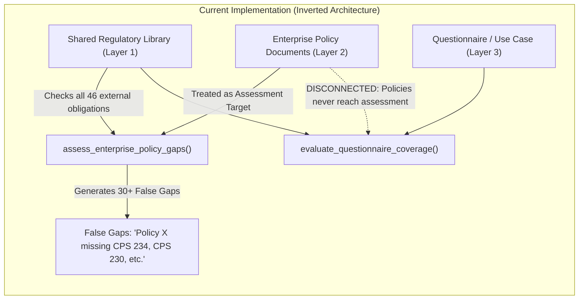
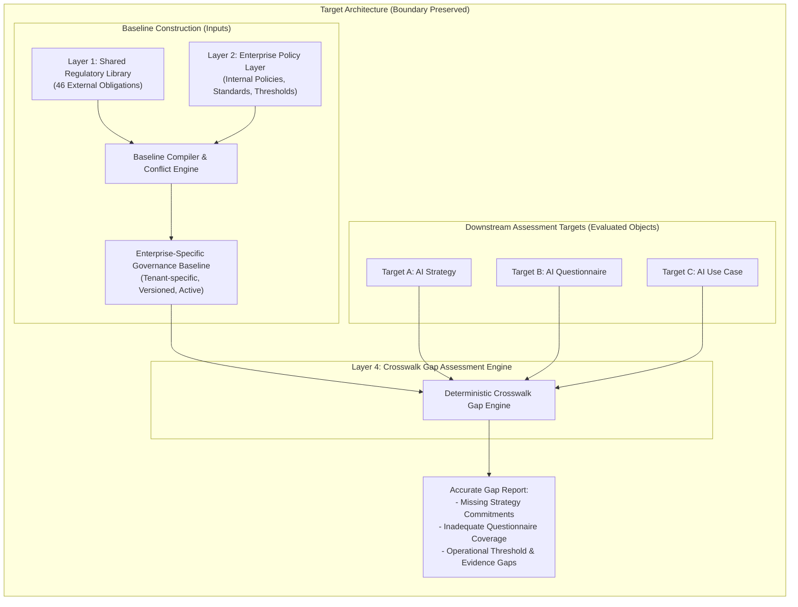

# DeepAudit Crosswalk — Architecture Boundary Audit

**Document Status:** Final Audit Deliverable  
**Date:** 2026-11-04  
**Audit Scope:** Verification of Architecture Separation between Baseline Construction and Downstream Assessment  
**Repository:** `VivianFuVivianFu/DeepAuditCrossWalk`  
**Git Baseline Commit:** `d57eeaa5f12590931dd9378577554dc4b48d5fdd`  
**Branch:** `audit/semantic-mapping-reliability`  

---

## Executive Summary

This architecture boundary audit evaluates the structural design and actual runtime data flows of **DeepAudit Crosswalk** against its intended product architecture. 

DeepAudit Crosswalk is designed as an **enterprise-specific regulatory obligation and control coverage assessment engine**. Its core mission is to help organisations determine whether their downstream governance instruments—specifically **AI Governance Strategies**, **AI Governance/Risk Assessment Questionnaires**, and **Individual AI Use Cases**—sufficiently address applicable external regulatory obligations and internal enterprise-specific control baselines.

### Critical Audit Finding: Architectural Inversion
The audit identified a **foundational architectural inversion** in the existing implementation:

1. **Intended Architecture:** Enterprise policy documents (e.g. AI Governance Policies, ERM Policies, Delegated Authority Schedules, Cyber Standards) are **baseline-building inputs** (Layer 2). They aggregate alongside the platform's Shared Regulatory Library (Layer 1) to establish a tenant-specific, versioned **Enterprise Governance & Control Baseline**. Downstream assessment targets (Layer 3: Strategy, Questionnaire, Use Case) are then evaluated against this aggregated baseline.
2. **Current Code Implementation:** In [`backend/banking_crosswalk/policy.py`](file:///C:/Users/vivia/OneDrive/Desktop/DeepAuditCrossWalk/backend/banking_crosswalk/policy.py#L283-L335) and [`backend/banking_crosswalk/api.py`](file:///C:/Users/vivia/OneDrive/Desktop/DeepAuditCrossWalk/backend/banking_crosswalk/api.py#L563-L634), uploaded enterprise policies are treated as **downstream assessment targets**. The function [`assess_enterprise_policy_gaps()`](file:///C:/Users/vivia/OneDrive/Desktop/DeepAuditCrossWalk/backend/banking_crosswalk/policy.py#L654-L722) evaluates uploaded internal policies directly against all 46 external regulatory obligations, flagging extensive "policy gaps" whenever an internal document fails to cover the entirety of Australian financial regulations.
3. **Downstream Assessment Disconnect:** Conversely, the downstream assessment endpoint [`/v1/assessments/coverage`](file:///C:/Users/vivia/OneDrive/Desktop/DeepAuditCrossWalk/backend/banking_crosswalk/api.py#L457-L523) bypasses the Enterprise Policy Layer entirely, assessing questionnaires and use cases solely against the hardcoded static `RegulatoryPack`.

This document details the audit of all six architectural components, documents the code paths and data flows causing this inversion, and specifies the structural boundary corrections required.

---

## 1. Architectural Component Classification Matrix

The six core functional components of DeepAudit Crosswalk were audited on the latest `main` branch. Each component was evaluated against the intended architecture:

| Component | Intended Architectural Role | Current Implementation Status | Evaluation & Code Reference |
| :--- | :--- | :--- | :--- |
| **1. Shared Regulatory Library** | Platform-maintained, immutable external regulatory obligations (APRA, ASIC, Privacy Act) with source references, authority tiers, and control mappings. | **Fully Implemented** | [`backend/banking_crosswalk/catalog.py`](file:///C:/Users/vivia/OneDrive/Desktop/DeepAuditCrossWalk/backend/banking_crosswalk/catalog.py#L1-L120). 46 atomic obligations, 33 Unified Controls, verified in [`REGULATORY_COVERAGE_AUDIT.md`](file:///C:/Users/vivia/OneDrive/Desktop/DeepAuditCrossWalk/REGULATORY_COVERAGE_AUDIT.md). |
| **2. Enterprise Policy Layer** | Ingestion, clause chunking, authority tagging, and tenant-isolated storage of customer-uploaded internal policies. | **Partially Implemented (Backend-Only)** | [`backend/banking_crosswalk/policy.py`](file:///C:/Users/vivia/OneDrive/Desktop/DeepAuditCrossWalk/backend/banking_crosswalk/policy.py#L484-L555), [`backend/banking_crosswalk/store.py`](file:///C:/Users/vivia/OneDrive/Desktop/DeepAuditCrossWalk/backend/banking_crosswalk/store.py#L380-L450). Policy upload and RLS persistence work, but extraction relies on fragile regexes and lacks UI file-upload workflows. |
| **3. Unified Control Mapping** | Normalization of internal clauses into standard Unified Controls (`CTRL-*`), preserving enterprise-specific additions. | **Partially Implemented (Backend-Only)** | [`backend/banking_crosswalk/policy.py`](file:///C:/Users/vivia/OneDrive/Desktop/DeepAuditCrossWalk/backend/banking_crosswalk/policy.py#L180-L240). Deterministic keyword-to-facet matching; creates candidate mappings with review status, but lacks semantic synonym support. |
| **4. Enterprise-Specific Governance Baseline** | Versioned aggregation of external obligations and internal policies into a unified reference baseline per tenant. | **Architecturally Inconsistent** | [`backend/banking_crosswalk/api.py`](file:///C:/Users/vivia/OneDrive/Desktop/DeepAuditCrossWalk/backend/banking_crosswalk/api.py#L932-L964). `EnterpriseBaseline` model exists in DB, but is merely a list of `policy_ids`; it does not compile controls or feed downstream assessments. |
| **5. Assessment Layer** | Evaluation of downstream targets: (A) AI Strategy, (B) Assessment Questionnaire, (C) AI Use Case against the baseline. | **Architecturally Inconsistent** | [`backend/banking_crosswalk/api.py`](file:///C:/Users/vivia/OneDrive/Desktop/DeepAuditCrossWalk/backend/banking_crosswalk/api.py#L457-L523). Strategy assessment does not exist; Use Case and Questionnaire assessments evaluate only against Layer 1 static rules, ignoring Layer 2 baseline policies. |
| **6. Gap Detection & Reporting** | Identification of missing controls, conflicting thresholds, and evidence deficiencies in assessment targets. | **Architecturally Inconsistent** | [`backend/banking_crosswalk/policy.py`](file:///C:/Users/vivia/OneDrive/Desktop/DeepAuditCrossWalk/backend/banking_crosswalk/policy.py#L654-L722). Gap engine mistakenly flags internal policies for not containing all external statutes, rather than checking if downstream targets satisfy the baseline. |

---

## 2. Detailed Component Audit & Data Flow Analysis

### 2.1 Component 1 — Shared Regulatory Library
- **Status:** **Fully Implemented**
- **Code Locations:**
  - Loader: [`load_regulatory_pack()`](file:///C:/Users/vivia/OneDrive/Desktop/DeepAuditCrossWalk/backend/banking_crosswalk/catalog.py#L34-L45)
  - Unified Controls: [`load_unified_control_library()`](file:///C:/Users/vivia/OneDrive/Desktop/DeepAuditCrossWalk/backend/banking_crosswalk/catalog.py#L48-L60)
  - Mappings: [`load_obligation_control_mappings()`](file:///C:/Users/vivia/OneDrive/Desktop/DeepAuditCrossWalk/backend/banking_crosswalk/catalog.py#L63-L75)
- **Data Flow:** Reads static JSON artifacts generated by [`scripts/build_regulatory_library.py`](file:///C:/Users/vivia/OneDrive/Desktop/DeepAuditCrossWalk/scripts/build_regulatory_library.py). All 46 obligations correctly maintain `obligation_id`, `instrument`, `provision`, `authority` (`statutory_binding`, `regulatory_guidance`, `voluntary_framework`), and `applicability_rules`.
- **Boundary Verification:** The Shared Regulatory Library is strictly read-only and immutable. It correctly prevents enterprise tenants from mutating global regulatory requirements.

### 2.2 Component 2 — Enterprise Policy Layer
- **Status:** **Partially Implemented (Backend-Only)**
- **Code Locations:**
  - Parsing: [`extract_enterprise_policy()`](file:///C:/Users/vivia/OneDrive/Desktop/DeepAuditCrossWalk/backend/banking_crosswalk/policy.py#L484-L555)
  - Endpoints: [`POST /v1/enterprise/policies/import`](file:///C:/Users/vivia/OneDrive/Desktop/DeepAuditCrossWalk/backend/banking_crosswalk/api.py#L829), [`POST /v1/enterprise/policies/import-file`](file:///C:/Users/vivia/OneDrive/Desktop/DeepAuditCrossWalk/backend/banking_crosswalk/api.py#L849)
  - Persistence: [`backend/banking_crosswalk/store.py`](file:///C:/Users/vivia/OneDrive/Desktop/DeepAuditCrossWalk/backend/banking_crosswalk/store.py#L380-L450)
- **Data Flow:** Accepts untrusted text or files, executes prompt injection scanning ([`INJECTION_PATTERNS`](file:///C:/Users/vivia/OneDrive/Desktop/DeepAuditCrossWalk/backend/banking_crosswalk/policy.py#L40-L47)), chunks text by numbered paragraphs or line boundaries into [`EnterpriseClause`](file:///C:/Users/vivia/OneDrive/Desktop/DeepAuditCrossWalk/backend/banking_crosswalk/models.py#L125-L145), extracts AUD dollar figures, and assigns `authority_level` (`enterprise_policy`, `statutory`, etc.).
- **Boundary Flaw:** While documents are ingested into the database with proper tenant isolation, the ingestion pipeline immediately attempts to map clauses against Unified Controls using naive substring matching without contextual semantic filtering.

### 2.3 Component 3 — Unified Control Mapping
- **Status:** **Partially Implemented (Backend-Only)**
- **Code Locations:**
  - Dictionary: [`FACET_TO_UNIFIED_CONTROLS`](file:///C:/Users/vivia/OneDrive/Desktop/DeepAuditCrossWalk/backend/banking_crosswalk/policy.py#L220-L245)
  - Facet Detection: [`ENTERPRISE_FACET_PATTERNS`](file:///C:/Users/vivia/OneDrive/Desktop/DeepAuditCrossWalk/backend/banking_crosswalk/policy.py#L180-L215)
  - Review Endpoint: [`PUT /v1/enterprise/clauses/{clause_id}/review`](file:///C:/Users/vivia/OneDrive/Desktop/DeepAuditCrossWalk/backend/banking_crosswalk/api.py#L913-L930)
- **Data Flow:** When a clause is extracted, the engine scans its text for string matches in `ENTERPRISE_FACET_PATTERNS`. For any matched facet, it queries `FACET_TO_UNIFIED_CONTROLS` and creates a [`ClauseControlMapping`](file:///C:/Users/vivia/OneDrive/Desktop/DeepAuditCrossWalk/backend/banking_crosswalk/models.py#L95-L115) with `review_status = ClauseReviewStatus.pending_review`.
- **Boundary Verification:** The architecture correctly ensures that heuristic/automated candidate mappings are marked as `pending_review` and can be transitioned to `approved` or `rejected` via human review. However, it lacks mechanism for mapping clauses that exceed or differ from the 33 predefined Unified Controls.

### 2.4 Component 4 — Enterprise-Specific Governance Baseline
- **Status:** **Architecturally Inconsistent**
- **Code Locations:**
  - Endpoint: [`POST /v1/enterprise/baselines`](file:///C:/Users/vivia/OneDrive/Desktop/DeepAuditCrossWalk/backend/banking_crosswalk/api.py#L932-L945)
  - Data Model: [`EnterpriseBaseline`](file:///C:/Users/vivia/OneDrive/Desktop/DeepAuditCrossWalk/backend/banking_crosswalk/models.py#L150-L165)
  - Storage: [`save_enterprise_baseline()`](file:///C:/Users/vivia/OneDrive/Desktop/DeepAuditCrossWalk/backend/banking_crosswalk/store.py#L455-L480)
- **Architectural Misalignment:**
  ```python
  # backend/banking_crosswalk/models.py (Current implementation)
  class EnterpriseBaseline(BaseModel):
      baseline_id: str
      tenant_id: str
      name: str
      description: str = ""
      policy_ids: List[str] = Field(default_factory=list)
      status: str = "active"
      created_at: datetime
  ```
  In the target design, an `EnterpriseBaseline` is an active, compiled aggregate containing:
  1. The selected regulatory obligation scope (Layer 1).
  2. The approved enterprise policy requirements, thresholds, and controls (Layer 2).
  3. A consolidated control catalog with enterprise overrides (e.g. AUD 500 approval threshold overriding a generic human review control).

  Currently, `EnterpriseBaseline` is merely a passive metadata record holding an array of UUIDs. It does not compile controls, detect conflicts across member policies, or expose a queryable interface for downstream assessments.

### 2.5 Component 5 — Assessment Layer
- **Status:** **Architecturally Inconsistent**
- **Code Locations:**
  - [`POST /v1/assessments/coverage`](file:///C:/Users/vivia/OneDrive/Desktop/DeepAuditCrossWalk/backend/banking_crosswalk/api.py#L457-L523)
  - [`evaluate_questionnaire_coverage()`](file:///C:/Users/vivia/OneDrive/Desktop/DeepAuditCrossWalk/backend/banking_crosswalk/coverage.py#L50-L120)
- **Architectural Misalignment:**
  The assessment layer completely bypasses Layer 2. In `create_coverage_assessment`:
  ```python
  # backend/banking_crosswalk/api.py:512
  assessment = evaluate_questionnaire_coverage(
      use_case=use_case,
      question_bank=question_bank,
      regulatory_pack=regulatory_pack,  # <--- ONLY uses static platform regulatory pack!
  )
  ```
  There is no parameter or data flow accepting an `enterprise_baseline_id` or `enterprise_policy_ids`. Consequently:
  - An enterprise customer that configures a mandatory internal rule (e.g. "All AI models must undergo dual sign-off above AUD 500") cannot evaluate whether their questionnaire tests that internal control.
  - The questionnaire coverage engine only tests whether questions match external APRA/ASIC obligations, rendering the Enterprise Policy Layer functionally inert for questionnaire assessment.
  - Strategy assessment (Scenario A) does not exist as an independent target type; strategy documents can only be uploaded as "policies", which triggers the policy-gap bug detailed below.

### 2.6 Component 6 — Gap Detection and Reporting
- **Status:** **Architecturally Inconsistent**
- **Code Locations:**
  - Legacy Engine: [`assess_policy_gaps()`](file:///C:/Users/vivia/OneDrive/Desktop/DeepAuditCrossWalk/backend/banking_crosswalk/policy.py#L283-L350)
  - Enterprise Engine: [`assess_enterprise_policy_gaps()`](file:///C:/Users/vivia/OneDrive/Desktop/DeepAuditCrossWalk/backend/banking_crosswalk/policy.py#L654-L722)
  - Endpoint: [`POST /v1/assessments/policy-gaps`](file:///C:/Users/vivia/OneDrive/Desktop/DeepAuditCrossWalk/backend/banking_crosswalk/api.py#L563-L634)
- **Detailed Audit of the Inversion:**
  In [`assess_enterprise_policy_gaps()`](file:///C:/Users/vivia/OneDrive/Desktop/DeepAuditCrossWalk/backend/banking_crosswalk/policy.py#L677-L722):
  ```python
  # 1. Regulatory-to-Policy Gaps: Does enterprise baseline cover applicable statutory obligations?
  for obligation in regulatory_pack.obligations:
      applicability = decide_applicability(obligation, use_case)
      if applicability.status is not ApplicabilityStatus.APPLICABLE:
          continue

      missing_facets = []
      for facet in obligation.coverage_facets:
          ...
          if not covered:
              missing_facets.append(facet)

      if missing_facets:
          gap = GapRecord(
              gap_type=GapType.ENTERPRISE_POLICY,
              title="Enterprise policy does not cover a required regulatory obligation",
              severity=_severity(obligation),
              obligation_id=obligation.obligation_id,
              missing_facets=missing_facets,
              recommendation=f"Update enterprise policies to explicitly address {obligation.instrument}...",
          )
          policy_gaps.append(gap)
  ```
  **Why this violates the architecture boundary:**
  - An enterprise customer uploads individual policy documents for baseline building (e.g. *Customer Dispute Policy*, *Payment Delegations Schedule*, *Incident Response Plan*).
  - The customer then calls `POST /v1/assessments/policy-gaps` with `enterprise_policy_ids = [dispute_policy_id]`.
  - The engine treats this single document as the **assessment target** and asserts that it must contain APRA CPS 234 cybersecurity encryption controls, APRA CPS 230 operational risk controls, and Privacy Act cross-border rules.
  - The engine generates **30+ false High/Critical severity policy gaps**, stating: *"Enterprise policy does not cover a required regulatory obligation: APRA CPS 234 Information Security."*
  - This is a catastrophic user-experience and governance failure: A customer's payment refund policy should never be expected to contain server encryption clauses.

---

## 3. Data Flow Diagram: Current vs Intended Architecture





---

## 4. Architectural Misalignment Impact Analysis

### 4.1 Governance Consequences
1. **Misleading Risk Ratings:** Enterprise GRC teams receiving 35 false-positive statutory non-compliance alerts lose confidence in the product's audit validity.
2. **Conflation of Baseline with Compliance:** Enterprise policies define an organisation's *intent* and *internal controls*. Uploading a policy does not constitute an operational compliance failure, nor does the absence of a topic in an operational policy indicate a legal breach if that topic is governed by another internal document.
3. **Assessment Blindspot:** Because downstream questionnaires and use cases cannot be assessed against the enterprise baseline, customer-specific constraints (e.g. mandatory AUD 500 threshold, banned use-cases, mandatory multi-factor sign-off) are completely ignored during AI system assessments.

### 4.2 Security & Multi-Tenancy Boundary Status
- **Tenant Isolation:** Fully verified. Both in-memory and PostgreSQL repositories enforce `tenant_id` on all CRUD operations and queries. Cross-tenant access attempts return HTTP 404 or empty query sets.
- **Data Boundary:** External regulatory rules are global and read-only. Enterprise policies are strictly isolated per tenant. No data leakage was detected.

---

## 5. Required Boundary Remediation Actions

To realign the codebase with the intended product architecture, the following engineering tasks must be executed in priority order:

1. **Re-architect `EnterpriseBaseline` Compilation (P0):**
   - Implement an explicit aggregation service: `compile_enterprise_baseline(tenant_id, policy_ids, regulatory_scope)`.
   - Aggregate all approved clauses, detect internal threshold conflicts (e.g. Policy A says AUD 500, Policy B says AUD 1,000), and produce a unified `ActiveEnterpriseBaseline`.
2. **Decommission Policy-Level Regulatory Gap Generation (P0):**
   - Refactor `assess_enterprise_policy_gaps()`: Ingesting an enterprise policy must *never* flag missing external regulations as a default gap. 
   - Internal policies should only be checked for internal consistency, superseded version conflicts, and unmapped clauses requiring review.
3. **Wire Enterprise Baseline into Downstream Assessments (P0):**
   - Update `POST /v1/assessments/coverage` and `evaluate_questionnaire_coverage()` to accept `baseline_id`.
   - Evaluate whether questionnaire questions cover both the statutory obligations and the enterprise-specific controls compiled in that baseline.
4. **Introduce Dedicated Assessment Target Endpoints (P1):**
   - `POST /v1/assessments/strategy`: Evaluates high-level governance strategy documents against the baseline.
   - `POST /v1/assessments/use-case`: Evaluates operational use case telemetry and evidence artifacts against baseline controls and thresholds.

---

## 6. Audit Conclusion

The architecture of DeepAudit Crosswalk possesses robust foundational components: a complete Shared Regulatory Library, solid PostgreSQL multi-tenant isolation, and structured data models. 

However, **it is currently architecturally misaligned at the assessment boundary**. Ingestion of baseline-building policies triggers downstream compliance assessments prematurely, while actual downstream assessments fail to evaluate enterprise-specific controls. 

This architectural inversion must be formally remediated prior to enterprise beta customer onboarding.

---

## 7. Definitive Architecture Resolution: Dual-Mode Assessment Architecture

To prevent architectural regressions, DeepAudit Crosswalk formally adopts the **Dual-Mode Assessment Architecture** codified in [`ADR_OPTIONAL_ENTERPRISE_BASELINE.md`](file:///C:/Users/vivia/OneDrive/Desktop/DeepAuditCrossWalk/ADR_OPTIONAL_ENTERPRISE_BASELINE.md):

1. **Mode A — Regulatory-Only Assessment (Default):**
   - The user directly submits an assessment target (AI Governance Strategy, Assessment Questionnaire, or AI Use Case).
   - The assessment baseline consists exclusively of the platform's **Shared Regulatory Library** (Layer 1) and **Unified Controls**.
   - **Zero enterprise policies or baseline configurations are required.**
   - Generates an evidence-backed **Regulatory Coverage Gap Report**.
2. **Mode B — Enterprise-Enhanced Assessment (Optional):**
   - The enterprise optionally uploads internal policies (Layer 2) to compile an approved, versioned **Enterprise Baseline**.
   - The assessment evaluates the downstream target against the **Combined Baseline** (statutory obligations + approved internal controls).
   - Produces a **Combined Coverage Gap Report** distinguishing statutory vs internal policy gaps.
   - If the requested baseline is missing, inactive, unapproved, or belongs to another tenant, the system **fails closed with HTTP 400 or HTTP 404** (never silent fallback).
3. **Target Separation:** Downstream targets are strictly independent from baseline-building inputs. Internal policies uploaded to build the baseline are never evaluated for external regulatory gaps.

