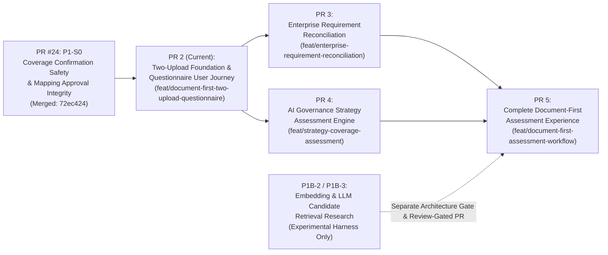

# DeepAudit Crosswalk — Document-First Two-Upload Product Architecture & Implementation Roadmap

**Repository:** `VivianFuVivianFu/DeepAuditCrossWalk`  
**Base Commit (`origin/main`):** `72ec424` (PR #24 — Revised P1-S0 Coverage Confirmation Safety & Mapping Approval Integrity merged)  
**PR 2 Implementation Branch:** `feat/document-first-two-upload-questionnaire`

---

## 0. Prerequisite Verification (`origin/main` @ `72ec424`)

Before designing and implementing PR 2, `origin/main` (`72ec424`) was audited to confirm all required prerequisites from PR #22, PR #23, and PR #24 (P1-S0):

| Prerequisite | Verification Target | Status on `origin/main` (`72ec424`) |
|---|---|---|
| **P1-S0 Coverage-State Safeguards** | `CoverageStatus` (8 explicit states) & `EnterpriseClauseCoverage` (7 orthogonal assurance dimensions) in [`backend/banking_crosswalk/models.py`](backend/banking_crosswalk/models.py) | **VERIFIED** |
| **No Weak Keyword Confirmed Coverage** | `facet.split("_")` and single-word unmapped overlap removed in [`backend/banking_crosswalk/coverage.py`](backend/banking_crosswalk/coverage.py); deterministic numeric, currency, operator, timing, role, and negation checks enforced | **VERIFIED** |
| **Separate Clause & Mapping Approval** | `PUT /v1/enterprise/clauses/{clause_id}/review` and `PUT /v1/enterprise/clauses/{clause_id}/mappings/{mapping_id}/review` decoupled; `compile_enterprise_baseline()` enforces all 5 approval invariants | **VERIFIED** |
| **Unmapped Requirements Traceable** | Approved unmapped or facet-less clauses resolve to `CoverageStatus.MAPPING_INCOMPLETE` and emit `in_review` gaps | **VERIFIED** |
| **PR #22 General Questionnaire Import** | `POST /v1/questionnaires/import` (`import_questionnaire_workbook`) parses arbitrary enterprise `.xlsx` questionnaires without AIAF sheet dependencies | **VERIFIED** |
| **PR #23 Enterprise Baseline Isolation** | `regulatory_only` (default) rejects `enterprise_baseline_id` and ignores tenant enterprise clauses; `enterprise_enhanced` requires an active, eligible, fingerprint-verified tenant baseline | **VERIFIED** |

---

## 1. Current-State vs Target-State Capability Matrix

| Capability Dimension | Pre-PR 2 Current State (`origin/main` @ `72ec424`) | PR 2 Target State (This PR) | Full Roadmap Target State (PR 2 → PR 5) |
|---|---|---|---|
| **Primary User Entry Point** | Synthetic Demo-first form (`web/app/page.tsx`) requiring users to configure a synthetic AI Use Case (`"Dispute and Refund Agent"`) and always running against `DEMO_BANKING_V1`. | **Document-First Two-Upload Workspace** presenting two primary workflows: **1. Assess a Document (Upload B)** and **2. Add Enterprise Policies — Optional (Upload A)**, with Synthetic Demo isolated as an explicit secondary example tab. | Unified document-first workspace supporting both Questionnaire (`.xlsx`) and Strategy (`.docx`, `.pdf`, `.txt`) assessment targets alongside optional Enterprise Baseline management and reconciliation. |
| **Upload B — Option 1: Questionnaire Assessment (`.xlsx`)** | Backend `POST /v1/questionnaires/import` exists, but the web UI cannot upload `.xlsx` files, preview extracted questions, or run coverage assessments on uploaded questionnaires. | **End-to-end UI + Server Gateway + Backend workflow**: upload `.xlsx` → validate & import → preview extracted questions, sheets, row locations & SHA-256 → choose `regulatory_only` or `enterprise_enhanced` → configure optional Organisation Profile → run coverage assessment → inspect traceable findings & export JSON. | Enhanced with interactive human review of candidate question-to-facet mappings and version-aware gap comparison (PR 5). |
| **Upload B — Option 2: Strategy Assessment (`.docx`, `.pdf`, `.txt`)** | Backend raises `501 Not Implemented` on `assessment_target_type="strategy"`; not represented in UI. | Explicitly shown in UI under **Assess a Document** as **Planned / Unavailable** with clear architectural messaging (never fabricates questionnaire items from strategy prose). | Independent Strategy Assessment pipeline (PR 4) and full UI integration (PR 5). |
| **Upload A — Add Enterprise Policies (Optional)** | Backend REST APIs exist (`/v1/enterprise/policies/*`, `/v1/enterprise/clauses/*`, `/v1/enterprise/baselines`), but have zero UI exposure or server-side proxy routes. | **End-to-end UI + Server Gateway workflow**: upload policy file (`.pdf`, `.docx`, `.txt`, `.md`) or text → inspect extracted candidate clauses → separately review/approve clauses and control mappings → compile versioned `EnterpriseBaseline` → view Draft / Pending Review / Approved / Eligible status. | Extended with formal External-vs-Enterprise Requirement Reconciliation (`equivalent`, `partial`, `additional`, `stricter`, `conflict`, `unmapped`, `undetermined`) in PR 3. |
| **Applicability Context** | Labelled `"01 / CONTEXT: Your AI use case"`, coupling applicability facts to a single AI use case. | Re-architected as a reusable, lightweight **Organisation Profile & Assessment Context** where all facts default to `Undetermined` (`null`), never inferred from document keywords, and never requiring standalone AI Use Case Assessment. | Persistent reusable Organisation Profile across Questionnaire and Strategy assessments (PR 5). |
| **Document Role Isolation** | Enforced in backend data models, but UI only had an inline policy excerpt box for `policy-gaps`. | Strictly enforced across UI, Next.js gateway, and backend: Upload A creates `EnterprisePolicy` baseline sources only; Upload B creates `QuestionBank` assessment targets only. | Maintained across Questionnaire, Strategy, and Enterprise Baseline workflows with independent provenance. |
| **Tenant & Upload Security** | Single `/api/analysis` route hardcoded to `public-demo` tenant, `DEMO_BANKING_V1`, and `persist: false`. | Dual-gateway architecture: `/api/analysis` remains locked to stateless `DEMO_BANKING_V1` (`public-demo`), while `/api/workspace` provides a server-bound private tenant gateway that strips caller tenant headers, keeps credentials server-side, blocks `public-demo` and `DEMO_BANKING_V1`, and fails closed in unconfigured production. | Multi-tenant authenticated session binding with durable PostgreSQL RLS enforcement. |

---

## 2. Two-Upload Architecture and Data-Flow Diagram

```mermaid
flowchart TD
    subgraph Browser["Web Client (Document-First UI)"]
        Nav["Primary Mode Switcher<br/>1. Assess a Document (Primary)<br/>2. Add Enterprise Policies (Optional)<br/>3. Synthetic Demo Example (Isolated)"]
        
        subgraph UploadB_UI["Workflow B: Assess a Governance Document (Primary)"]
            TargetSel["Target Selector<br/>• AI Assurance Questionnaire (.xlsx) [Active]<br/>• AI Governance Strategy (.docx/.pdf) [Planned - PR 4]"]
            QFile["Upload .xlsx Workbook"]
            QPreview["Extracted Question Preview<br/>Question IDs · Wording · Sheet/Row · SHA-256"]
            OrgCtx["Organisation Profile & Applicability Context<br/>Confirmed Yes / Confirmed No / Undetermined (null)"]
            ModeSel["Assessment Mode<br/>• Regulatory-Only (Default)<br/>• Enterprise-Enhanced (Requires Eligible Baseline)"]
            RunAssess["Run Questionnaire Coverage Assessment"]
            FindingsUI["Traceable Findings & Gap Report<br/>• Shared Regulatory Obligations<br/>• 7-Dimension Enterprise Clause Coverage<br/>• Actionable Gaps & JSON Export"]
        end

        subgraph UploadA_UI["Workflow A: Add Enterprise Policies (Optional Baseline Builder)"]
            PFile["Upload Internal Policy (.pdf/.docx/.txt/.md)"]
            ClauseList["Extracted Candidate Clauses & Facets<br/>Status: Proposed / Approved / Rejected"]
            MapList["Candidate Control Mappings<br/>Separate Approval: Proposed / Approved / Rejected"]
            CompileBase["Compile Versioned Enterprise Baseline<br/>Status: Pending Review vs Eligible Active"]
        end
    end

    subgraph NextGateway["Next.js Server-Side Gateways (Trust Boundary)"]
        WorkspaceGW["/api/workspace<br/>• Server-bound X-Tenant-ID (never browser-supplied)<br/>• Server-side X-API-Key & Reviewer Identity<br/>• Blocks 'public-demo' & 'DEMO_BANKING_V1'<br/>• Enforces payload byte limits"]
        PublicDemoGW["/api/analysis (Public Demo Only)<br/>• Locked to tenant 'public-demo'<br/>• Forces DEMO_BANKING_V1 & persist=false<br/>• Zero access to private tenant records"]
    end

    subgraph FastAPI["FastAPI Backend (/v1) & P1-S0 Safe Engines"]
        QImportAPI["POST /v1/questionnaires/import<br/>GET /v1/questionnaires"]
        PImportAPI["POST /v1/enterprise/policies/import-file<br/>GET /v1/enterprise/policies"]
        ReviewAPI["PUT /v1/enterprise/clauses/{id}/review<br/>PUT /v1/enterprise/clauses/{id}/mappings/{mid}/review"]
        BaselineAPI["POST /v1/enterprise/baselines<br/>GET /v1/enterprise/baselines"]
        AssessAPI["POST /v1/assessments/coverage"]
        RegPack["Shared Regulatory Library<br/>(6 Australian & Global Sources)"]
        TenantStore["Tenant-Scoped Repository<br/>(InMemoryStore / PostgreSQL RLS)"]
    end

    QFile --> WorkspaceGW --> QImportAPI --> TenantStore
    QImportAPI --> QPreview
    PFile --> WorkspaceGW --> PImportAPI --> TenantStore
    ClauseList --> WorkspaceGW --> ReviewAPI --> TenantStore
    MapList --> WorkspaceGW --> ReviewAPI
    CompileBase --> WorkspaceGW --> BaselineAPI --> TenantStore
    RunAssess --> WorkspaceGW --> AssessAPI
    RegPack --> AssessAPI
    TenantStore --> AssessAPI
    AssessAPI --> FindingsUI
```

---

## 3. Security and Tenant-Access Design

1. **Strict Separation Between Private Workspace Gateway (`/api/workspace`) and Public Demo Gateway (`/api/analysis`)**
   - `/api/analysis` remains strictly locked to the stateless synthetic demo: it forces `questionnaire_pack: "DEMO_BANKING_V1"`, `persist: false`, and tenant `"public-demo"`. It cannot read, list, or assess any uploaded questionnaire, enterprise policy, clause, or baseline.
   - `/api/workspace` is a dedicated server-side gateway for document-first operations. It never trusts any browser-supplied `X-Tenant-ID`, `tenant_id`, `X-API-Key`, `X-Actor`, or `X-Role`.
2. **Fail-Closed Production Tenant Binding & Clearly Labelled Local Single-Tenant Mode**
   - In production (`NODE_ENV === "production"` or `ENV === "production"`), `/api/workspace` requires `BANKING_CROSSWALK_TENANT_ID` (must not be empty or `"public-demo"`) and `CROSSWALK_API_KEY` to be configured on the server; otherwise it fails closed with `403 Forbidden`.
   - In local/non-production environments, `/api/workspace` binds to `process.env.BANKING_CROSSWALK_TENANT_ID || "local-private-workspace"` (explicitly isolated from `"public-demo"`), and the UI clearly displays the workspace security posture banner (`Private Local Single-Tenant Workspace`).
   - If `WORKSPACE_AUTH_TOKEN` is configured on the server, `/api/workspace` additionally verifies `X-Workspace-Token` / `Authorization: Bearer` using constant-time digest comparison (`crypto.timingSafeEqual`).
3. **No Silent Fallback to `DEMO_BANKING_V1` in Real Assessments**
   - When `/api/workspace` forwards a coverage assessment (`action: "assess_coverage"`), it requires an explicit uploaded `questionnaire_id` (rejecting `"DEMO_BANKING_V1"` or missing `questionnaire_id` with `400 Bad Request`).
4. **Bounded File Parsing, Input Validation & Zero Document-Content Logging**
   - `/api/workspace` streams request bodies with a hard byte ceiling (`MAX_WORKSPACE_UPLOAD_BYTES = 28_000_000` for base64-encoded 20 MB files; `1_000_000` for non-upload JSON actions) before calling `JSON.parse`.
   - Backend `import_questionnaire_workbook` and `extract_policy_file` enforce archive member limits, XML streaming cell bounds, formula injection guards (`=`, `+`, `-`, `@`), HTML tag rejection, and read-only extraction without writing uploaded files to disk or logging document text.

---

## 4. Existing API Reuse Analysis

| Workflow Step | Backend Endpoint | Method | Reuse Status in PR 2 |
|---|---|---|---|
| Import Enterprise Questionnaire (`.xlsx`) | `/v1/questionnaires/import` | `POST` | **Reused directly** (`QuestionnaireImportRequest`) |
| List / Get Tenant Uploaded Questionnaires | `/v1/questionnaires`, `/v1/questionnaires/{id}` | `GET` | **Added thin tenant-scoped read endpoints** in `api.py`, `store.py`, `sql_store.py` (excludes `DEMO_BANKING_V1`) |
| Import Enterprise Policy File (`.pdf`, `.docx`, `.txt`, `.md`) | `/v1/enterprise/policies/import-file` | `POST` | **Reused directly** (`EnterprisePolicyFileImportRequest`) |
| Import Enterprise Policy Text | `/v1/enterprise/policies/import` | `POST` | **Reused directly** (`EnterprisePolicyImportRequest`) |
| List / Get / Delete Enterprise Policies | `/v1/enterprise/policies`, `/v1/enterprise/policies/{id}` | `GET`, `DELETE` | **Reused directly** |
| List Extracted Policy Clauses | `/v1/enterprise/policies/{id}/clauses` | `GET` | **Reused directly** |
| Review Enterprise Clause (Approve / Reject) | `/v1/enterprise/clauses/{id}/review` | `PUT` | **Reused directly** (`ClauseReviewRequest` — P1-S0 decoupled) |
| Review Clause Control Mapping (Approve / Reject) | `/v1/enterprise/clauses/{id}/mappings/{mid}/review` | `PUT` | **Reused directly** (`ClauseMappingReviewRequest` — P1-S0 decoupled) |
| Compile Enterprise Baseline | `/v1/enterprise/baselines` | `POST` | **Reused directly** (`EnterpriseBaselineCreateRequest`) |
| List / Get Enterprise Baselines | `/v1/enterprise/baselines`, `/v1/enterprise/baselines/{id}` | `GET` | **Reused directly** |
| Run Questionnaire Coverage Assessment | `/v1/assessments/coverage` | `POST` | **Reused directly** (`CoverageAssessmentRequest` with `questionnaire_id`, `assessment_mode`, `enterprise_baseline_id`) |

---

## 5. Implementation Dependency Map (PR 2 → PR 5 & P1B Research)

---

## 6. PR 2 Change Scope

1. **Backend (`backend/banking_crosswalk/store.py`, `sql_store.py`, `api.py`)**:
   - Add `list_questionnaires(tenant_id)` and `get_tenant_questionnaire(tenant_id, questionnaire_id)` to `TenantStore` and `SQLTenantStore` so tenants can list and inspect their uploaded questionnaires without `DEMO_BANKING_V1` pollution or cross-tenant leakage.
   - Expose `GET /v1/questionnaires` and `GET /v1/questionnaires/{questionnaire_id}` in `api.py`.
2. **Next.js Private Workspace Gateway (`web/app/api/workspace/route.ts`)**:
   - Implement server-bound tenant gateway supporting Upload B (`import_questionnaire`, `list_questionnaires`, `get_questionnaire`, `assess_coverage`) and Upload A (`import_policy_file`, `import_policy_text`, `list_policies`, `get_policy_clauses`, `delete_policy`, `review_clause`, `review_clause_mapping`, `create_baseline`, `list_baselines`).
   - Enforce server-side `X-Tenant-ID`, `X-API-Key`, `X-Actor`, `X-Role`, payload size limits, production fail-closed guard, and strict rejection of `"public-demo"` and `"DEMO_BANKING_V1"`.
3. **Frontend Document-First Application (`web/app/analysis.ts`, `web/app/page.tsx`, `web/app/style.css`)**:
   - Replace the Demo-first layout with the Document-First Two-Upload workspace:
     - **Primary View 1 — Assess a Document (Upload B)**:
       - Target selector: **AI Assurance / Governance Questionnaire (`.xlsx`)** (active) and **AI Governance Strategy (`.docx`, `.pdf`, `.txt`)** (visibly marked **Planned / Unavailable** with explanation).
       - Direct `.xlsx` upload, extracted question preview table (IDs, wording, sheet/row location, SHA-256, warnings), Assessment Mode selector (`regulatory_only` default vs `enterprise_enhanced` with eligible baseline selector), collapsible Organisation Profile & Applicability Context (`Undetermined` defaults), assessment execution, traceable findings (including 7-dimension `enterprise_clause_coverage`), and JSON export.
     - **Primary View 2 — Add Enterprise Policies (Optional — Upload A)**:
       - Policy file upload (`.pdf`, `.docx`, `.txt`, `.md`) or policy text import with version, category, and authority level.
       - Policy inventory showing status badges (**Pending Review**, **Approved / Eligible for Baseline**, **Rejected**).
       - Extracted clause table with independent **Approve / Reject Clause** actions and per-mapping **Approve / Reject Mapping** actions (preserving P1-S0 separation).
       - Versioned Enterprise Baseline compiler (`POST /v1/enterprise/baselines`) and active baseline registry.
     - **Secondary View 3 — Synthetic Demo Example (`DEMO_BANKING_V1`)**:
       - Explicitly separated example experience calling `/api/analysis` so synthetic demo assessments are never confused with customer document assessments.

---

## 7. PR 2 Regression and Acceptance Test Plan

1. **Backend API & Isolation Tests (`backend/tests/test_pr2_two_upload_workflow.py`)**:
   - **Scenario A (Regulatory-Only Questionnaire)**: Upload `.xlsx` questionnaire -> preview questions via `GET /v1/questionnaires/{id}` -> run `regulatory_only` coverage assessment -> verify source-linked findings and zero enterprise leakage.
   - **Scenario B (Enterprise-Enhanced Questionnaire)**: Upload internal policy -> verify clauses & mappings start `proposed` -> try compiling baseline before approval (rejected `422`) -> approve clause -> verify proposed mapping still excluded from `confirmed_control_ids` -> approve mapping -> compile baseline -> run `enterprise_enhanced` assessment on uploaded `.xlsx` questionnaire -> verify internal threshold/timing/role checks and 7-dimension `enterprise_clause_coverage`.
   - **Scenario C (Strategy Target Guard)**: Verify `assessment_target_type="strategy"` continues to return `501 Not Implemented`.
   - **Scenario D (Unknown Applicability Preserved)**: Upload `.xlsx` questionnaire and run assessment with all Organisation Profile facts `null` (`Undetermined`) -> verify conditional obligations report `undetermined` applicability and are never silently marked `not_applicable` or `covered`.
   - **Scenario E (Document Role Separation)**: Upload a policy in Upload A (does not appear in `GET /v1/questionnaires`) and upload a questionnaire in Upload B (does not appear in `GET /v1/enterprise/policies`); verify independent provenance and versioning.
   - **Scenario F (False-Coverage Regression)**: Verify P1-S0 guard that a question mentioning `"human oversight"` does not satisfy a requirement for `"human approval before execution above AUD 500"`.
   - **Scenario G (Tenant Isolation)**: Verify Bank A's uploaded questionnaires, policies, clauses, mappings, baselines, and assessments cannot be listed, read, reviewed, or assessed by Bank B (`404` / `403`).
2. **Frontend Unit & Gateway Security Tests (`web/tests/analysis.test.ts`, `web/tests/proxy.test.ts`, `web/tests/workspace_gateway.test.ts`)**:
   - Verify `/api/workspace` strips browser-supplied `X-Tenant-ID`, `tenant_id`, and `X-API-Key`, injects server-bound headers, blocks `DEMO_BANKING_V1` on real assessments, fails closed in production when `BANKING_CROSSWALK_TENANT_ID` is unset or `"public-demo"`, and enforces payload byte limits.
   - Verify `/api/analysis` (Public Demo) remains locked to `DEMO_BANKING_V1` and `persist: false`.
   - Verify helper functions in `web/app/analysis.ts` for building document-first coverage payloads and formatting status badges.
