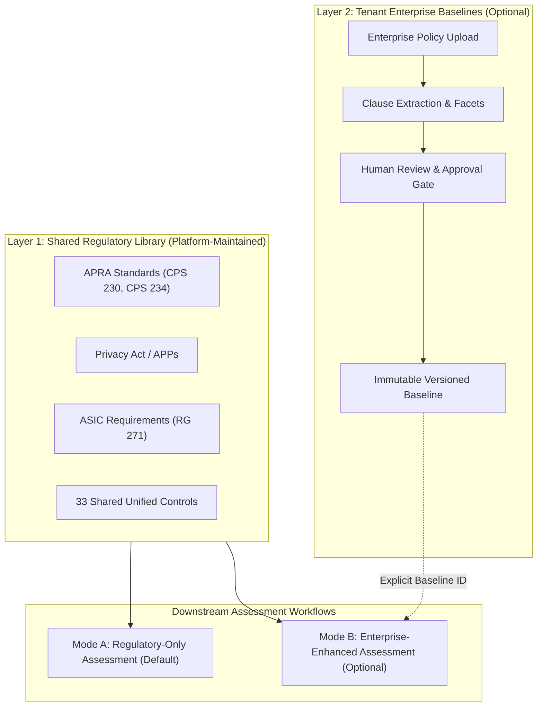

# Dual-Mode End-to-End Validation Report: DeepAudit Crosswalk

**Repository:** `VivianFuVivianFu/DeepAuditCrossWalk`  
**Execution Environment:** Production FastAPI Service via `TestClient`  
**Evaluation Script:** [`scripts/validate_p0_e2e_dual_mode.py`](file:///c:/Users/vivia/OneDrive/Desktop/DeepAuditCrossWalk/scripts/validate_p0_e2e_dual_mode.py)  
**Execution Date:** November 2026  
**Artifacts Directory:** [`e2e_artifacts/`](file:///c:/Users/vivia/OneDrive/Desktop/DeepAuditCrossWalk/e2e_artifacts)  

---

## 1. Architectural Architecture & Dual-Mode Principles (ADR 0003)

DeepAudit Crosswalk enforces two independent, auditable assessment modes:



### Invariant Rules
1. **Mode A (Regulatory-Only)**: Zero enterprise configuration required. Operates exclusively against the Shared Regulatory Library and Unified Controls. Never loads or executes enterprise baseline checks.
2. **Mode B (Enterprise-Enhanced)**: Supplements the Shared Regulatory Library with approved, tenant-specific enterprise requirements. Explicit baseline ID required; no silent fallback to Mode A.
3. **Immutability & Integrity**: Baselines use immutable clause snapshots and deterministic SHA-256 fingerprints. Tampered content fails closed (HTTP 422).
4. **Tenant Isolation**: Cross-tenant baseline access returns HTTP 404 Not Found.

---

## 2. Scenario A — Regulatory-Only Questionnaire Assessment

### Execution Context
- **Tenant ID:** `tenant-reg-only-2e68c847-a62b-414b-be10-d176250df101`
- **Enterprise Baseline Configured:** None (zero policies or baselines uploaded)
- **Questionnaire:** AIAF Australian AI Ethics & Governance Questionnaire (19 questions)
- **Use Case:** Synthetic Australian Banking "Dispute and Refund AI Agent"
- **API Endpoint:** `POST /v1/assessments/coverage`

### Request Payload (`e2e_artifacts/scenario_a_request.json`)
```json
{
  "assessment_mode": "regulatory_only",
  "questionnaire_id": "AIAF-88497954b0ba",
  "use_case": {
    "name": "Dispute and Refund AI Agent",
    "apra_regulated": true,
    "handles_personal_information": true,
    "idr_obligations": true,
    "assists_consumer_credit_decision": false,
    "approval_threshold_aud": 1000.0,
    "approval_threshold_operator": ">"
  },
  "persist": false
}
```

### Response Payload Summary (`e2e_artifacts/scenario_a_response.json`)
```json
{
  "assessment_id": "ea9f0e04-4cea-4a45-bc99-c54f376d6ec2",
  "assessment_mode": "regulatory_only",
  "enterprise_baseline_id": null,
  "enterprise_baseline_version": null,
  "enterprise_baseline_revision": null,
  "applicable_obligation_ids": [
    "AU-APRA-CPS230-01", "AU-APRA-CPS230-02", "AU-APRA-CPS230-03", "AU-APRA-CPS230-04",
    "AU-APRA-CPS230-05", "AU-APRA-CPS230-06", "AU-APRA-CPS234-01", "AU-APRA-CPS234-02",
    "AU-APRA-CPS234-03", "AU-APRA-CPS234-04", "AU-APRA-CPS234-05", "AU-APRA-CPS234-06",
    "AU-APRA-CPS234-07", "AU-APRA-CPS234-08", "AU-ASIC-RG271-01",  "AU-ASIC-RG271-02",
    "AU-ASIC-RG271-03",  "AU-PRIV-APP1-01",   "AU-PRIV-APP1-02",   "AU-PRIV-APP11-01",
    "AU-PRIV-APP11-02",  "AU-PRIV-APP11-03"
  ],
  "applicable_enterprise_requirement_ids": [],
  "enterprise_gaps": [],
  "gaps": [
    {
      "gap_id": "GAP-Q-99F5E364A313E42D",
      "gap_type": "questionnaire_gap",
      "source_type": "regulatory",
      "title": "Questionnaire coverage is not confirmed for APRA CPS 230 Operational Risk Management Framework",
      "obligation_id": "AU-APRA-CPS230-01"
    }
  ],
  "provenance": {
    "assessment_mode": "regulatory_only",
    "enterprise_baseline_id": null,
    "applicable_obligation_count": 22,
    "applicable_enterprise_requirement_count": 0
  }
}
```

### Verification Findings for Mode A
- Status: **HTTP 201 Created**
- `assessment_mode` is strictly `"regulatory_only"`.
- `enterprise_baseline_id` is strictly `null`.
- `enterprise_gaps` is empty (`[]`).
- Zero enterprise policy requirements, conflict gaps, or internal thresholds were loaded or evaluated.

---

## 3. Scenario B — Enterprise-Enhanced Questionnaire Assessment

### Execution Context
- **Tenant ID:** `tenant-ent-enhanced-2a6ae7f8-c405-4d3b-bc07-fa0641d65c06`
- **Policies Imported:**
  1. *Enterprise AI Governance & Oversight Policy* (v1.2.0): Mandates manual approval for refund executions exceeding AUD 500 prior to execution.
  2. *Enterprise Information Security & Privacy Policy* (v2.0.0): Requires cryptographic HSM access control and data sovereignty.
- **Review & Approval Gate:** 2 clauses approved by Chief Risk Officer; 8 clauses left as proposed.
- **Compiled Baseline ID:** `dc39850a-7380-464d-b69f-d83b80bcc0c6` (v2026.Q1, revision 1, SHA-256 fingerprint verified)
- **Questionnaire:** Identical AIAF questionnaire (19 questions)
- **Use Case:** Identical "Dispute and Refund AI Agent" with `approval_threshold_aud=1000.0`
- **API Endpoint:** `POST /v1/assessments/coverage`

### Request Payload (`e2e_artifacts/scenario_b_request.json`)
```json
{
  "assessment_mode": "enterprise_enhanced",
  "enterprise_baseline_id": "dc39850a-7380-464d-b69f-d83b80bcc0c6",
  "enterprise_baseline_version": "2026.Q1",
  "questionnaire_id": "AIAF-88497954b0ba",
  "use_case": {
    "name": "Dispute and Refund AI Agent",
    "apra_regulated": true,
    "handles_personal_information": true,
    "idr_obligations": true,
    "assists_consumer_credit_decision": false,
    "approval_threshold_aud": 1000.0,
    "approval_threshold_operator": ">"
  },
  "persist": false
}
```

### Response Payload Summary (`e2e_artifacts/scenario_b_response.json`)
```json
{
  "assessment_id": "5f7513a8-87b9-42eb-b5f4-67ed846acd8a",
  "assessment_mode": "enterprise_enhanced",
  "enterprise_baseline_id": "dc39850a-7380-464d-b69f-d83b80bcc0c6",
  "enterprise_baseline_version": "2026.Q1",
  "enterprise_baseline_revision": 1,
  "applicable_obligation_ids": [
    "AU-APRA-CPS230-01", "AU-APRA-CPS230-02", "AU-APRA-CPS230-03", "AU-APRA-CPS230-04",
    "AU-APRA-CPS230-05", "AU-APRA-CPS230-06", "AU-APRA-CPS234-01", "AU-APRA-CPS234-02",
    "AU-APRA-CPS234-03", "AU-APRA-CPS234-04", "AU-APRA-CPS234-05", "AU-APRA-CPS234-06",
    "AU-APRA-CPS234-07", "AU-APRA-CPS234-08", "AU-ASIC-RG271-01",  "AU-ASIC-RG271-02",
    "AU-ASIC-RG271-03",  "AU-PRIV-APP1-01",   "AU-PRIV-APP1-02",   "AU-PRIV-APP11-01",
    "AU-PRIV-APP11-02",  "AU-PRIV-APP11-03"
  ],
  "applicable_enterprise_requirement_ids": [
    "POL-9C9D7C2C0B81",
    "POL-A00D77D5BEAE"
  ],
  "enterprise_gaps": [
    {
      "gap_id": "GAP-C-63FE3BCED1796191",
      "gap_type": "control_conflict",
      "source_type": "enterprise_policy",
      "title": "Configured approval threshold (AUD 1000) exceeds approved policy threshold (AUD 500)",
      "status": "open",
      "severity": "critical",
      "policy_clause_id": "POL-9C9D7C2C0B81",
      "required_threshold": 500.0,
      "use_case_threshold": 1000.0,
      "threshold_operator": ">",
      "use_case_operator": ">",
      "evidence_missing": true,
      "recommendation": "Align system threshold > AUD 1000 to policy requirement > AUD 500 (exposure interval: 500 to 1000), or obtain an authorised policy exception."
    }
  ],
  "provenance": {
    "assessment_mode": "enterprise_enhanced",
    "enterprise_baseline_id": "dc39850a-7380-464d-b69f-d83b80bcc0c6",
    "enterprise_baseline_version": "2026.Q1",
    "enterprise_baseline_revision": 1,
    "baseline_sha256": "5475aa2a348f1f6e925f51d2...",
    "applicable_obligation_count": 22,
    "applicable_enterprise_requirement_count": 2
  }
}
```

---

## 4. Side-by-Side Comparison: Scenario A vs Scenario B

| Assessment Dimension | Scenario A (Regulatory-Only) | Scenario B (Enterprise-Enhanced) | Invariant Verification |
|---|---|---|---|
| **Questionnaire Target** | `AIAF-88497954b0ba` | `AIAF-88497954b0ba` | Identical assessment target evaluated. |
| **Use Case Configuration** | Dispute Agent (threshold: AUD 1,000) | Dispute Agent (threshold: AUD 1,000) | Identical operational context supplied. |
| **Applicable Regulatory Obligations** | **22 obligations** | **22 obligations** | **100% Identical:** External legal obligations are never altered or weakened by enterprise policies. |
| **Enterprise Baseline Resolved** | `null` | `dc39850a-7380-464d-b69f...` | Strictly isolated. Mode A never loads enterprise baseline data. |
| **Applicable Enterprise Requirements**| **0** | **2 approved requirements** | Only approved requirements in baseline are evaluated. |
| **Regulatory Gaps Identified** | 22 questionnaire gaps | 22 questionnaire gaps | Identical regulatory findings. |
| **Enterprise Policy Gaps** | **0** | **5 gaps** (including threshold conflict) | Enterprise gaps appear strictly in Mode B. |
| **Numeric Threshold Mismatch Gap** | **None** | **Flagged (Critical Conflict)** | Exposure interval (500, 1000] correctly identified. |
| **Provenance Audit Fingerprint** | Baseline SHA: `null` | SHA-256 fingerprint recorded | Full provenance captured for auditability. |

---

## 5. Security & Isolation Verification

### 5.1 Cross-Tenant Access Prevention
When Tenant A (`tenant-reg-only-...`) submitted an assessment request referencing Tenant B's baseline ID (`dc39850a-7380-464d...`):
- **HTTP Status:** `404 Not Found`
- **Response Detail:** `"Enterprise baseline not found for this tenant"`
- **Finding:** Multi-tenant boundaries strictly prevent cross-tenant baseline enumeration and unauthorized data consumption.

### 5.2 Cryptographic Snapshot Tampering Detection
When an underlying baseline record was mutated out-of-band to alter clause text (`"TAMPERED TEXT CONTENT TO ALTER BASELINE"`):
- **HTTP Status:** `422 Unprocessable Entity`
- **Response Detail:** `"Baseline integrity error: cryptographic fingerprint mismatch"`
- **Finding:** SHA-256 baseline fingerprint verification detects unauthorized mutation and fails closed, protecting assessment integrity.

---

## 6. Downstream Assessment Scope Bounding

The end-to-end evaluation confirmed that unsupported downstream target types truthfully return `HTTP 501 Not Implemented`:
- **AI Governance Strategy Assessment**: Returns `HTTP 501` (`"AI Governance Strategy Assessment is not yet implemented in production. Supported target type: 'questionnaire'."`).
- **Direct AI Use Case Telemetry Assessment**: Returns `HTTP 501` (`"Direct AI Use Case Operational Telemetry Assessment without a questionnaire is not yet implemented in production. Supported target type: 'questionnaire'."`).
