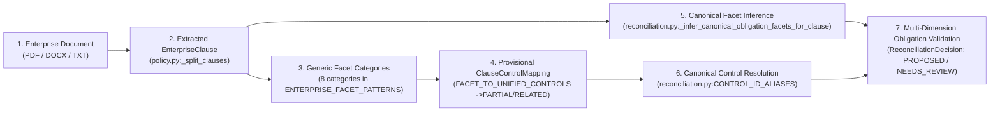

# E3.3 Legacy-to-Canonical Production Facet & Control Mapping Audit

**Repository:** `VivianFuVivianFu/DeepAuditCrossWalk`  
**Stage:** Stage B — E3.3 Production Extraction & Matching Accuracy (B1 & B2)  
**Branch:** `fix/e33-evidence-preserving-matching`  
**Regulatory Pack:** `AU-BANKING-REG-PACK-0.1` v`0.2.0` (46 Obligations, 33 Unified Controls, 158 Canonical Facets, 55 Active Control Mappings)  

---

## 1. End-to-End Extraction and Mapping Transition Audit (B1)

We audited the complete production transition path across [`backend/banking_crosswalk/policy.py`](file:///C:/Users/vivia/OneDrive/Desktop/DeepAuditCrossWalk/backend/banking_crosswalk/policy.py), [`backend/banking_crosswalk/reconciliation.py`](file:///C:/Users/vivia/OneDrive/Desktop/DeepAuditCrossWalk/backend/banking_crosswalk/reconciliation.py), [`backend/banking_crosswalk/semantic_reconciliation.py`](file:///C:/Users/vivia/OneDrive/Desktop/DeepAuditCrossWalk/backend/banking_crosswalk/semantic_reconciliation.py), and [`backend/banking_crosswalk/coverage.py`](file:///C:/Users/vivia/OneDrive/Desktop/DeepAuditCrossWalk/backend/banking_crosswalk/coverage.py):

### Transition-by-Transition Audit Table

| Transition Stage | Source Evidence | Mapping Rule & Module | Relationship Fidelity | Ambiguity & Information Loss Risks | Review Status Enforced | Downstream Coverage Impact |
|---|---|---|---|---|---|---|
| **1. Document $\rightarrow$ Clause** | Raw paragraph/sentence text, SHA-256 document hash | `policy.py:_split_clauses()`, `extract_enterprise_policy()` | Exact verbatim text extraction | Compound multi-obligation sentences can carry deadlines from two different regulatory domains (remediated in E3.3 via `_split_compound_subclauses`). | `ClauseReviewStatus.PROPOSED` | Unapproved clauses cannot enter `approved_clause_ids` or contribute to confirmed coverage. |
| **2. Clause $\rightarrow$ Generic Facet** | Case-insensitive phrase substring match + numeric AUD regex | `policy.py:ENTERPRISE_FACET_PATTERNS` (8 generic categories) | Approximate (covers only 8 generic categories vs 158 canonical UCL facets) | 150 canonical facets have no direct pattern in `ENTERPRISE_FACET_PATTERNS`; previously protective staff prohibitions (`STAFF_PROHIBITION_PATTERN`) discarded valid protective facets (remediated in E3.3 via `PROTECTIVE_STAFF_PROHIBITION_CUES`). | Stored on `EnterpriseClause.control_facets` | Used for initial policy-to-questionnaire gap checks and Stage A candidate linking. |
| **3. Generic Facet $\rightarrow$ Legacy Control ID** | Extracted generic facet strings (`clause.control_facets`) | `policy.py:FACET_TO_UNIFIED_CONTROLS` | Approximate / 1-to-many | **Defect remediated in B2:** Previously emitted `MappingRelationship.FULL` on every single keyword match and forced ambiguous legacy IDs (`CTRL-GOV-FRAMEWORK`, `CTRL-TECH-OBSERVABILITY`, `CTRL-OPS-OUTSOURCING`) to `FULL`. Now emits `PARTIAL` or `RELATED`. | `ClauseReviewStatus.PROPOSED` | Prevents single keyword hits from masquerading as full control equivalence. |
| **4. Legacy Control ID $\rightarrow$ Canonical UCL Control** | `ClauseControlMapping.control_id` | `reconciliation.py:CONTROL_ID_ALIASES` (production) & `canonical_adapter.py` (experiments) | 1:1 for verified aliases; 1:N candidate expansion for ambiguous aliases | Note: Production runtime uses `reconciliation.py:CONTROL_ID_ALIASES` (not `CanonicalMappingAdapter`, which is isolated in `scripts/experiments/`). Ambiguous legacy IDs expand to multiple candidate controls in Stage A and require facet-level validation in Stage B. | Candidate link only until human approval | Sharing a Control ID never establishes obligation equivalence (`reconciliation.py` Rule 9). |
| **5. Clause + Generic Facet $\rightarrow$ Canonical UCL Facet** | `clause.text`, `clause.control_facets`, `obligation.facet_keywords` | `reconciliation.py:GENERIC_TO_CANONICAL_FACET_BRIDGES` & `_infer_canonical_obligation_facets_for_clause()` | Verified deterministic bridge (`50` facets) + semantic candidate retrieval (`108` facets) | Hyphenated/inflected phrasing (e.g., `"Second-line"`, `"independently challenge"`) previously missed exact substring keywords; remediated in E3.3 via normalized local-window stem matching (`_phrase_matches_normalized`). | Evaluated per `(clause, obligation)` pair | Full `EQUIVALENT` requires 100% of `obligation.coverage_facets` to be satisfied (`external_unaddressed_facets == []`). |
| **6. Canonical Control & Facets $\rightarrow$ Regulatory Obligation** | `OBLIGATION_CONTROL_MAPPINGS.json` (`55` mappings) & `ATOMIC_OBLIGATION_CATALOGUE.json` (`46` obligations) | `reconciliation.py:validate_candidate_relationship()` & `semantic_reconciliation.py:validate_hybrid_candidate_relationship()` | Multi-dimension deterministic validation across 13 dimensions | `MAP-CROSS-003` (`non_equivalent` link between `AU-PRIV-NDB-S26WE` and `CTRL-SEC-INCIDENT`) is explicitly blocked from crediting coverage (`non_eq_rels`). | `PROPOSED` or `NEEDS_REVIEW` (`0` auto-approved) | Only human-approved `EQUIVALENT` or `STRICTER_ENTERPRISE_REQUIREMENT` decisions in a validated Effective Baseline can satisfy enterprise-enhanced assessment scope. |

---

## 2. Production Consumers of Legacy Control & Facet Identifiers

Auditing the production backend (`backend/banking_crosswalk/`) confirmed that `scripts/experiments/canonical_adapter.py` is **not** invoked in production request paths. Instead, legacy identifiers are consumed by:

1. [`backend/banking_crosswalk/policy.py`](file:///C:/Users/vivia/OneDrive/Desktop/DeepAuditCrossWalk/backend/banking_crosswalk/policy.py):
   - `ENTERPRISE_FACET_PATTERNS` emits 8 generic facet keys (`3` exact canonical UCL facet names: `human_approval_required`, `approval_threshold_defined`, `pre_execution_block`; `5` legacy shorthands: `zero_data_retention`, `prompt_logging`, `data_sovereignty`, `bias_testing`, `model_inventory`).
   - `FACET_TO_UNIFIED_CONTROLS` emits `2` exact canonical control IDs (`CTRL-PRIV-COLLECTION`, `CTRL-PRIV-CROSS-BORDER`) and `6` legacy control aliases (`CTRL-FIN-APPROVAL-THRESHOLDS`, `CTRL-GOV-OVERSIGHT`, `CTRL-OPS-OUTSOURCING`, `CTRL-TECH-OBSERVABILITY`, `CTRL-FAIR-BIAS-DETECTION`, `CTRL-GOV-FRAMEWORK`).
   - `_valid_control_ids()` accepts both the 33 canonical UCL control IDs and the legacy aliases in `FACET_TO_UNIFIED_CONTROLS` so existing persisted baselines remain backward-compatible.
2. [`backend/banking_crosswalk/reconciliation.py`](file:///C:/Users/vivia/OneDrive/Desktop/DeepAuditCrossWalk/backend/banking_crosswalk/reconciliation.py):
   - `CONTROL_ID_ALIASES` expands legacy control IDs into their candidate canonical UCL controls during Stage A candidate retrieval.
   - `GENERIC_TO_CANONICAL_FACET_BRIDGES` bridges generic facets to obligation `coverage_facets`.
3. [`backend/banking_crosswalk/coverage.py`](file:///C:/Users/vivia/OneDrive/Desktop/DeepAuditCrossWalk/backend/banking_crosswalk/coverage.py):
   - Evaluates `EnterpriseClause.control_facets` and approved `ClauseControlMapping` records (`FULL`, `PARTIAL`, `RELATED`) during `enterprise_enhanced` questionnaire coverage assessment.

---

## 3. Removal of Unsupported `MappingRelationship.FULL` Claims (B2)

### Defect Identified
Previously, `extract_enterprise_policy()` (`policy.py` lines 935–950) and `ClauseControlMapping` (`models.py` line 634) defaulted every keyword-generated mapping to `relationship=MappingRelationship.FULL`:
- A clause mentioning only `"model registry"` received `MappingRelationship.FULL` for `CTRL-GOV-FRAMEWORK` (an ambiguous alias spanning `CTRL-AI-GOV-ACCOUNTABILITY`, `CTRL-RISK-FRAMEWORK`, and `CTRL-ISO-AIMS`).
- A clause mentioning only `"human approval"` without a numeric threshold, pre-execution block, or audit log retention received `MappingRelationship.FULL` for `CTRL-FIN-APPROVAL-THRESHOLDS`.

### Remediation Implemented
1. **Default Relationship Changed to `MappingRelationship.PARTIAL`**:
   - In [`backend/banking_crosswalk/models.py`](file:///C:/Users/vivia/OneDrive/Desktop/DeepAuditCrossWalk/backend/banking_crosswalk/models.py), `ClauseControlMapping.relationship` now defaults to `MappingRelationship.PARTIAL`.
2. **Evidence-Graded Provisional Relationship Assignment in `extract_enterprise_policy()`**:
   - **Ambiguous Legacy Controls (`AMBIGUOUS_LEGACY_CONTROL_IDS = {"CTRL-GOV-FRAMEWORK", "CTRL-TECH-OBSERVABILITY", "CTRL-OPS-OUTSOURCING"}`)**: Emit `MappingRelationship.RELATED` with rationale: *"Candidate keyword match on facet '...' associated with ambiguous legacy control '...'; requires human disambiguation against canonical UCL controls."*
   - **Single-Facet or Partial Keyword Matches**: Emit `MappingRelationship.PARTIAL` with rationale: *"Clause contains candidate facet '...' partially addressing control ...; keyword match alone does not establish full control equivalence."*
   - **Full Facet & Condition Completeness (`CONTROL_REQUIRED_GENERIC_FACETS`)**: `MappingRelationship.FULL` is emitted only when all required facets of the control are simultaneously evidenced on a mandatory (`is_mand=True`), unconditional (`is_cond=False`), non-excepted (`has_exc=False`) clause without post-execution weakening (`timing_val != "post_execution"`), and still remains `ClauseReviewStatus.PROPOSED`.
3. **Protective Staff Prohibition Preservation**:
   - Added `PROTECTIVE_STAFF_PROHIBITION_CUES` in `policy.py` so clauses phrased as `"Employees are prohibited from executing automated refunds above AUD 500 without human approval before payment"` retain their protective facets (`human_approval_required`, `approval_threshold_defined`, `pre_execution_block`) instead of being stripped to `control_facets=[]` by `STAFF_PROHIBITION_PATTERN`.
