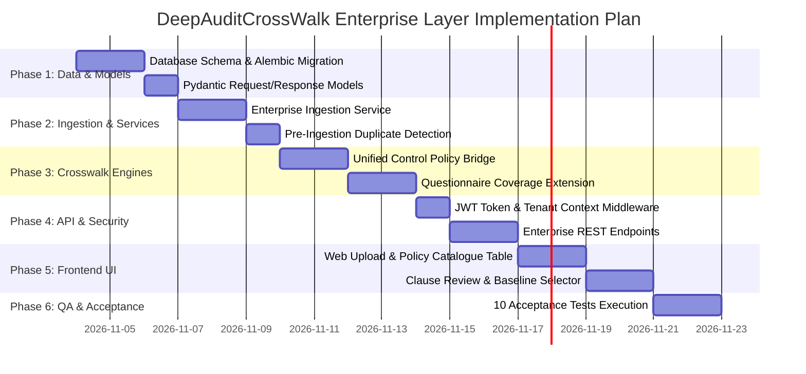

# Enterprise Regulatory & Policy Layer — Implementation Plan & Strategic Options

**Product**: DeepAuditCrossWalk  
**Date**: November 2026  
**Status**: Pending Architecture Approval  

---

## 1. Evaluation of Strategic Options

We evaluate three implementation paths to solve the enterprise policy requirement:

| Dimension | Option A: Reuse Existing PolicyPack | Option B: Add Tenant-Specific Requirements Catalogue (Recommended) | Option C: Full Enterprise Policy Management Platform |
|---|---|---|---|
| **Description** | Patch `policy.py` to add more regex patterns and store multiple `PolicyPack` IDs in an array. | Create normalized, persistent tables for tenant policies, clauses, mappings, and baselines; reuse the 33 Unified Controls. | Build a complete enterprise GRC platform with document drafting, approvals, redlining, and complex workflows. |
| **User Value** | Low (fragile regexes, no real multi-document baseline, no UI catalogue). | **High** (solves both Workflow A and B, provides true traceability and multi-doc baselines). | Diminishing returns (enterprises already have Archer/ServiceNow/OneTrust; they only need AI crosswalk). |
| **Implementation Complexity** | Low (3–5 days). | **Moderate (1.5–2 weeks)**. | Extremely High (2–3 months). |
| **Reuse of Existing Code** | High (100% existing code), but keeps bad architecture. | **High (~75% existing code)**: Reuses `policy_documents.py`, 33 Unified Controls, `sql_store.py`, and `coverage.py`. | Low (requires massive new infrastructure). |
| **Data Governance & Lineage** | Poor (single JSON blobs, no clause review state, no audit trail). | **Excellent** (point-in-time baseline revisions, human review status, tenant RLS). | High, but bloated. |
| **Mapping Accuracy** | Poor (relies on token matching against 3 generic facets). | **High** (bridges clauses directly to 33 Unified Controls with 6 relationship types). | High. |
| **Security & Isolation** | Inadequate (still trusts unauthenticated `X-Tenant-ID`). | **Robust** (cryptographic JWT verification + PostgreSQL RLS + strict tenant boundaries). | Robust. |
| **Future Scalability** | Fails when handling >2 policy files or complex frameworks. | **High** (foundation for multi-framework compliance and automated evidence testing). | High, but excessive maintenance overhead. |

### Architectural Recommendation
**Option B: Add a Tenant-Specific Enterprise Requirements Catalogue** is the optimal choice. It directly answers the user's need for multi-document baselines, integrates with both Crosswalk engines, reuses 100% of the shared 33 Unified Controls, and avoids over-engineering an unnecessary enterprise GRC monolith.

---

## 2. Phased Implementation Roadmap

---

## 3. Detailed Work Breakdown Structure

### Phase 1: Database Schema & Core Models (Days 1–3)
1. **Alembic Migration (`0002_enterprise_policy_layer.py`)**:
   - Create tables: `enterprise_policies`, `enterprise_clauses`, `clause_control_mappings`, `enterprise_baselines`.
   - Add indices on `(tenant_id, policy_id)` and `(tenant_id, control_id)`.
2. **Domain Models (`backend/banking_crosswalk/models.py`)**:
   - Define `EnterprisePolicy`, `EnterpriseClause`, `ClauseControlMapping`, `EnterpriseBaseline`.
   - Update `Authority` enum to include `ENTERPRISE_POLICY`, `CONTRACTUAL_OBLIGATION`, `INDUSTRY_FRAMEWORK`, `AUDIT_FINDING`.

### Phase 2: Ingestion & Clause Staging Service (Days 4–6)
1. **Document Extractor Enhancement (`backend/banking_crosswalk/policy_documents.py`)**:
   - Reuse bounded parser for PDF, DOCX, TXT.
   - Retain document metadata (file hash, page count, upload timestamp).
2. **Deterministic Clause Segmentation (`backend/banking_crosswalk/policy.py`)**:
   - Generalize clause segmentation to preserve section headings (`Section 4.1.2`).
   - Extract numerical thresholds, mandatory indicators, and candidate control mappings.
   - Stage all new items with `review_status = "proposed"`.
3. **Duplicate Detection against Shared Catalogue**:
   - Compare uploaded instrument hash and title against `REGULATORY_SOURCE_REGISTER.csv`.

### Phase 3: Dual-Engine Crosswalk Integration (Days 7–10)
1. **Bridge Clauses to 33 Unified Controls**:
   - In `backend/banking_crosswalk/policy.py`, replace direct `_obligation_facet_covered` token matching with mapping through `clause_control_mappings` and `obligation_control_mappings`.
2. **Upgrade Questionnaire Coverage Engine (`backend/banking_crosswalk/coverage.py`)**:
   - Update `evaluate_questionnaire_coverage()` to accept optional `enterprise_baseline: Optional[EnterpriseBaseline]`.
   - When present, the engine iterates over both shared regulatory obligations AND confirmed enterprise policy clauses, ensuring questionnaire questions cover both.
3. **Multi-Document Conflict Detection**:
   - Inspect all policies within the active baseline for conflicting numeric thresholds and conflicting approval requirements.

### Phase 4: API & Security Hardening (Days 11–13)
1. **Cryptographic Authentication Middleware**:
   - Replace unverified `X-Tenant-ID` header with JWT bearer token verification.
   - Extract `tenant_id` and `user_role` directly from verified claims.
2. **Enterprise Endpoints (`backend/banking_crosswalk/api.py`)**:
   - Implement `POST /v1/enterprise/policies/upload-file`.
   - Implement `GET /v1/enterprise/policies` and `GET /v1/enterprise/policies/{id}/clauses`.
   - Implement `PUT /v1/enterprise/clauses/{id}/review`.
   - Implement `POST /v1/enterprise/baselines` and `GET /v1/enterprise/baselines`.

### Phase 5: Web UI Extension (Days 14–17)
1. **Policy Management Component (`web/app/policies/`)**:
   - Drag-and-drop file uploader (PDF/DOCX).
   - Policy Catalogue table showing document name, version, category, and review status.
2. **Clause Review Modal**:
   - Interface for GRC officers to confirm or reject proposed clauses and select mapped Unified Controls.
3. **Assessment Integration (`web/app/page.tsx`)**:
   - Add "Include Enterprise Baseline" dropdown to Questionnaire Coverage and Policy Gap views.

### Phase 6: Automated Verification & Acceptance Testing (Days 18–19)
- Implement and pass all 10 acceptance test suites defined in `ENTERPRISE_LAYER_GAP_ANALYSIS.md`.
- Verify full regression across existing banking crosswalk tests (`pytest backend/tests`).

---

## 4. Key Reused Assets vs. Required Net-New Code

### Reused Without Modification (100% Preserved)
- `UNIFIED_CONTROL_LIBRARY.json` (The 33 foundational Unified Controls).
- `OBLIGATION_CONTROL_MAPPINGS.json` (The 57 baseline regulatory-to-control mappings).
- `ATOMIC_OBLIGATION_CATALOGUE.json` (The 28 Australian banking & privacy obligations).
- `documents.py` (PyMuPDF document extraction engine).
- `database.py` (SQLAlchemy connection management and Alembic integration).

### Reused with Light Extension
- `policy_documents.py`: Bounded file extraction logic reused; wrapped with metadata extraction.
- `policy.py`: Regex extraction patterns and threshold conflict detector reused; refactored to target Unified Controls.
- `coverage.py`: Candidate scoring algorithm reused; augmented to evaluate combined baselines.
- `sql_store.py`: Persistence abstractions extended with new enterprise tables.

### Net-New Code to Build
- Database tables for enterprise policies, clauses, mappings, and baselines.
- JWT authentication dependency for tenant extraction.
- REST endpoints for policy catalogue, clause review, and baseline management.
- Web UI components for file uploading and clause review.

