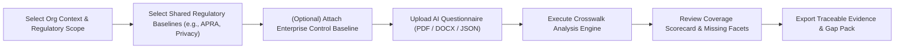
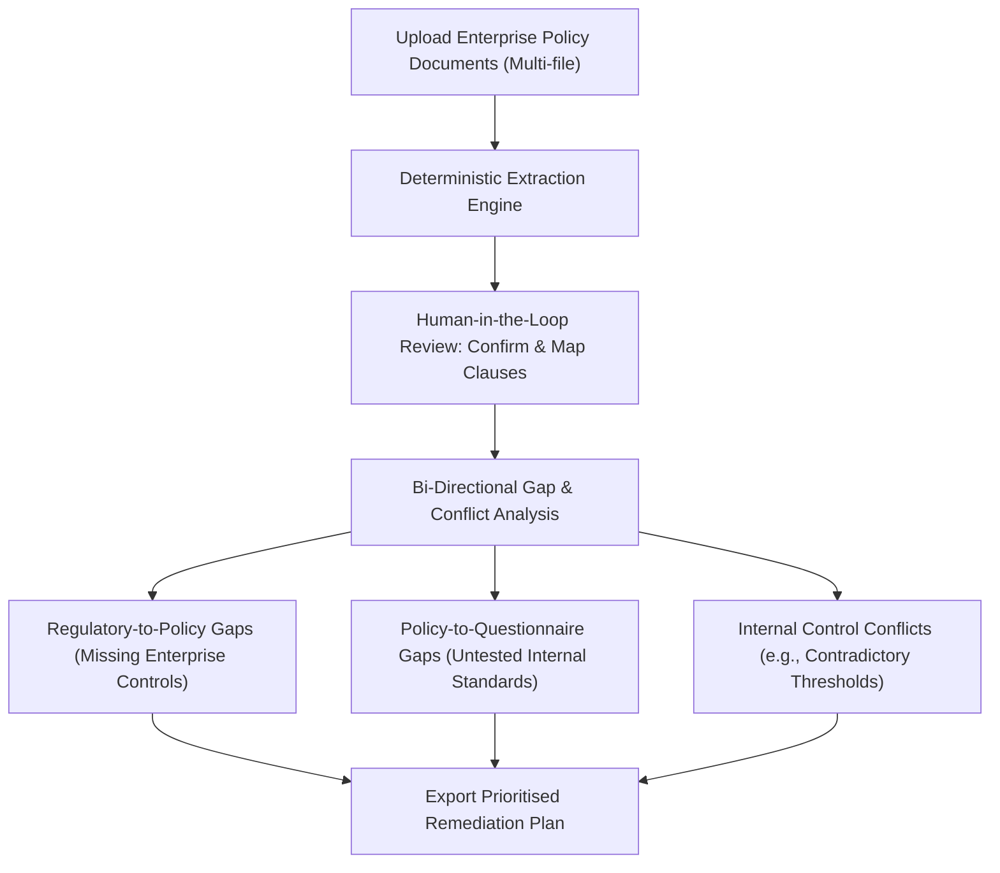

# Enterprise Regulatory & Policy Layer — Product Requirements Document (PRD)

**Product**: DeepAuditCrossWalk — Enterprise Policy Layer  
**Target Audience**: Australian Tier-1/Tier-2 Banks, APRA-Regulated Entities, Insurers, Enterprise GRC & AI Governance Officers  
**Date**: November 2026  
**Status**: Ready for Architecture Review  

---

## 1. Product Vision & Problem Statement

### 1.1 The Enterprise Problem
Australian regulated financial institutions and enterprises cannot manage AI risk by relying solely on generic legal frameworks (e.g., APRA CPS 230, Privacy Act 1988, Corporations Act 2001). Enterprises have internal policies, contractual customer commitments, and internal risk appetite statements that are often **stricter** than external regulations (e.g., prohibiting any customer PII from leaving Australian sovereign borders, mandating dual human approval for automated credit changes over $1,000, or requiring zero data retention from third-party AI vendors).

Currently, enterprises have no automated way to:
1. Ingest their proprietary policy documents and map them against external regulatory baselines.
2. Verify whether their AI Governance Review Questionnaires test internal enterprise standards as rigorously as external laws.
3. Consolidate disparate internal standards (Cyber, Data, Ethical AI, Vendor Management) into a single verifiable control baseline.

### 1.2 Product Vision
DeepAuditCrossWalk will provide an **Enterprise Private Layer** that sits alongside the immutable **Shared Regulatory Library**. Enterprises can upload and maintain their own private obligations, standards, and control baselines without altering the shared library, risking data leakage, or requiring custom code changes.

---

## 2. Requirement Taxonomy & Classification Framework

The system must never treat every uploaded clause as a legally binding statute. All enterprise requirements must be classified into one of six distinct authority categories:

```
┌─────────────────────────────────────────────────────────────────────────────┐
│                       LEGAL & GOVERNANCE TAXONOMY                           │
├─────────────────────────┬───────────────────────────────────────────────────┤
│ 1. External Law/Statute │ Binding by law (e.g., Privacy Act, Corps Act)    │
│ 2. Regulatory Guidance  │ Enforceable/Prudential (e.g., APRA CPS 230, RG 271│
│ 3. Industry Framework   │ Voluntary/Best Practice (e.g., NIST AI, ISO 42001)│
│ 4. Enterprise Policy    │ Mandatory internally (e.g., Board Risk Standard)  │
│ 5. Contractual Term     │ Legally binding by contract (e.g., Cloud SLA)     │
│ 6. Audit Finding        │ Remediation obligation (e.g., Internal Audit Gap) │
└─────────────────────────┴───────────────────────────────────────────────────┘
```

### Classification Rules
1. **Binding Status**:
   - `LEGAL_STATUTE` & `REGULATORY_GUIDANCE`: Legally or regulatorily binding. Severity of gaps: **Critical / High**.
   - `ENTERPRISE_POLICY` & `CONTRACTUAL_OBLIGATION`: Internally binding or legally actionable. Severity of gaps: **High / Medium**.
   - `INDUSTRY_FRAMEWORK`: Benchmark / voluntary. Severity of gaps: **Low / Informational**.
   - `AUDIT_FINDING`: Time-bound corrective action. Severity of gaps: **Dynamic based on finding rating**.
2. **Pre-Ingestion Duplicate Detection**:
   - When a user uploads a regulatory document (e.g., "APRA CPS 234"), the engine computes text SHA-256 and checks the shared catalogue.
   - If an authoritative version already exists in the Shared Library, the system prompts the user: *"This instrument exists in the Shared Regulatory Library. Would you like to link your enterprise applicability profile to the shared standard rather than creating an unverified custom copy?"*
   - Enterprise-specific interpretations are stored separately as private tenant overrides. Customer uploads are **never automatically promoted** to the shared public library.

---

## 3. Supported Policy Document Types

The Enterprise Private Layer must support ingestion across 11 core enterprise domains:

1. **AI Governance Policies**: Acceptable AI use, foundation model deployment, model lifecycle, algorithmic fairness.
2. **Data Governance Policies & Standards**: Data classification, retention, quality management, secondary use.
3. **Cybersecurity & Information Security**: APRA CPS 234 alignment, access control, prompt defense, vulnerability scanning.
4. **Privacy Policies & Information Handling**: Australian Privacy Principles (APPs), de-identification, cross-border data transfer.
5. **Compliance Frameworks**: Regulatory compliance management policies, statutory reporting standards.
6. **Internal Audit Frameworks**: Model audit charters, control testing cadence, independence standards.
7. **Risk Management Frameworks (RMF)**: Three Lines of Accountability, operational risk appetite, residual risk limits.
8. **Third-Party Risk & Procurement**: APRA CPS 230 material service provider rules, vendor AI zero-data retention, sub-processor rights.
9. **Delegated Authority & Human Approval**: Financial delegation limits, pre-execution human sign-off schedules.
10. **Additional Applicable Jurisdictional Laws**: State-specific legislation (e.g., NSW AI Assurance Framework requirements for public-sector integrations).
11. **Contractual & Customer Commitments**: Client confidentiality agreements, sovereign hosting warranties.

---

## 4. Core User Workflows

### 4.1 Workflow A: Questionnaire Coverage Validation
**Objective**: Enable enterprise GRC and risk teams to prove their AI Governance Questionnaires comprehensively test both external regulations and internal policies.



#### Step-by-Step Requirements
1. **Scope Definition**: User selects industry sector (e.g., Banking/Credit), organisation size, and target jurisdictions.
2. **Baseline Selection**: User selects active regulatory packs (e.g., AU Banking Pack v0.1).
3. **Enterprise Baseline Inclusion**: User toggles on one or more approved Enterprise Policy Packs from their private tenant library.
4. **Questionnaire Import**: User uploads the organisation's AI intake or risk assessment questionnaire.
5. **Crosswalk Execution**: The engine maps questionnaire questions to the 33 Unified Controls and determines whether all required facets of both external and internal obligations are covered.
6. **Gap Reporting**: Identifies missing control facets (e.g., *"Questionnaire tests human oversight generally, but fails to test Enterprise Policy 4.2's mandatory AUD $1,000 dual-signoff rule"*).
7. **Traceable Export**: Generates exportable CSV/PDF reports linking every question to Unified Controls, Regulatory Provisions, and Enterprise Policy Clauses.

---

### 4.2 Workflow B: Enterprise Policy Gap Detection
**Objective**: Detect conflicts, omissions, and control gaps between enterprise policies, external regulations, and operational intake processes.



#### Step-by-Step Requirements
1. **Multi-Document Ingestion**: User uploads multiple files (e.g., `Risk_Appetite.pdf`, `Credit_Policy.docx`, `AI_Ethics_Guide.md`).
2. **Clause Extraction & Staging**: Engine extracts raw clauses, tags mandatory language, identifies numerical thresholds, and marks extracted items with `review_status = "proposed"`.
3. **Review & Approval Gate**: GRC Officer reviews candidate requirements, adjusts authority classification, maps them to Unified Controls, and approves them into the active baseline.
4. **Bi-Directional Gap Evaluation**:
   - **External Obligation → Enterprise Policy**: Identifies legal/regulatory requirements where the enterprise has no internal policy coverage.
   - **Enterprise Policy → Operational Questionnaire**: Identifies approved mandatory enterprise policies that the organization's questionnaire fails to test.
   - **Internal Conflict Detection**: Flags conflicting statements between internal policies (e.g., Fraud Policy allows automated refunds up to $500, but AI Policy sets limit at $200).
5. **Assessment Scope Support**:
   - **Enterprise-Wide Baseline**: Evaluates overall organizational policy alignment without needing a specific AI use case.
   - **Use-Case-Specific**: (Optional) Overlays specific technical parameters (e.g., PII usage, vendor hosting) to evaluate a specific deployment.

---

## 5. Non-Functional & Enterprise Governance Requirements

1. **Multi-Document Baseline Aggregation**: An enterprise must be able to group 1 to 50 policy documents into a single active "Enterprise Control Baseline".
2. **Reproducibility & Historical Lineage**: Assessments must be immutable snapshots. Updating an enterprise policy does not alter past completed assessments; it creates a new baseline revision.
3. **Proposed vs. Approved Gate**: Unreviewed AI-extracted clauses must never be treated as authoritative policy rules. They must remain in `proposed` status until validated by an authorized reviewer.
4. **Zero Cross-Tenant Leakage**: Enterprise policy documents, clauses, and mappings must be strictly isolated to the authenticated tenant.

