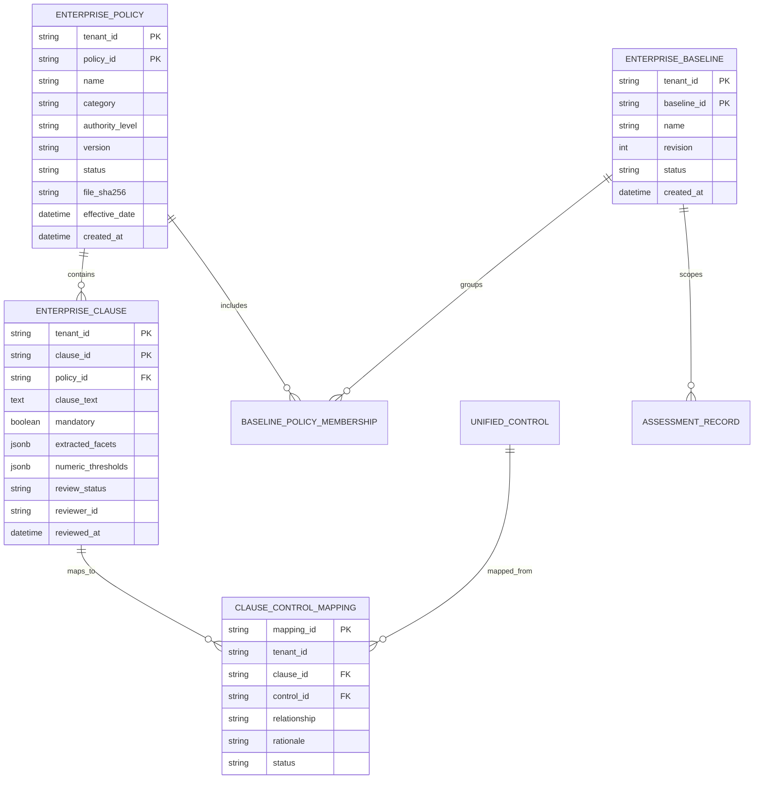

# Enterprise Regulatory & Policy Layer — Target Architecture Specification

**Product**: DeepAuditCrossWalk  
**Architecture Domain**: Enterprise Private Control & Policy Subsystem  
**Date**: November 2026  
**Status**: Architecture Design for Review  

---

## 1. Architectural Principles

1. **Strict Immutability & Traceability**: Shared regulatory catalogues are immutable. Enterprise policies and baselines are strictly versioned. Assessment results are point-in-time immutable records.
2. **Unified Control as the Universal Bridge**: Enterprise policy requirements never map directly to vague custom tags. They map to the **33 Unified Controls** (`CTRL-*`), which already map to the 57 External Regulatory Obligations and Focus Questions.
3. **Additive, Non-Breaking Design**: The existing `RegulatoryPack`, `UnifiedControl`, and `QuestionBank` data contracts remain fully backwards compatible.
4. **Lightweight Pragmatism**: No new databases, no vector databases, no external microservices. Extends the existing PostgreSQL/SQLite engine via SQLAlchemy and Alembic.

---

## 2. High-Level Architecture Overview

```
┌────────────────────────────────────────────────────────────────────────────────────────┐
│                                   PRESENTATION LAYER                                   │
│  ┌─────────────────────────────────┐      ┌─────────────────────────────────────────┐  │
│  │   Questionnaire Coverage View   │      │   Enterprise Policy Management & Gaps   │  │
│  │  (Regulatory + Private Baseline)│      │    (Multi-doc Ingestion, Clause Review) │  │
│  └────────────────┬────────────────┘      └────────────────────┬────────────────────┘  │
└───────────────────┼────────────────────────────────────────────┼────────────────────────┘
                    │                                            │
                    ▼                                            ▼
┌────────────────────────────────────────────────────────────────────────────────────────┐
│                              NEXT.JS BFF / API GATEWAY                                 │
│  - JWT Bearer Token Validation (Claims: sub, tenant_id, role: [admin, compliance])    │
│  - Request rate-limiting & document size limits (20MB upload limit)                   │
└───────────────────────────────────────────┬────────────────────────────────────────────┘
                                            │
                                            ▼
┌────────────────────────────────────────────────────────────────────────────────────────┐
│                                 FASTAPI CORE SERVICES                                  │
│                                                                                        │
│  ┌────────────────────────┐  ┌────────────────────────┐  ┌──────────────────────────┐  │
│  │ PolicyIngestionService │  │ EnterpriseCatalogueSvc │  │ UnifiedCrosswalkService  │  │
│  │ - Bounded PDF/DOCX Ext │  │ - Multi-doc Baselines  │  │ - Coverage Engine        │  │
│  │ - Injection Sanitizer  │  │ - Clause Review & State│  │ - Policy Gap Engine      │  │
│  │ - Candidate Clause Gen │  │ - Tenant Isolation     │  │ - Conflict Detector      │  │
│  └───────────┬────────────┘  └───────────┬────────────┘  └────────────┬─────────────┘  │
└──────────────┼───────────────────────────┼────────────────────────────┼────────────────┘
               │                           │                            │
               ▼                           ▼                            ▼
┌────────────────────────────────────────────────────────────────────────────────────────┐
│                               DATA & PERSISTENCE LAYER                                 │
│                                                                                        │
│  ┌────────────────────────┐  ┌────────────────────────┐  ┌──────────────────────────┐  │
│  │  Shared Reg Catalogue  │  │ Enterprise Collections │  │ Assessment Snapshots     │  │
│  │  (Static JSON/Seeds)   │  │ (Postgres / SQLite)    │  │ (Immutable JSONB)        │  │
│  │  - 33 Unified Controls │  │ - enterprise_policies  │  │ - Coverage Assessments   │  │
│  │  - 57 Global Mappings  │  │ - enterprise_clauses   │  │ - Policy Gap Assessments │  │
│  │  - Atomic Obligations  │  │ - enterprise_baselines │  │ - Reviewer Sign-offs     │  │
│  └────────────────────────┘  └────────────────────────┘  └──────────────────────────┘  │
└────────────────────────────────────────────────────────────────────────────────────────┘
```

---

## 3. Data Model & Schema Design

To support multi-document enterprise baselines and clause mapping without breaking existing models, we introduce four normalized entities into `backend/banking_crosswalk/schema.py`:



### 3.1 Table Definitions (`SQLAlchemy`)

```python
# In backend/banking_crosswalk/schema.py

enterprise_policies = Table(
    "enterprise_policies",
    metadata,
    Column("tenant_id", String(64), nullable=False),
    Column("policy_id", String(64), nullable=False),
    Column("name", String(255), nullable=False),
    Column("category", String(64), nullable=False),  # ai_governance, cyber, privacy, credit, etc.
    Column("authority_level", String(64), nullable=False),  # statutory, policy, contractual, audit_finding
    Column("version", String(64), nullable=False, default="1.0.0"),
    Column("status", String(32), nullable=False, default="active"),  # draft, active, superseded, retired
    Column("effective_date", DateTime(timezone=True), nullable=True),
    Column("file_sha256", String(64), nullable=False),
    Column("raw_text", Text, nullable=False),
    Column("created_at", DateTime(timezone=True), nullable=False, default=utc_now),
    Column("created_by", String(128), nullable=True),
    PrimaryKeyConstraint("tenant_id", "policy_id"),
)

enterprise_clauses = Table(
    "enterprise_clauses",
    metadata,
    Column("tenant_id", String(64), nullable=False),
    Column("clause_id", String(64), nullable=False),
    Column("policy_id", String(64), nullable=False),
    Column("clause_number", String(64), nullable=True),
    Column("clause_text", Text, nullable=False),
    Column("mandatory", Boolean, nullable=False, default=True),
    Column("control_facets", JSONB, nullable=False, default=list),
    Column("thresholds_aud", JSONB, nullable=False, default=list),
    Column("review_status", String(32), nullable=False, default="proposed"),  # proposed, confirmed, rejected
    Column("reviewer_actor", String(128), nullable=True),
    Column("reviewer_role", String(64), nullable=True),
    Column("reviewed_at", DateTime(timezone=True), nullable=True),
    PrimaryKeyConstraint("tenant_id", "clause_id"),
    ForeignKeyConstraint(
        ["tenant_id", "policy_id"],
        ["enterprise_policies.tenant_id", "enterprise_policies.policy_id"],
        ondelete="CASCADE",
    ),
)

clause_control_mappings = Table(
    "clause_control_mappings",
    metadata,
    Column("mapping_id", String(64), primary_key=True),
    Column("tenant_id", String(64), nullable=False),
    Column("clause_id", String(64), nullable=False),
    Column("control_id", String(64), nullable=False),  # CTRL-* from Unified Control Library
    Column("relationship", String(32), nullable=False),  # full, partial, related, not_equivalent
    Column("rationale", Text, nullable=True),
    Column("review_status", String(32), nullable=False, default="proposed"),  # proposed, approved, rejected
    Column("created_at", DateTime(timezone=True), nullable=False, default=utc_now),
    ForeignKeyConstraint(
        ["tenant_id", "clause_id"],
        ["enterprise_clauses.tenant_id", "enterprise_clauses.clause_id"],
        ondelete="CASCADE",
    ),
)

enterprise_baselines = Table(
    "enterprise_baselines",
    metadata,
    Column("tenant_id", String(64), nullable=False),
    Column("baseline_id", String(64), nullable=False),
    Column("name", String(255), nullable=False),
    Column("description", Text, nullable=True),
    Column("revision", Integer, nullable=False, default=1),
    Column("policy_ids", JSONB, nullable=False, default=list),  # List of policy_ids included
    Column("status", String(32), nullable=False, default="active"),  # active, archived
    Column("created_at", DateTime(timezone=True), nullable=False, default=utc_now),
    PrimaryKeyConstraint("tenant_id", "baseline_id"),
)
```

---

## 4. API Interface Contract

### 4.1 Enterprise Policy Management
- `POST /v1/enterprise/policies/upload-file`:
  - Multipart form upload (PDF, DOCX, TXT) with `name`, `category`, `authority_level`, `version`, `effective_date`.
  - Performs bounded extraction, injection scan, clause segmentation.
  - Automatically saves policy and stages clauses with `review_status="proposed"`.
- `GET /v1/enterprise/policies`:
  - Lists all active and superseded policies for the authenticated tenant with clause counts and review statistics.
- `GET /v1/enterprise/policies/{policy_id}/clauses`:
  - Returns extracted clauses, candidate control mappings, and review status.
- `PUT /v1/enterprise/clauses/{clause_id}/review`:
  - Approves, rejects, or edits a clause, its mandatory flag, its numeric thresholds, and its mapping to Unified Controls.
  - Required body: `ReviewClauseRequest(status: "confirmed"|"rejected", control_mappings: List[MappingItem])`.

### 4.2 Enterprise Control Baselines
- `POST /v1/enterprise/baselines`:
  - Creates a reusable baseline grouping multiple approved policies (e.g., `policy_ids: ["pol-ai-01", "pol-cyber-02", "pol-credit-03"]`).
- `GET /v1/enterprise/baselines`:
  - Lists available enterprise control baselines for the tenant.

### 4.3 Enhanced Assessment Endpoints
- `POST /v1/assessments/coverage`:
  - Request body augmented with optional `enterprise_baseline_id: Optional[str]`.
  - When provided, the engine tests questionnaire coverage across **both** shared regulatory obligations AND confirmed enterprise policy requirements.
- `POST /v1/assessments/policy-gaps`:
  - Request body accepts `enterprise_baseline_id: Optional[str]`.
  - Assesses gaps across the entire multi-document baseline against the regulatory pack and questionnaire.

---

## 5. Security & Isolation Architecture

1. **Authentication Gate**:
   - Transition from trusting raw `X-Tenant-ID` header to requiring a **Cryptographically Signed JWT Bearer Token** (`Authorization: Bearer <token>`).
   - Tenant ID (`tenant_id`) and user identity (`sub`, `roles`) must be cryptographically extracted from the validated token claims.
   - For automated CI/CD or CLI usage, API keys are stored hashed with SHA-256 and mapped to a specific tenant record.
2. **PostgreSQL Row-Level Security (RLS)**:
   - When deploying on PostgreSQL, enforce RLS on all enterprise tables:
     ```sql
     ALTER TABLE enterprise_policies ENABLE ROW LEVEL SECURITY;
     CREATE POLICY tenant_isolation_policy ON enterprise_policies
         USING (tenant_id = current_setting('app.current_tenant', true));
     ```
3. **Public Demo Isolation**:
   - The public demo environment is strictly hardcoded to a sandboxed read-only tenant (`tenant_id = "public-demo"`).
   - Ingestion and persistence endpoints return `403 Forbidden` unless the request carries an enterprise-authenticated identity.

