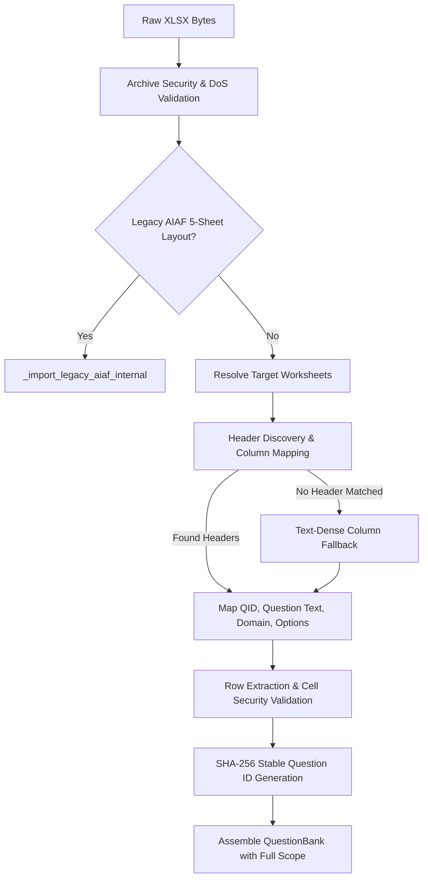

# General Enterprise Questionnaire Import Design & Architecture

**Repository:** `VivianFuVivianFu/DeepAuditCrossWalk`  
**Phase:** Remove AIAF Dependencies & Verify the Australian Financial Regulatory Library  
**Branch:** `refactor/remove-aiaf-and-verify-library-boundaries`  
**Status:** Implemented & Verified  
**Date:** November 2026  

---

## 1. Architectural Mission & Rationale

DeepAudit Crosswalk's authoritative mission is to:
> **Evaluate an organisation's AI Governance Strategy or AI Governance / Assurance Questionnaire against applicable regulatory and governance requirements, and identify coverage gaps.**

Historically, the prototype import engine was rigidly coupled to the New South Wales Artificial Intelligence Assurance Framework (AIAF) spreadsheet structure. That legacy implementation mandated specific sheet names (`Questions`, `Triggers`, `ALL Focus Questions`, `Risks`, `Treatments`), assumed a two-tier hierarchy (`core` vs `focus`), hardcoded cell coordinates, and silently dropped focus questions during default assessment unless an elaborate trigger-based routing snapshot was generated.

This document outlines the architectural design and implementation of the **General Enterprise Questionnaire Importer** (`import_questionnaire_workbook`), which completely decouples DeepAudit Crosswalk from proprietary or state-specific workbook templates. Any valid Excel workbook (.xlsx) containing enterprise AI governance questions can now be ingested, securely validated, content-addressed, and fully evaluated.

---

## 2. Dynamic Discovery & Ingestion Engine

### 2.1 Flexible Sheet & Column Topology
Rather than expecting hardcoded sheet names and coordinates, the ingestion engine inspects arbitrary worksheets and intelligently resolves table columns.

### 2.2 Intelligent Header Discovery
The importer normalises cell text in rows 1 and 2 (stripping punctuation, lowercasing, collapsing whitespace) and evaluates candidate headers against comprehensive alias dictionaries:

| Field Target | Matching Header Patterns | Fallback Behaviour |
|---|---|---|
| **Question ID** | `id`, `question id`, `question_id`, `qid`, `q id`, `item id`, `item`, `item no`, `item number`, `ref`, `reference`, `ref no`, `ref id`, `reference id`, `code`, `control id`, `clause id`, `number` | Auto-generates content-addressable ID: `{SHEET}-Q{ROW:03d}-{SHA256[:8]}` |
| **Question Text** | `question`, `question text`, `question_text`, `question description`, `questions`, `requirement`, `requirement text`, `requirement description`, `requirements`, `control description`, `control requirement`, `assurance question`, `assessment question`, `prompt`, `item description`, `audit question`, `evaluation question`, `clause text`, `description`, `governance question`, `control objective` | Dynamically detects column with highest average string length (average length >= 12 chars across initial rows) |
| **Domain / Category** | `domain`, `risk domain`, `category`, `topic`, `section`, `risk area`, `theme`, `pillar`, `area`, `stream` | Set to `None` if unmapped |
| **Answer Options / Guidance** | `answer`, `response`, `options`, `answer options`, `response options`, `guidance`, `notes`, `evidence guidance`, `acceptable responses` | Initialised to empty list `[]` if unmapped |

To eliminate false positive matches (such as "Question ID" matching "question"), ID detection patterns are evaluated with strict priority before general text patterns.

### 2.3 Explicit Caller Overrides
Callers can explicitly direct the import process via two optional parameters in `import_questionnaire_workbook` and `QuestionnaireImportRequest`:
1. `sheet_names: Optional[List[str]]`: Restricts ingestion to a specific subset of worksheets (e.g. `["Model Governance", "Cyber Risk"]`). If any specified sheet does not exist, ingestion fails fast with a descriptive `ValueError`.
2. `column_mapping: Optional[Dict[str, str]]`: Explicitly binds field targets to column headers or 1-based column indices (e.g. `{"question_text": "Requirement", "question_id": "Ref"}`).

---

## 3. Defense-in-Depth Security Controls

All untrusted user input is treated as potentially malicious. The importer enforces five independent layers of defensive validation:

### 3.1 Archive Decompression Limits (Zip Bomb Mitigations)
- `MAX_WORKBOOK_BYTES = 20 MB`: Upper bound on incoming raw base64 payload.
- `MAX_WORKBOOK_MEMBERS = 2,000`: Caps maximum number of archive member entries.
- `MAX_WORKBOOK_PART_BYTES = 50 MB`: Maximum allowed size for any individual compressed XML part.
- `MAX_WORKBOOK_UNCOMPRESSED_BYTES = 100 MB`: Total decompressed archive volume ceiling.
- Path traversal defenses: Absolute paths (`/`) and directory climbing (`..`) immediately trigger `ValueError("Workbook contains an unsafe archive path")`.
- Archive encryption rejection: Encrypted XLSX packages are rejected (`ValueError("Encrypted workbook archives are not supported")`).

### 3.2 Pre-Parse XML Streaming Validation
Before openpyxl constructs memory-intensive in-memory cell graphs, `_validate_worksheet_archives` streams all `xl/worksheets/*.xml` parts using `defusedxml.ElementTree.iterparse`:
- `MAX_WORKSHEET_ROWS = 20,000`
- `MAX_WORKSHEET_COLUMNS = 500`
- `MAX_WORKSHEET_CELLS = 250,000`
- `MAX_TOTAL_WORKSHEET_CELLS = 750,000`
Any element crossing these boundaries terminates execution before memory expansion can degrade host availability.

### 3.3 Formula Injection (CSV / Excel DDE) Rejection
To prevent Dynamic Data Exchange (DDE) and formula injection vulnerabilities:
- Any cell whose leading stripped text begins with `=` or `@` is immediately rejected (`ValueError("Cell contains prohibited formula expression")`).
- Any cell beginning with `+` or `-` that is not a strictly valid numeric scalar (or contains formula operators `(`, `)`, `|`, `'`, `"`, `=`) is rejected (`ValueError("Cell contains prohibited formula injection")`).

### 3.4 Prohibited HTML & Script Injection Defense
Any cell containing HTML or XML markup matching `re.search(r"<\s*/*\s*[a-zA-Z][^>]*>", text)` is rejected (`ValueError("Cell contains prohibited HTML markup")`).

### 3.5 Character Encoding & Null Byte Defense
Null bytes (`\x00`) and invalid surrogate code points (`0xD800`–`0xDFFF`) are rejected immediately, protecting underlying storage layers from byte truncation attacks.

---

## 4. Assessment Scope Decoupling: Default to Full Questionnaire

A critical defect of the legacy AIAF implementation was the assumption that questionnaires must be filtered down to 16 "core" questions by default, silently ignoring all other questions unless an external trigger snapshot was provided.

In the refactored architecture:
1. **Full Questionnaire Default (`full_questionnaire`)**:
   When an enterprise imports a questionnaire and runs an assessment without a `routing_snapshot_id`, the assessment scope defaults to `full_questionnaire`. All ingested questions participate in candidate mapping and coverage assessment.
2. **Deterministic Question Scope**:
   `CoverageAssessment.question_scope` records `"full_questionnaire"`, `"core_only"`, or `"routed_snapshot"`, ensuring complete provenance transparency.
3. **Multi-Sheet Aggregation**:
   Questions distributed across multiple sheets (e.g. "Governance", "Risk", "Operations") are aggregated into a single unified `QuestionBank` without dropping cross-sheet controls.

---

## 5. Backward Compatibility & Deprecation Strategy

To ensure zero breaking changes for existing test fixtures and integrations:
- `import_aiaf_workbook(raw, filename)` is preserved as a deprecated wrapper emitting `DeprecationWarning` and delegating to `import_questionnaire_workbook`.
- When an uploaded workbook is detected to contain the five legacy AIAF sheets (`EXPECTED_SHEETS`), the importer automatically invokes `_import_legacy_aiaf_internal`, preserving historical multi-tier routing fixtures without regression.
- `load_aiaf_question_bank()` is preserved as a deprecated wrapper emitting `DeprecationWarning` and delegating to `load_demo_questionnaire()`.
