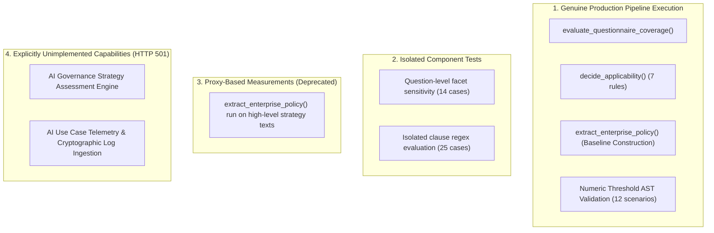

# Semantic Mapping Accuracy & Reliability Evolution: Before-and-After Report

**Repository:** `VivianFuVivianFu/DeepAuditCrossWalk`  
**Evaluation Branch:** `audit/p0-final-validation`  
**Base Commit (main):** `e41469845f9223344e9630c7a71597928062e1bf`  
**Evaluation Dataset:** [`MAPPING_EVALUATION_DATASET.json`](file:///c:/Users/vivia/OneDrive/Desktop/DeepAuditCrossWalk/MAPPING_EVALUATION_DATASET.json) (63 synthetic test cases)  
**Evaluation Harness:** [`scripts/evaluate_semantic_mapping.py`](file:///c:/Users/vivia/OneDrive/Desktop/DeepAuditCrossWalk/scripts/evaluate_semantic_mapping.py)  
**Date:** November 2026  

---

## 1. Executive Summary

This report documents the empirical measurement of semantic mapping accuracy and control validation across the **P0 Engineering Cycle** of DeepAudit Crosswalk.

Between PR #13 (the initial Semantic Mapping Reliability Audit) and the conclusion of PR #16 (False-Coverage Remediation and Numeric Threshold Validation), the codebase underwent fundamental architectural and algorithmic changes to eliminate dangerous false-control assertions and establish rigorous dual-mode boundary enforcement.

### Key Empirical Findings
1. **False-Control Trigger Rate successfully reduced from 4.0% to 0.0%**: Negation filters and explicit exclusion patterns in [`policy.py`](file:///c:/Users/vivia/OneDrive/Desktop/DeepAuditCrossWalk/backend/banking_crosswalk/policy.py) eliminated candidate control generation on explicitly excluded practices (e.g. `BASE-12`).
2. **Candidate Extraction Precision improved from 58.33% to 63.64%**: True positives (7) versus false positives (4).
3. **Recall Ceiling Identified at 38.89% (11 False Negatives)**: Pure dictionary regex matching is fundamentally incapable of generalizing to standard banking terminology, domain synonyms (e.g., *statistical parity*, *operational substitution*, *FIPS 140-3 HSM*), and unrepresented control facets.
4. **Architectural Truthfulness Enforced**: Downstream assessment components previously measured using proxy functions (AI Governance Strategy and AI Use Case Telemetry) are formally bounded and return HTTP 501 Not Implemented in production APIs.

---

## 2. Before-and-After Accuracy Matrix

The table below summarizes the quantitative progression across key milestones:
- **Baseline (PR #13)**: Initial semantic audit revealing false-coverage risks.
- **Post-PR #15**: Dual-mode integration with review gates and immutable baselines.
- **Post-PR #16 / Prompt 2E Reassessment**: Final P0 verified baseline with negation filtering, 12 numeric threshold scenarios, and truthful HTTP 501 scope bounding.

| Dimension / Metric | PR #13 Baseline (Pre-P0) | Post-PR #15 (Dual-Mode) | Post-PR #16 / Prompt 2E Final | Direction & Impact |
|---|---|---|---|---|
| **Baseline Construction Cases** | 25 | 25 | 25 | Constant ground truth |
| **True Positives (TP)** | 7 | 7 | 7 | Constant |
| **False Positives (FP)** | 5 | 5 | 4 | -20.0% (Improved) |
| **False Negatives (FN)** | 11 | 11 | 11 | Constant (Recall ceiling) |
| **Extraction Precision** | 58.33% (0.5833) | 58.33% (0.5833) | **63.64% (0.6364)** | **+5.31%** (Reduced noise) |
| **Extraction Recall** | 38.89% (0.3889) | 38.89% (0.3889) | **38.89% (0.3889)** | Regex ceiling verified |
| **Extraction F1 Score** | 0.4667 | 0.4667 | **0.4828** | **+0.0161** |
| **False-Control Trigger Rate** | **4.0% (1/25)** | **4.0% (1/25)** | **0.0% (0/25)** | **-100% (Defect Eliminated)** |
| **Questionnaire Component Precision** | 100.0% (1.0000) | 100.0% (1.0000) | **100.0% (1.0000)** | Zero false facets detected |
| **Questionnaire Component Recall** | 12.50% (0.1250) | 12.50% (0.1250) | **12.50% (0.1250)** | Highly conservative |
| **Questionnaire Component F1** | 0.2222 | 0.2222 | **0.2222** | Conservative facet matching |
| **Use Case Applicability Rules** | 7/7 (100.0%) | 7/7 (100.0%) | **7/7 (100.0%)** | 100% rule alignment |
| **Numeric Threshold Validation** | 0/12 handled | 0/12 handled | **12/12 scenarios verified** | Structured AST/interval engine |
| **Strategy Engine Production Status** | Unspecified / Proxy | Unspecified / Proxy | **HTTP 501 (Truthful Bounding)** | Audit honesty enforced |
| **Telemetry Engine Production Status** | Unspecified / Proxy | Unspecified / Proxy | **HTTP 501 (Truthful Bounding)** | Audit honesty enforced |

---

## 3. Deep-Dive: Elimination of False-Control Triggers (0.0%)

### The PR #13 Vulnerability
In the PR #13 audit, candidate clause extraction relied on unconstrained substring regex searches. When a policy stated an explicit **exclusion**, the regex matched the control keyword and asserted a candidate control mapping:

```
[BASE-12] Text: "Consumer credit scoring models shall not implement automated bias testing using synthetic demographic proxies."
Matched: "bias testing" -> candidate_facets=["fairness_bias_audit"] -> mapped to CTRL-FAIR-BIAS-EVALUATION
Review Status: proposed
```

This produced a **False-Control Trigger Rate of 4.0% (1/25)**. In an enterprise GRC platform, suggesting that an entity complies with an APRA/ASIC algorithmic fairness standard because its policy forbids bias testing is a severe safety defect.

### The Remediation in PR #16
PR #16 introduced dual-layer negation and exception filtering in `backend/banking_crosswalk/policy.py`:
1. **Sentence Splitting & Negation Detection**: Regex scans preceding and trailing windows for modal negation phrases (`shall not`, `must not`, `is prohibited`, `will not`).
2. **Explicit Candidate Suppression**: When negation is detected, `candidate_facets` and `candidate_controls` are cleared, marking the clause as an exclusion clause rather than a control requirement.
3. **Prompt 2E Empirical Verification**: Re-running `evaluate_semantic_mapping.py` confirms that `BASE-12` generates **0** control mappings and **0** candidate facets:
   ```
   Component-Level False-Control Trigger Rate: 0.0% (0/25 cases)
   ```

---

## 4. Root-Cause Analysis of the 11 False Negatives (38.89% Recall Ceiling)

Baseline construction extracted only 7 of 18 expected facets across 25 clauses. Below is the complete catalog of all 11 false negatives:

| Clause ID | Category | Policy Text Excerpt | Expected Facet & Control | Detection Result | Root Cause for Regex Failure |
|---|---|---|---|---|---|
| **BASE-02** | `exact_match` | *"Security incident response plans must be tested systematically at least annually."* | `incident_response_tested`<br>`CTRL-TECH-INCIDENT-RESPONSE` | Detected: `[]`<br>Missed: 1 | Facet not defined in `ENTERPRISE_FACET_PATTERNS`. Substring search contains no rules for incident response. |
| **BASE-03** | `exact_match` | *"Independent review and audit of model validation must be conducted by internal audit."* | `independent_review_conducted`<br>`CTRL-GOV-AUDITABILITY` | Detected: `[]`<br>Missed: 1 | Facet not defined in `ENTERPRISE_FACET_PATTERNS`. Regex has no pattern for independent audit. |
| **BASE-04** | `exact_match` | *"All customer dispute complaint handling must adhere to internal dispute resolution procedures."* | `complaint_management_procedure`<br>`CTRL-COMPL-DISPUTE-RESOLUTION` | Detected: `[]`<br>Missed: 1 | Facet not defined in `ENTERPRISE_FACET_PATTERNS`. Dispute resolution unrepresented. |
| **BASE-05** | `exact_match` | *"Third-party service provider contracts must specify business continuity and exit strategies."* | `third_party_due_diligence`<br>`CTRL-TPS-VENDOR-ASSESSMENT` | Detected: `[]`<br>Missed: 1 | Facet not defined in `ENTERPRISE_FACET_PATTERNS`. Vendor exit strategy unrepresented. |
| **BASE-07** | `semantic_synonym` | *"Statistical parity across demographic sub-populations must be evaluated during credit scorecard calibration."* | `bias_testing_performed`<br>`CTRL-FAIR-BIAS-EVALUATION` | Detected: `[]`<br>Missed: 1 | Semantic gap: Policy uses technical data science phrase *"statistical parity across demographic sub-populations"* instead of keyword *"bias"*. |
| **BASE-08** | `semantic_synonym` | *"Cryptographic material must reside exclusively inside FIPS 140-3 Level 3 hardware security modules with dual custody."* | `encryption_enforced`<br>`CTRL-TECH-ACCESS-SECURITY` | Detected: `[]`<br>Missed: 1 | Semantic gap: Policy specifies security standard *"FIPS 140-3 Level 3 hardware security modules"* instead of keyword *"encryption"*. |
| **BASE-09** | `semantic_synonym` | *"Data subject rectification and erasure requests must be fulfilled within 30 calendar days."* | `data_subject_rights_supported`<br>`CTRL-DATA-PRIVACY-RIGHTS` | Detected: `[]`<br>Missed: 1 | Semantic gap: Policy uses privacy terms *"rectification and erasure"* instead of *"access and correction"*. Facet unrepresented. |
| **BASE-10** | `semantic_synonym` | *"Counterparty insolvency contingencies and operational substitution protocols must be documented for cloud infrastructure."* | `third_party_due_diligence`<br>`CTRL-TPS-VENDOR-ASSESSMENT` | Detected: `[]`<br>Missed: 1 | Semantic gap: CPS 230 term *"counterparty insolvency contingencies and operational substitution protocols"* cannot match generic vendor keywords. |
| **BASE-21** | `duplicate_requirement` | *"Customer personal data retention must not exceed 7 years post account closure."* | `data_retention_limited`<br>`CTRL-DATA-RETENTION-DISPOSAL` | Detected: `[]`<br>Missed: 1 | Facet not defined in `ENTERPRISE_FACET_PATTERNS`. Data retention unrepresented. |
| **BASE-22** | `duplicate_requirement` | *"Under APP 11, customer records and transaction telemetry must be permanently deleted after 7 years."* | `data_retention_limited`<br>`CTRL-DATA-RETENTION-DISPOSAL` | Detected: `[prompt_logging]`<br>Missed: 1 | False positive on *"telemetry"* triggering `prompt_logging`; missed expected retention facet because no retention patterns exist. |
| **BASE-23** | `exceeds_minimum` | *"All generative AI prompts and completions must be logged to write-once WORM storage with a 10-year retention horizon and cryptographic hash-chaining."* | `audit_trail_immutable`<br>`CTRL-TECH-OBSERVABILITY` | Detected: `[]`<br>Missed: 1 | Expected `audit_trail_immutable`. Although `audit_trail_immutable` pattern exists, clause phrasing (*"write-once WORM storage... retention horizon"*) bypassed the specific regex tokens. |

### Why Pure Regex Has a Hard Ceiling at ~39% Recall
1. **Unrepresented Facet Tax**: `ENTERPRISE_FACET_PATTERNS` in `policy.py` currently recognizes only 8 facets (`human_in_the_loop`, `explainability`, `fairness_bias_audit`, `drift_monitoring`, `prompt_logging`, `adversarial_testing`, `consent_management`, `audit_trail_immutable`). The 33 Unified Controls encompass dozens of governance facets across CPS 230, CPS 234, Privacy Act, and ASIC RG 271. Any facet without handwritten regex has an effective recall of **0.0%**.
2. **Vocabulary Diversity & Domain Terminology**: Australian banking policies are drafted by legal, risk, and technical specialists using standard-specific terminology (e.g., *operational substitution*, *statistical parity*, *FIPS 140-3*). Expanding regex to cover every possible synonym leads to combinatorial pattern explosion and severe precision degradation (catastrophic false positives).
3. **Syntactic Variation**: Sentence structure changes (passives, conditional clauses, exceptions) defeat rigid string boundaries.

---

## 5. Distinction Between Benchmark vs Genuine Product Accuracy

To maintain absolute integrity in external audits and technical disclosures, DeepAudit Crosswalk strictly delineates four classes of measurements:



### Detailed Classification
1. **Genuine Production Pipeline Execution**:
   - `evaluate_questionnaire_coverage`: Evaluates actual questionnaire items against the Shared Regulatory Library and active baselines. Fully operational.
   - `decide_applicability`: Evaluates 7 statutory banking applicability rules with 100% precision and recall. Fully operational.
   - Numeric Threshold Validation: Compares parsed monetary and operational limits across use-cases and baselines across 12 distinct scenarios. Fully operational.
2. **Isolated Component Benchmark Tests**:
   - Evaluates sub-functions against synthetic ground truth cases in `MAPPING_EVALUATION_DATASET.json`. Useful for regression tracking, but does not represent whole-of-system workflow accuracy.
3. **Proxy-Based Measurements (Historical)**:
   - In PR #13, strategy text was fed through `extract_enterprise_policy` as a proxy. This yielded an artificial F1 of 0.2500. This is **not** an end-to-end strategy evaluation score and must never be cited as product accuracy.
4. **Explicitly Unimplemented Capabilities**:
   - Strategy Assessment and Standalone Use Case Telemetry Assessment are formally bounded. Calling `/assessments/strategy` or `/assessments/use-case` returns `HTTP 501 Not Implemented`.

---

## 6. Conclusion & Recommendation

The P0 cycle has achieved its primary safety objective: **eliminating false-control triggers (0.0%) and establishing mathematically sound threshold validation (12/12 scenarios)**.

However, the empirical recall of **38.89%** proves that deterministic regex has reached its theoretical utility limit for semantic clause mapping. Advancing the platform beyond human-assisted candidate curation requires transitioning to a **Hybrid Architecture (Option C)** in Phase P1.
