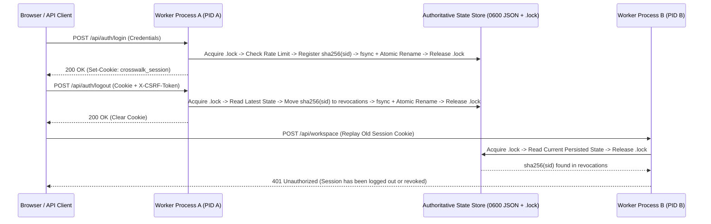

# DeepAudit Crosswalk — P0.6 Authoritative Session & Security State Architecture

**Repository:** `VivianFuVivianFu/DeepAuditCrossWalk`  
**Branch:** `fix/p06-cross-process-session-consistency`  
**Primary Implementation:** [`web/app/security.ts`](web/app/security.ts)

---

## 1. Architectural Overview

To eliminate stale in-memory security caches and lost-update race conditions across multiple worker processes on a single host while keeping the Apache-2.0 Community Edition 100% self-contained (zero mandatory external cloud services), `web/app/security.ts` implements an authoritative, lockfile-synchronized, fail-closed security state store (`DurableRevocationStore` / `SessionSecurityStore`).

---

## 2. Core Invariants Implemented

### 2.1 No Stale In-Memory Security Cache
- Removed the read-once `if (this.initialized) return;` guard and process-local `Map` caches (`this.memory`, `runtimeUserOverrides`, `failedLoginAttempts`).
- Every security check (`isRevoked`, `checkSessionValidity`, `getUserOverrides`, `checkRateLimit`, `assertStorageHealthy`) reads the current persisted state from `SESSION_REVOCATION_PATH` inside a synchronized lock scope.

### 2.2 Cross-Process Exclusive Lockfile & Atomic Read-Modify-Write
- All mutations (`registerSession`, `revoke`, `invalidateUserSessions`, `upsertUserOverride`, `setUserDisabled`, `deleteUser`, `setUserTenantRoles`, `recordFailedLoginAttempt`, `clearRateLimit`) execute inside `withFileLock()`:
  1. Acquires an exclusive lockfile `${filePath}.lock` using `fs.openSync(lockPath, "wx", 0o600)`.
  2. Uses non-busy synchronous backoff (`Atomics.wait` in 2–5 ms increments) and automatically reclaims stale locks (`mtime > 8000 ms`) left by crashed processes.
  3. Reads and parses the latest persisted state from disk (`readStateUnlocked`).
  4. Applies the caller's mutation and prunes expired sessions, expired revocations, and expired rate-limit windows.
  5. Writes the updated state to a process- and timestamp-unique temporary file (`${filePath}.${pid}.${ts}.${rand}.tmp`) with `0o600` permissions, flushes to disk via `fs.fsyncSync(fd)`, and atomically replaces `filePath` via `fs.renameSync` before releasing `${filePath}.lock`.

### 2.3 Cryptographic Session Identifier Digests (`sha256(sid)`)
- Raw session IDs (`sid`) and bearer tokens are **never** written to disk.
- `hashSessionId(sid)` computes `SHA-256(sid)` (64-character lowercase hex digest).
- Both `state.sessions` and `state.revocations` are keyed exclusively by `sid_digest`.
- **Backward Compatibility:** When reading an existing v1 array file (`Array<{ sid, revokedAt, expiresAt }>`), `readStateUnlocked()` transparently hashes any raw `sid` into `sid_digest` and upgrades the file to the v2 schema (`version: 2`) on the next write.

### 2.4 Strict Fail-Closed Storage Semantics (`SecurityStateStorageError`)
- Eliminated all silent `catch {}` fallbacks.
- If `SESSION_REVOCATION_PATH` exists on disk and cannot be read, is truncated, or contains corrupted JSON, or if acquiring the lock or persisting state fails:
  - `readStateUnlocked` / `writeStateUnlocked` / `withFileLock` throws `SecurityStateStorageError`.
  - `isSessionRevoked(sid)` catches `SecurityStateStorageError` and returns **`true`** (fail-closed).
  - `loadWorkspaceUsers()` catches `SecurityStateStorageError` and returns an **empty `Map`** so corrupted state can never restore disabled/deleted users or reverse role downgrades.
  - `checkLoginRateLimit()` catches `SecurityStateStorageError` and returns **`false`** (blocks login).
  - `resolveSecurityContext()` verifies `assertStorageHealthy()` and returns HTTP **`503 Service Unavailable`** (`Security state storage error`).
  - `/api/auth/login` and `/api/auth/logout` catch `SecurityStateStorageError` and return HTTP **`503 Service Unavailable`**.

### 2.5 Cross-Process Membership, Role & Account State Consistency
- `upsertRuntimeWorkspaceUser`, `setRuntimeUserDisabled`, `deleteRuntimeWorkspaceUser`, and `setRuntimeUserTenantRoles` persist directly into `state.user_overrides` and `state.deleted_users` in the shared store:
  - **Disable User (`setRuntimeUserDisabled(userId, true)`)**: Marks the user disabled in `state.user_overrides` and immediately revokes all active sessions for `userId` in `state.sessions`. Any subsequent request on any worker process returns `401 Unauthorized`.
  - **Delete User (`deleteRuntimeWorkspaceUser(userId)`)**: Adds `userId` to `state.deleted_users`, removes `state.user_overrides[userId]`, and revokes all active sessions for `userId`. Even if `userId` was present in `WORKSPACE_USERS_JSON` or local fixtures, `loadWorkspaceUsers()` removes all `deleted_users` entries, and any subsequent request on any worker process returns `401 Unauthorized`.
  - **Remove Tenant Membership (`setRuntimeUserTenantRoles(userId, tenantId, null)`)**: Removes `tenantId` from the user's persisted tenant map. Subsequent requests for `tenantId` on any worker process fail live membership verification with `403 Forbidden`.
  - **Role Downgrade (`Reviewer -> Analyst` or `Admin -> Reviewer`)**: Updates the persisted tenant roles in `state.user_overrides` and active session records. Because `resolveSecurityContext()` always overrides static JWT role claims with live roles from `loadWorkspaceUsers()`, privileged actions (`review_clause`, `review_clause_mapping`, `create_baseline`, `delete_policy`) are immediately blocked with `403 Forbidden` across all worker processes, and backend `X-Role` / `X-Workspace-Context` assertions reflect the downgraded role.

### 2.6 Cross-Process Login Rate Limiting & Client-IP Trust Boundary
- Login failure counters (`state.login_attempts`) are persisted in the shared store across worker processes.
- **Client-IP Trust Boundary (`TRUST_PROXY_HEADERS`)**:
  - By default (`TRUST_PROXY_HEADERS` unset or `false`), `getLoginRateLimitKeys()` ignores client-supplied `X-Forwarded-For` and `X-Real-IP` headers completely so an attacker cannot bypass rate limits by spoofing headers.
  - Only when `TRUST_PROXY_HEADERS=true` is explicitly configured behind a trusted reverse proxy are forwarding headers used for the network key (`ip:<clientIp>:<username>`).
  - In **all** modes, `getLoginRateLimitKeys()` simultaneously enforces a per-account rate-limit key (`acct:<username>`), ensuring that neither worker distribution nor IP rotation can exceed 5 failed password attempts per 60-second window against a target account.
