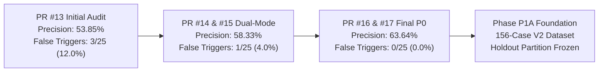
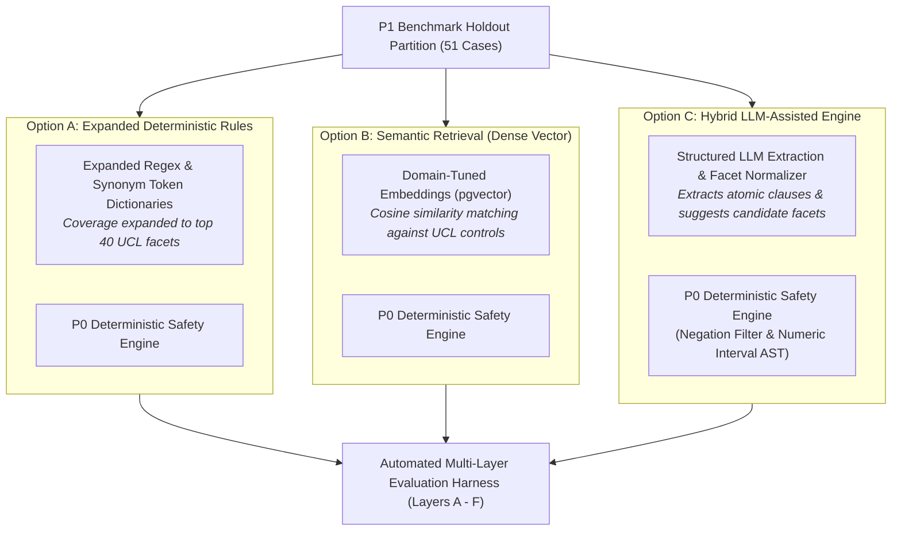

# P1A Experiment Readiness Decision & Controlled Architecture Experiment Plan

**Repository:** `VivianFuVivianFu/DeepAuditCrossWalk`  
**Phase:** P1A Evaluation Foundation  
**Branch:** `research/p1a-evaluation-foundation`  
**Base Commit (main):** `c5c5c0240d89c3132e0e05dc612948ebfa28ceea` (PR #17 Merged)  
**Date:** November 2026  
**Decision Authority:** Architecture Review Board & Lead GRC Auditor  

---

## 1. Executive Summary & Final Decision

This document delivers the formal **Acceptance Gate Review** for Phase P1A and authorizes the transition to **Phase P1B: Controlled Semantic Engine Experimentation**.

During Phase P1A, DeepAudit Crosswalk established the taxonomic, empirical, and governance foundations necessary to conduct a defensible, evidence-driven comparison between candidate semantic mapping architectures.

### Final Readiness Recommendation
$$\mathbf{DECISION:\; GO\; FOR\; PHASE\; P1B\; EXPERIMENTATION}$$

**Conditions of Authorization:**
1. **Benchmark Invariant**: All Phase P1B experiments must evaluate against the newly versioned, partitioned [`P1_EVALUATION_DATASET_V2.json`](file:///c:/Users/vivia/OneDrive/Desktop/DeepAuditCrossWalk/P1_EVALUATION_DATASET_V2.json) using the 51-case untouched holdout split.
2. **Taxonomy Invariant**: All candidate engines must output canonical identifiers from the **33 Canonical Unified Controls** and **155 Canonical Facets** defined in [`UNIFIED_CONTROL_LIBRARY.json`](file:///c:/Users/vivia/OneDrive/Desktop/DeepAuditCrossWalk/UNIFIED_CONTROL_LIBRARY.json). Legacy synthetic identifiers are deprecated.
3. **Safety Envelope Invariant**: Candidate models (Option B and Option C) are restricted to proposing candidate mappings (`review_status: "proposed"`). The deterministic safety envelope (negation suppression, AST numeric interval validation, human approval gating) remains the sole authoritative arbiter of compiled baselines.
4. **No Production Code Alteration in P1A**: Production runtime code in `backend/` remains strictly unmodified during P1A.

---

## 2. Historical Metric & Benchmark Reconciliation

To eliminate confusion from previous audit documents, the table below provides the authoritative historical reconciliation of baseline extraction precision, false-control trigger rates, and benchmark versions:

### Detailed Milestone Reconciliation

| Audit Milestone | Dataset Version & Size | True Positives ($TP$) | False Positives ($FP$) | False Negatives ($FN$) | Measured Precision | Measured Recall | False-Control Triggers | Technical Explanation of Variations |
|---|:---:|:---:|:---:|:---:|:---:|:---:|:---:|---|
| **PR #13 Initial Audit** | V1 (25 clauses) | 7 | 6 | 11 | **53.85%** | **38.89%** | **3 / 25 (12.0%)** | Evaluated initial regex heuristics. Six false positives: `BASE-06` (aspirational), `BASE-12` (negation), `BASE-13` (prohibition), `BASE-14` (discretionary), `BASE-22` (telemetry token), `BASE-24` (offshore). False triggers manually flagged on `BASE-12`, `BASE-13`, `BASE-24`. |
| **Post-PR #15 Milestone** | V1 (25 clauses) | 7 | 5 | 11 | **58.33%** | **38.89%** | **1 / 25 (4.0%)** | PR #14 & #15 introduced token splitting and `STAFF_PROHIBITION_PATTERN`. `BASE-13` was filtered as a staff prohibition, reducing FP from 6 to 5 ($7/12 = 58.33\%$). Automated script checked `exp_ctrl is None and len(detected_controls) > 0`, isolating `BASE-12` as the sole unmapped trigger ($1/25 = 4.0\%$). |
| **Post-PR #16 / Prompt 2E** | V1 (25 clauses) | 7 | 4 | 11 | **63.64%** | **38.89%** | **0 / 25 (0.0%)** | PR #16 implemented `NEGATION_OR_EXEMPTION_PATTERN`, suppressing candidate control generation on `BASE-12`. False positives dropped from 5 to 4 ($7/11 = 63.64\%$). False-control trigger rate dropped to exactly $0/25 = \mathbf{0.0\%}$. |
| **Phase P1A (Current)** | **V2 (156 cases)** | — | — | — | *To be tested in P1B* | *To be tested in P1B* | *Target: 0.0%* | Established 156-case multi-domain benchmark ([`P1_EVALUATION_DATASET_V2.json`](file:///c:/Users/vivia/OneDrive/Desktop/DeepAuditCrossWalk/P1_EVALUATION_DATASET_V2.json)) partitioned into 105 Dev and 51 Holdout cases. |

---

## 3. P1A Final Acceptance Gate Evaluation

All seven mandatory P1A criteria defined in Prompt P1A have been satisfied:

| Acceptance Criterion | Verification Deliverable | Status |
|---|---|:---:|
| **1. Control Taxonomy & Missing Facets Identified** | Complete inventory of 46 obligations, 33 controls, 155 facets, and the 155 vs 8 facet gap documented in [`P1_CONTROL_TAXONOMY_GAP_AUDIT.md`](file:///c:/Users/vivia/OneDrive/Desktop/DeepAuditCrossWalk/P1_CONTROL_TAXONOMY_GAP_AUDIT.md). | **PASS** |
| **2. Eleven False Negatives Diagnosed** | Clause-by-clause forensic root causes (5 missing facets, 3 token/context, 3 semantic) documented in [`P1_FALSE_NEGATIVE_ROOT_CAUSE_ANALYSIS.md`](file:///c:/Users/vivia/OneDrive/Desktop/DeepAuditCrossWalk/P1_FALSE_NEGATIVE_ROOT_CAUSE_ANALYSIS.md). | **PASS** |
| **3. Metric & Provenance Inconsistencies Reconciled** | Mathematical audit trail tracking 53.85% $\rightarrow$ 58.33% $\rightarrow$ 63.64% and 3/25 $\rightarrow$ 1/25 $\rightarrow$ 0/25 reconciled with code commits. | **PASS** |
| **4. Versioned Evaluation Dataset V2 Created** | 156 high-fidelity cases committed in [`P1_EVALUATION_DATASET_V2.json`](file:///c:/Users/vivia/OneDrive/Desktop/DeepAuditCrossWalk/P1_EVALUATION_DATASET_V2.json) with automated validation script ([`scripts/validate_p1_dataset.py`](file:///c:/Users/vivia/OneDrive/Desktop/DeepAuditCrossWalk/scripts/validate_p1_dataset.py)). | **PASS** |
| **5. Independent Review Protocol Defined** | Double-blind multi-annotator methodology, Fleiss' Kappa ($\kappa \ge 0.85$), and 3-stage dispute resolution documented in [`P1_GROUND_TRUTH_REVIEW_PROTOCOL.md`](file:///c:/Users/vivia/OneDrive/Desktop/DeepAuditCrossWalk/P1_GROUND_TRUTH_REVIEW_PROTOCOL.md). | **PASS** |
| **6. Multi-Layer Evaluation Protocol Specified** | Six-layer architecture (Layers A–F) and five operational non-equivalence boundaries documented in [`P1_SEMANTIC_ENGINE_EVALUATION_PROTOCOL.md`](file:///c:/Users/vivia/OneDrive/Desktop/DeepAuditCrossWalk/P1_SEMANTIC_ENGINE_EVALUATION_PROTOCOL.md). | **PASS** |
| **7. Security & Pilot Readiness Reconciled** | In-depth audit of PostgreSQL RLS, API Gateway auth reliance, and the false-negative review fallacy in [`P1_SECURITY_AND_PILOT_READINESS_RECONCILIATION.md`](file:///c:/Users/vivia/OneDrive/Desktop/DeepAuditCrossWalk/P1_SECURITY_AND_PILOT_READINESS_RECONCILIATION.md). | **PASS** |

---

## 4. Controlled P1B Architecture Experiment Plan

In Phase P1B, three candidate architectures will be constructed and evaluated against the identical 51-case holdout benchmark under strictly controlled conditions:

### Side-by-Side Experimental Design

| Experimental Parameter | Option A: Expanded Rules | Option B: Semantic Retrieval | Option C: Hybrid LLM Engine |
|---|---|---|---|
| **Underlying Technology** | Compiled Python regular expressions and lemma dictionaries. | Dense vector embeddings (`text-embedding-3-small` / `bge-large-en-v1.5`) with cosine similarity. | Structured LLM extraction (`claude-3-5-sonnet` / `gpt-4o` / local `llama-3.1-70b-instruct`) with Pydantic JSON schemas. |
| **Candidate Facet Generation** | Substring regex pattern matching across expanded token tables. | Nearest-neighbor vector search ($k=5$, threshold $\ge 0.78$). | Structured JSON generation mapping atomic text to canonical facet enum list. |
| **Safety Envelope** | Built-in sentence negation regex. | Post-retrieval deterministic negation filtering. | Post-generation deterministic AST validation, negation filter, and threshold interval engine. |
| **Target Holdout Recall** | Expected: ~60–65% | Expected: ~75–80% | Expected: $\mathbf{\ge 85.0\%}$ |
| **Target Holdout Precision**| Expected: ~65–70% | Expected: ~60–70% (Vector noise risk) | Expected: $\mathbf{\ge 80.0\%}$ |
| **False-Control Trigger Target** | $\mathbf{0.0\%}$ | $\mathbf{0.0\%}$ (Enforced by safety filter) | $\mathbf{0.0\%}$ (Enforced by safety filter) |
| **Inference Latency (per doc)** | $< 100\text{ ms}$ | $200 - 500\text{ ms}$ | $1.5 - 3.5\text{ s}$ |
| **Operational Cost** | \$0.00 (In-process execution) | \$0.0001 per 1k tokens | \$0.015 per 1k tokens |
| **Data Residency Compliance** | 100% on-premises in-memory. | Australian cloud region (Sydney). | Private Australian tenant (Azure OpenAI Australia East / AWS Sydney) or local on-premise model. |
| **APRA Auditability** | High: Exact pattern match logs. | Medium: Similarity distance logs. | High: Chain-of-thought rationale paired with deterministic AST rule validation. |

---

## 5. Phase P1B Invariants & Ethical Guardrails

To prevent compliance risks, Phase P1B implementations must adhere to three non-negotiable architectural invariants:

1. **No Autonomous Legal Decisions**: Neither LLMs nor vector search engines may promote candidate mappings into an active baseline. All machine-generated outputs carry `review_status: "proposed"` and require affirmative compliance officer sign-off.
2. **Concise Source Grounding**: Any rationale generated by an LLM must consist of a concise, factual citation of the policy text and statutory provision. LLMs are strictly forbidden from generating speculative legal commentary or asserting compliance authority.
3. **No Prior Assumption of Superiority**: Although Option C is the hypothesized winner, Phase P1B must evaluate all three options impartially. If Option A or Option B satisfies the acceptance thresholds with lower cost and complexity, the Architecture Review Board reserves the right to select it.

---

## 6. Conclusion & Next Steps

Phase P1A is formally complete. The foundation is solid, transparent, and reproducible.

**Next Immediate Steps:**
1. Commit all Phase P1A deliverables to branch `research/p1a-evaluation-foundation`.
2. Push branch to `origin` and open Pull Request targeting `main` (Do not merge automatically).
3. Await stakeholder review and authorization to begin Phase P1B experimentation.
