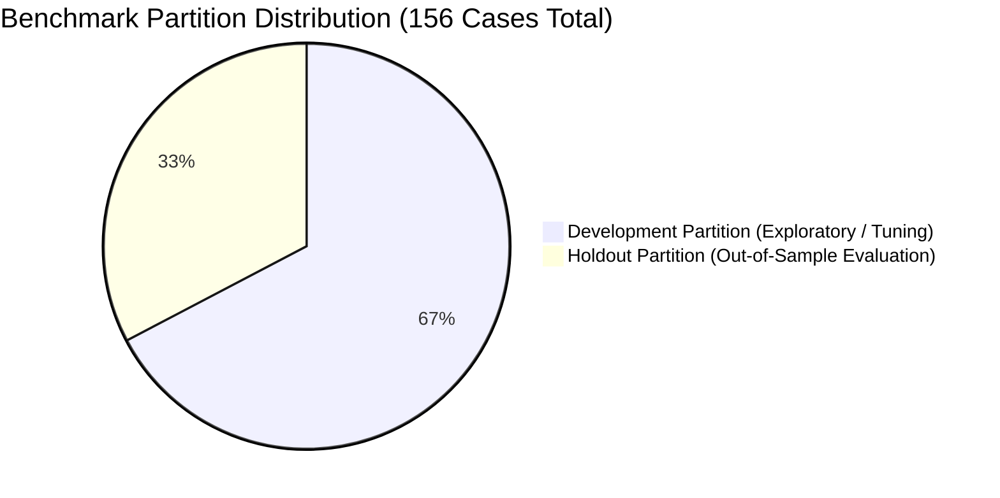
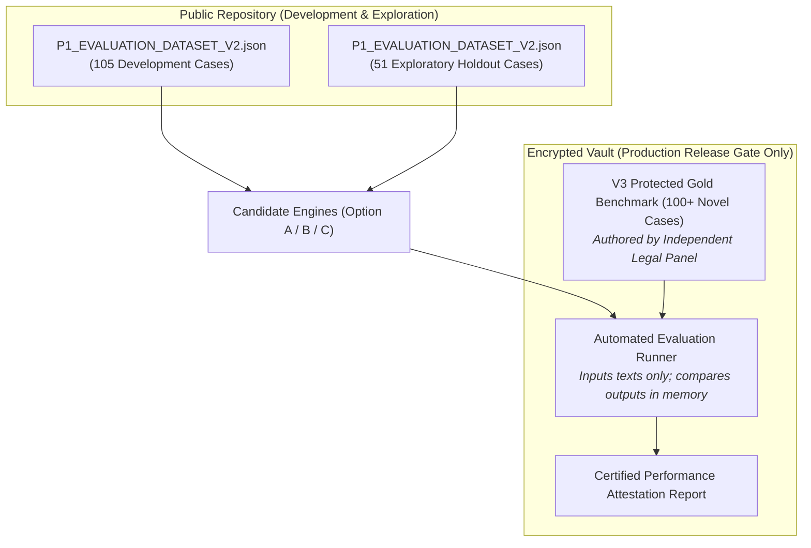

# P1B-0 Benchmark Validity & Data Leakage Forensic Review

**Repository:** `VivianFuVivianFu/DeepAuditCrossWalk`  
**Phase:** P1B-0 Semantic Evaluation Contract Correction & Experiment Readiness  
**Branch:** `research/p1b0-evaluation-contract`  
**Benchmark Target:** [`P1_EVALUATION_DATASET_V2.json`](file:///c:/Users/vivia/OneDrive/Desktop/DeepAuditCrossWalk/P1_EVALUATION_DATASET_V2.json) (156 Cases)  
**Date:** November 2026  

---

## 1. Executive Summary

A critical obligation of Phase P1B-0 is to conduct an uncompromising audit of benchmark integrity, data leakage risks, and partition validity.

While [`scripts/validate_p1_dataset.py`](file:///c:/Users/vivia/OneDrive/Desktop/DeepAuditCrossWalk/scripts/validate_p1_dataset.py) verified that zero exact string duplicates exist between the Development (105 cases) and Holdout (51 cases) partitions, this review goes deeper to examine:
1. **Semantic near-duplicates and shared scenario families**.
2. **Boilerplate sentence structures and syntactic repetition**.
3. **Accidental label leakage through developer notes, prompts, or few-shot examples**.
4. **The fundamental reality of repository-committed benchmarks**: A holdout dataset stored in public Git is a **Public Exploratory Benchmark**, not a cryptographically blinded test set.

---

## 2. Benchmark Composition & Partition Verification

The 156 benchmark cases in [`P1_EVALUATION_DATASET_V2.json`](file:///c:/Users/vivia/OneDrive/Desktop/DeepAuditCrossWalk/P1_EVALUATION_DATASET_V2.json) were verified against structural integrity invariants:

- **Total Cases**: 156
- **Development Partition**: 105 cases (67.3%)
- **Holdout Partition**: 51 cases (32.7%)
- **Identifier Uniqueness**: 156 unique case IDs (`P1-001` through `P1-156`).
- **Taxonomy Validity**: 100% of expected control IDs map to canonical controls in [`UNIFIED_CONTROL_LIBRARY.json`](file:///c:/Users/vivia/OneDrive/Desktop/DeepAuditCrossWalk/UNIFIED_CONTROL_LIBRARY.json). 100% of expected facets map to the 155 canonical UCL facets.
- **Provenance Truthfulness**: 151 synthetic reference cases, 5 legally ambiguous cases, 0 expert-verified cases.

---

## 3. Forensic Leakage & Scenario-Family Overlap Audit

Although normalized exact-string overlap is 0%, qualitative inspection reveals three levels of structural and semantic overlap between the Development and Holdout partitions:

### 3.1 Scenario-Family Parallels
Several holdout cases test the identical statutory mechanism as development cases, differing only in asset classes or numeric thresholds:

| Governance Mechanism | Development Case(s) | Holdout Case(s) | Leakage Analysis & Risk |
|---|---|---|---|
| **Delegated Approval Thresholds** | `P1-093` ($500 credit limit) `P1-101` ($1M corporate credit) `P1-102` ($10k overdraft) | `P1-107` ($5,000 personal loan) `P1-111` ($1,000 payment engine) | **Moderate Structural Overlap**: If a model memorizes the template *"All [product] approvals exceeding AUD [threshold] must be signed off by [role]"*, it easily generalizes to holdout cases without genuine legal understanding. |
| **Data Retention & Disposal** | `P1-010` (Biometric tokens destroyed within 30 days under APP 11.2) | `P1-024` (Loan application records permanently sanitized after 7 years) | **Low Overlap**: Tests different statutory timelines (30 days vs 7 years) and different data sensitivity tiers. |
| **Security Testing Frequency** | `P1-032` (Test internet-facing APIs annually under CPS 234 para 30) `P1-046` (Test credit algorithms semi-annually) | `P1-048` (Testing scope must include inversion and evasion attacks) | **Low Overlap**: Development tests testing frequency; holdout tests technical penetration scope. |
| **Material Service Provider Notice**| `P1-079` (Notify APRA of MSP agreement within 20 business days) `P1-081` (Notify APRA of MSP disruption within 72 hours) | `P1-091` (Offshore AI provider diligence and 72-hour breach notice) | **Moderate Overlap**: Both exercise APRA CPS 230 statutory notification windows. |
| **Prohibited Practices (Negations)**| `P1-006` (Prohibit secondary marketing use) `P1-072` (Prohibit deployment without BCP) | `P1-154` (Prohibit subliminal behavioral distortion under EU AI Act Art 5) | **Minimal Overlap**: Distinct regulatory bodies (APRA vs EU AI Act). |

### 3.2 Syntactic Boilerplate Repetition
Australian banking policies are drafted using standard enterprise legal templates. As a result, both development and holdout cases share recurring syntactic frames:
- *"All [AI systems / models] supporting [critical operations / core banking] must [normative verb]..."*
- *"System architects must embed [control] into [pipeline] and enforce [technical safeguard]..."*
- *"Third-party contracts must specify [safeguards] and provide [audit rights]..."*

**Implication for P1B**: Rule-based regexes (Option A) and few-shot LLM prompts (Option C) could achieve artificially high holdout recall by matching these common syntactic frames rather than understanding semantic obligation intent.

---

## 4. The Reality of Public Repository Benchmarks

In earlier audit documents, the holdout split was described as "quarantined" and "cryptographically isolated."

### Technical Reality Check
1. **Public Accessibility**: [`P1_EVALUATION_DATASET_V2.json`](file:///c:/Users/vivia/OneDrive/Desktop/DeepAuditCrossWalk/P1_EVALUATION_DATASET_V2.json) is committed in plaintext directly to the Git repository.
2. **LLM Context Visibility**: Any LLM that inspects the codebase (including coding assistants and automated CI evaluation runners) has complete read access to the holdout cases, reference answers, and explanatory notes.
3. **No Cryptographic Blinding**: Freezing files in Git guarantees *version immutability*, but it provides **zero cryptographic blinding** against model developers or automated tools.

### Formal Classification
The current Holdout partition is formally classified as a:
$$\mathbf{Public\; Exploratory\; Benchmark}$$

It is suitable for **internal exploratory engineering and comparative architectural hypothesis testing** (Option A vs Option B vs Option C).

It is **NOT** an independent, blind release gate for commercial deployment or external regulatory certification.

---

## 5. Specification for a Protected Release-Gate Benchmark (V3 Sealed Vault)

Prior to promoting any semantic engine from exploratory research to commercial enterprise release, a **Protected Release Benchmark (V3)** must be established:

### Protocol for the V3 Protected Release Benchmark:
1. **Isolated Storage**: The V3 dataset is stored in an encrypted AWS S3 bucket / Azure Key Vault with restricted IAM access. It is **never committed to public Git repositories**.
2. **Author Independence**: All cases must be authored by external, non-engineering GRC practitioners using real (anonymized) Australian banking policies that have never been exposed to the development team or public internet.
3. **Black-Box Execution**: The evaluation runner takes the candidate engine, feeds only the raw `input_text` strings, and compares outputs to ground-truth labels in memory. Developers receive only aggregate metrics ($P, R, F1$), never the raw failure cases, preventing iterative prompt overfitting.
4. **Certified Release Gate**: Commercial beta readiness requires $\ge 85\%$ recall on the blind V3 dataset.

---

## 6. Anti-Leakage Guardrails for Phase P1B Experiments

During Phase P1B experimentation, all teams must enforce the following anti-contamination rules:

1. **No Holdout Few-Shot Injection**: No prompt template or in-context learning example for Option C (LLM) may contain text, clauses, or labels from cases `P1-021` through `P1-030`, `P1-047` through `P1-054`, `P1-069` through `P1-074`, `P1-087` through `P1-092`, `P1-107` through `P1-112`, `P1-124` through `P1-128`, `P1-137` through `P1-140`, `P1-146` through `P1-148`, or `P1-154` through `P1-156`.
2. **No Holdout Vector Seeding**: Embedding indexes for Option B must index only the Canonical Unified Controls and Development cases, never Holdout clauses.
3. **Automated Leakage Regression**: CI tests must scan prompt files and configuration dictionaries for holdout case ID strings prior to running evaluation scripts.
