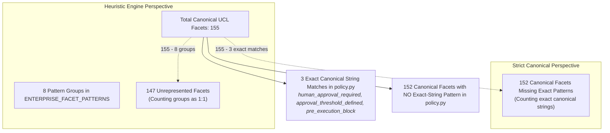
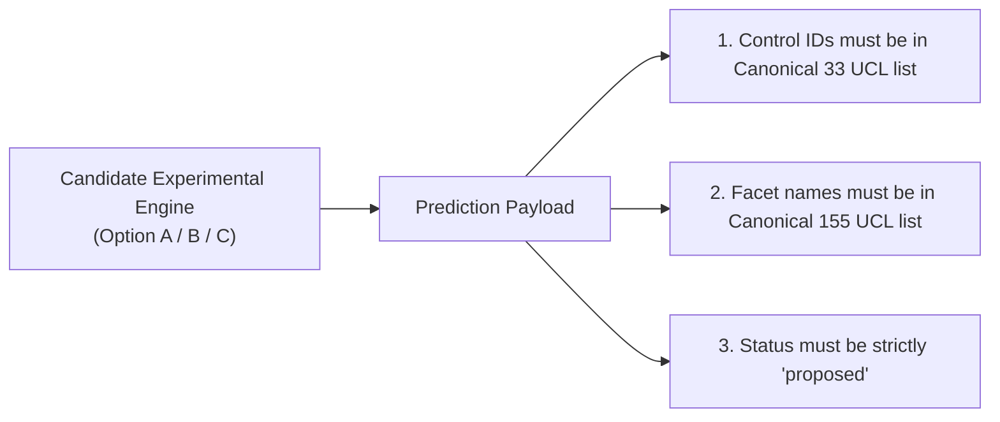

# P1B-0 Canonical Taxonomy Alignment & Identifier Reconciliation Matrix

**Repository:** `VivianFuVivianFu/DeepAuditCrossWalk`  
**Phase:** P1B-0 Semantic Evaluation Contract Correction & Experiment Readiness  
**Branch:** `research/p1b0-evaluation-contract`  
**Canonical Source:** [`UNIFIED_CONTROL_LIBRARY.json`](file:///c:/Users/vivia/OneDrive/Desktop/DeepAuditCrossWalk/UNIFIED_CONTROL_LIBRARY.json) (v1.0.0, 33 Controls, 155 Facets)  
**Date:** November 2026  

---

## 1. Executive Summary

A primary source of confusion across earlier audit milestones was the coexistence of three competing taxonomy dialects:
1. **The Canonical Unified Control Library (UCL)**: The authoritative, platform-maintained catalog of 33 Unified Controls and 155 standardized control facets ([`UNIFIED_CONTROL_LIBRARY.json`](file:///c:/Users/vivia/OneDrive/Desktop/DeepAuditCrossWalk/UNIFIED_CONTROL_LIBRARY.json)).
2. **The Production Extraction Engine (`policy.py`)**: A legacy heuristic engine referencing 8 regex pattern groups and a mix of ad-hoc control identifiers (`CTRL-FIN-APPROVAL-THRESHOLDS`, `CTRL-GOV-OVERSIGHT`, etc.).
3. **The Historical Benchmark Dataset V1 (`MAPPING_EVALUATION_DATASET.json`)**: A 63-case benchmark using 11 ad-hoc synthetic control IDs with 0% direct string overlap with canonical UCL identifiers.

This document establishes the definitive reconciliation between all legacy identifiers and the Canonical UCL. It mathematically resolves the discrepancy between the "147" and "152" missing facet figures and establishes the taxonomy output standard for Phase P1B experiments.

---

## 2. Mathematical Reconciliation: The 147 vs 152 Missing Facet Figure

Prior audit deliverables reported two different numbers regarding missing facets:
- [`P1_CONTROL_TAXONOMY_GAP_AUDIT.md`](file:///c:/Users/vivia/OneDrive/Desktop/DeepAuditCrossWalk/P1_CONTROL_TAXONOMY_GAP_AUDIT.md) stated in Section 4.2: *"Completely Missing Facets: 147 facets"*.
- Other audit sections cited: *"152 canonical facets have zero extraction patterns"*.

### The Mathematical Explanation
The Canonical Unified Control Library defines exactly **155 unique facets**.

1. **The 147 Figure (Pattern Group Perspective)**:
   - The production engine defines 8 pattern groups in `ENTERPRISE_FACET_PATTERNS`:
     `human_approval_required`, `approval_threshold_defined`, `pre_execution_block`, `zero_data_retention`, `prompt_logging`, `data_sovereignty`, `bias_testing`, `model_inventory`.
   - If each pattern group is treated as addressing one governance concept, the number of unaddressed facets is:
     $$155 - 8 = \mathbf{147}$$
2. **The 152 Figure (Strict Canonical String Perspective)**:
   - Of those 8 pattern groups, **only 3** match the exact canonical string name of a facet in the UCL (`human_approval_required`, `approval_threshold_defined`, `pre_execution_block`).
   - The other 5 pattern groups are non-canonical shorthands (`zero_data_retention`, `prompt_logging`, `data_sovereignty`, `bias_testing`, `model_inventory`).
   - Therefore, the number of canonical UCL facets that have zero exact-string regex patterns in `policy.py` is:
     $$155 - 3 = \mathbf{152}$$

Both figures are mathematically correct within their respective definitions: **147** measures unrepresented facets against total pattern groups, while **152** measures canonical facets lacking exact-string regex implementations.

---

## 3. Classification of Existing Engine Pattern Groups

Below is the formal classification of the 8 heuristic pattern groups in `backend/banking_crosswalk/policy.py`:

| Pattern Group Name in `policy.py` | Canonical UCL Control Association | Canonical UCL Facet Target(s) | Taxonomy Status | Technical Classification & Guidance |
|---|---|---|:---:|---|
| `human_approval_required` | `CTRL-DELEGATED-AUTHORITY-THRESHOLD` `CTRL-HUMAN-OVERSIGHT` | `human_approval_required` | **Exact Canonical Match** | Exact match. Keep canonical string. |
| `approval_threshold_defined`| `CTRL-DELEGATED-AUTHORITY-THRESHOLD` | `approval_threshold_defined` | **Exact Canonical Match** | Exact match. Keep canonical string. |
| `pre_execution_block` | `CTRL-DELEGATED-AUTHORITY-THRESHOLD` | `pre_execution_block` | **Exact Canonical Match** | Exact match. Keep canonical string. |
| `zero_data_retention` | `CTRL-PRIV-SECURITY-RETENTION` | `retention_schedule_applied` `destruction_or_deidentification_verified` | **Verified Alias** | Shorthand for statutory data minimization and disposal under APP 11.2. Translate to canonical facets. |
| `prompt_logging` | `CTRL-DELEGATED-AUTHORITY-THRESHOLD` `CTRL-SEC-INCIDENT` | `approval_logs_retained` `incident_detection_defined` | **Verified Alias** | Shorthand for immutable audit trail and telemetry. Translate to canonical facets. |
| `data_sovereignty` | `CTRL-PRIV-CROSS-BORDER` `CTRL-MSP-NOTIFICATION` | `overseas_recipients_and_regions_mapped` `prior_apra_consultation_for_material_offshoring` | **Partial / Ambiguous** | Broad term spanning Privacy Act APP 8 and APRA CPS 230 offshoring. Requires context disambiguation. |
| `bias_testing` | `CTRL-AI-DRIFT-MONITORING` | `fairness_and_explainability_metrics_evaluated` | **Verified Alias** | Shorthand for algorithmic fairness calibration. Translate to canonical facet. |
| `model_inventory` | `CTRL-AI-GOV-ACCOUNTABILITY` `CTRL-SEC-COMMENSURATE` | `use_case_registered_in_enterprise_ai_inventory` `ai_assets_classified_by_criticality_and_sensitivity` | **Verified Alias** | Shorthand for central model asset registration. Translate to canonical facet. |

---

## 4. Complete Legacy Control Identifier Reconciliation Matrix

To eliminate identifier fragmentation, all legacy and benchmark identifiers are classified against the 33 Canonical Unified Controls:

| Legacy / Benchmark Identifier | Functional Governance Scope | Canonical UCL Control ID | Alignment Status | Disambiguation & Mapping Decision |
|---|---|---|:---:|---|
| `CTRL-FIN-APPROVAL-THRESHOLDS` | Financial delegated authority & approval limits | `CTRL-DELEGATED-AUTHORITY-THRESHOLD` | **Verified Alias** | Direct 1:1 alias. Rename to canonical `CTRL-DELEGATED-AUTHORITY-THRESHOLD`. |
| `CTRL-GOV-OVERSIGHT` | Human oversight, kill-switches, QA reviews | `CTRL-HUMAN-OVERSIGHT` | **Verified Alias** | Direct 1:1 alias. Rename to canonical `CTRL-HUMAN-OVERSIGHT`. |
| `CTRL-FAIR-BIAS-DETECTION` | Algorithmic fairness & demographic parity | `CTRL-AI-DRIFT-MONITORING` | **Verified Alias** | Direct 1:1 alias. Mapped to drift & fairness monitoring in UCL. |
| `CTRL-FAIR-BIAS-EVALUATION` | Algorithmic fairness & demographic parity | `CTRL-AI-DRIFT-MONITORING` | **Verified Alias** | Direct 1:1 alias. Mapped to drift & fairness monitoring in UCL. |
| `CTRL-DATA-RETENTION-DISPOSAL`| Data retention limits & secure deletion | `CTRL-PRIV-SECURITY-RETENTION` | **Verified Alias** | Direct 1:1 alias. Mapped to APP 11 security & retention control. |
| `CTRL-COMPL-DISPUTE-RESOLUTION`| Customer complaints & IDR handling | `CTRL-IDR-HANDLING` | **Verified Alias** | Direct 1:1 alias. Mapped to ASIC RG 271 IDR control. |
| `CTRL-GOV-AUDITABILITY` | Model validation & internal audit review | `CTRL-INDEPENDENT-AUDIT-ASSURANCE` | **Verified Alias** | Direct 1:1 alias. Mapped to APRA CPS 220 audit assurance control. |
| `CTRL-DATA-PRIVACY-RIGHTS` | Access, correction, and contestability | `CTRL-PRIV-ACCESS-CORRECTION` | **Verified Alias** | Direct 1:1 alias. Mapped to Privacy Act APPs 12 & 13 control. |
| `CTRL-TECH-INCIDENT-RESPONSE` | Security incident response & escalation | `CTRL-SEC-INCIDENT` | **Verified Alias** | Direct 1:1 alias. Mapped to APRA CPS 234 incident control. |
| `CTRL-TECH-ACCESS-SECURITY` | Cryptography, MFA, and access control | `CTRL-SEC-COMMENSURATE` | **Verified Alias** | Direct 1:1 alias. Mapped to APRA CPS 234 security control. |
| `CTRL-TPS-VENDOR-ASSESSMENT` | Third-party AI due diligence & exit plans | `CTRL-THIRD-PARTY-AI` | **Verified Alias** | Direct 1:1 alias. Mapped to APRA CPS 230 service provider control. |
| `CTRL-OPS-OUTSOURCING` | Vendor management & cloud dependencies | `CTRL-THIRD-PARTY-AI` | **Verified Alias** | Direct 1:1 alias. Mapped to APRA CPS 230 service provider control. |
| `CTRL-GOV-FRAMEWORK` | General AI risk management framework | `CTRL-RISK-FRAMEWORK` | **Partial / Ambiguous** | Maps primarily to `CTRL-RISK-FRAMEWORK`. If focused on board licensing, maps to `CTRL-AI-GOV-ACCOUNTABILITY`. |
| `CTRL-TECH-OBSERVABILITY` | Audit trails, prompt logging & drift logs | `CTRL-DELEGATED-AUTHORITY-THRESHOLD` `CTRL-AI-DRIFT-MONITORING` | **Partial / Ambiguous** | Split between approval audit logs (`approval_logs_retained`) and operational drift telemetry (`tevv_validity_and_reliability_benchmarked`). |
| `CTRL-PRIV-CROSS-BORDER` | Cross-border data flows & cloud sovereignty | `CTRL-PRIV-CROSS-BORDER` | **Exact Canonical Match** | Canonical identifier shared across all modules. |
| `CTRL-PRIV-COLLECTION` | Lawful and necessary collection limitation | `CTRL-PRIV-COLLECTION` | **Exact Canonical Match** | Canonical identifier shared across all modules. |

---

## 5. Output Standards for Phase P1 Experimental Engines

To guarantee fair and objective comparison across candidate architectures (Option A: Rules, Option B: Embeddings, Option C: LLM), all models in Phase P1B must adhere to the following output contract:

### Mandatory Output Rules:
1. **Canonical UCL IDs Only**:
   - Predictions must emit canonical identifiers (e.g. `CTRL-DELEGATED-AUTHORITY-THRESHOLD`, not `CTRL-FIN-APPROVAL-THRESHOLDS`).
   - Any prediction emitting a deprecated legacy ID is translated through the verified alias table or scored as a classification error.
2. **Canonical Facet Strings Only**:
   - Predictions must emit canonical facet strings from the 155 list (e.g. `retention_schedule_applied`, not `zero_data_retention`).
3. **No Unmapped Inventions**:
   - Engines must never invent ad-hoc control IDs. Any control ID outside the 33 canonical controls is penalized with a precision penalty.
4. **Preservation Invariant**:
   - The production codebase in `backend/banking_crosswalk/` remains untouched during P1B-0. Experimental adapters in `scripts/` handle canonical formatting for benchmark evaluation.
