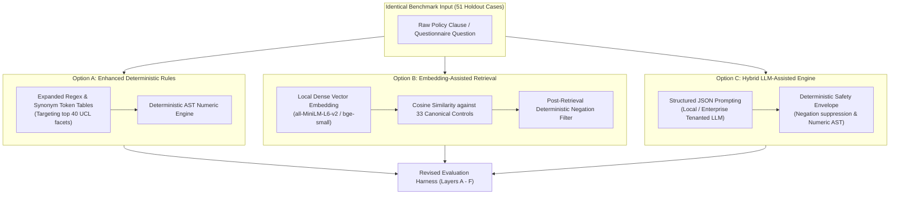
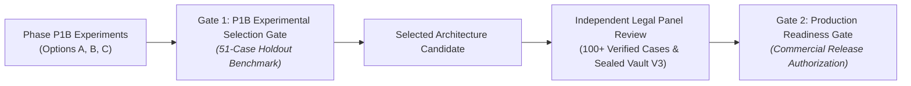

# P1B-0 Controlled Architecture Experiment Execution Plan

**Repository:** `VivianFuVivianFu/DeepAuditCrossWalk`  
**Phase:** P1B-0 Semantic Evaluation Contract Correction & Experiment Readiness  
**Branch:** `research/p1b0-evaluation-contract`  
**Benchmark Target:** [`P1_EVALUATION_DATASET_V2.json`](file:///c:/Users/vivia/OneDrive/Desktop/DeepAuditCrossWalk/P1_EVALUATION_DATASET_V2.json) (51-Case Holdout Partition)  
**Evaluation Standard:** [`P1B0_REVISED_EVALUATION_CONTRACT.md`](file:///c:/Users/vivia/OneDrive/Desktop/DeepAuditCrossWalk/P1B0_REVISED_EVALUATION_CONTRACT.md)  
**Date:** November 2026  

---

## 1. Executive Summary & Experimental Purpose

Phase P1B executes an objective, side-by-side comparative experiment across three candidate semantic mapping architectures:
1. **Option A: Enhanced Deterministic Rules Engine** (Expanded regular expressions, lemma dictionaries, and syntactic patterns).
2. **Option B: Embedding-Assisted Candidate Retrieval Engine** (Dense vector embeddings and cosine similarity nearest-neighbor search).
3. **Option C: Hybrid LLM-Assisted Engine** (Structured zero-shot/few-shot LLM candidate extraction coupled with deterministic safety envelopes).

### Experimental Objective
Determine which architecture achieves the highest holdout candidate recall ($\ge 80\%$) and precision ($\ge 75\%$) while maintaining a **0.0% False-Control Trigger Rate** and adhering to Australian banking data sovereignty (APRA CPS 234) and operational cost constraints.

**Critical Principle:** We do **NOT** assume the Hybrid LLM is the winning architecture. All three options will be evaluated impartially against identical holdout inputs, canonical taxonomies, and scoring algorithms.

---

## 2. The Three Candidate Architectures Under Test

---

### Detailed Technical Specifications:

#### Option A: Enhanced Deterministic Rules
- **Mechanism**: Expand `ENTERPRISE_FACET_PATTERNS` in a modular test harness from 8 to 40 canonical facets. Add specialized regex tokenizers for incident response testing, independent audit, complaint handling (ASIC RG 271), and data retention limits (APP 11.2).
- **Inference Runtime**: Python in-process execution ($< 10\text{ ms}$ per clause).
- **Cost**: \$0.00.
- **Privacy & Hosting**: 100% on-premise in-memory.
- **Hypothesis**: Will significantly outperform P0 baseline (increasing recall from 38.89% to ~65–70%), but will fail on complex domain synonyms (*statistical parity*, *operational substitution*, *FIPS 140-3 HSM*).

#### Option B: Embedding-Assisted Candidate Retrieval
- **Mechanism**: Encode incoming clauses into 384-dimensional dense vectors using a local, open-source embedding model (e.g. `sentence-transformers/all-MiniLM-L6-v2` or `BAAI/bge-small-en-v1.5`) running locally via ONNX / PyTorch. Compute cosine similarity against pre-computed vector embeddings of the 33 Canonical Unified Controls and their 155 facets.
- **Candidate Selection**: Rank top-5 controls above similarity threshold $\tau \ge 0.72$. Apply deterministic negation filter to suppress Category 4 and 5 clauses.
- **Inference Runtime**: $50 - 150\text{ ms}$ per clause (local CPU/GPU).
- **Cost**: \$0.00 (Local open-source model; zero external cloud API calls).
- **Privacy & Hosting**: 100% local in-process execution; zero data leaves the execution environment.
- **Hypothesis**: Will achieve high semantic synonym recall (~75–80%), but risks false positives due to vector proximity between related but distinct governance domains.

#### Option C: Hybrid LLM-Assisted Engine
- **Mechanism**: Use an enterprise LLM (or locally hosted model such as `Llama-3.1-8B-Instruct`) with constrained Pydantic JSON decoding. The model extracts atomic clauses and proposes candidate canonical facets and controls with a brief source-grounded rationale.
- **Safety Envelope**: The generated candidate mappings are passed directly into the P0 deterministic safety envelope:
  1. Mandatory negation and prohibition suppression (Category 4 & 5).
  2. AST numeric threshold interval extraction and conflict detection.
  3. All outputs tagged `review_status: "proposed"`.
- **Inference Runtime**: $1.0 - 2.5\text{ s}$ per clause.
- **Cost**: Controlled experimental token budget (or \$0.00 if using local open-weight model).
- **Privacy & Hosting**: Private Australian tenant (Azure OpenAI Australia East / AWS Sydney) or local on-premise inference.
- **Hypothesis**: Highest potential recall ($\ge 85\%$) and precision ($\ge 80\%$) through syntactic normalization, with deterministic guardrails preventing hallucinations.

---

## 3. Strict Experimental Guardrails & Non-Negotiable Invariants

All Phase P1B experiments must adhere to the following six constraints:

1. **Candidate-Only Output (`review_status: "proposed"`)**:
   - No experimental model may promote a candidate mapping to `approved` or `confirmed`.
   - Machine outputs are unverified candidate suggestions, never legal compliance findings.
2. **Zero Production Customer Data**:
   - Experiments must run exclusively on the synthetic benchmark [`P1_EVALUATION_DATASET_V2.json`](file:///c:/Users/vivia/OneDrive/Desktop/DeepAuditCrossWalk/P1_EVALUATION_DATASET_V2.json). No real client policy documents or PII may be ingested during P1B.
3. **Zero Unapproved Paid API Calls**:
   - External commercial AI API calls that incur billing require explicit prior user approval. Local open-weight models, ONNX runtimes, or approved enterprise endpoints must be prioritized.
4. **Preservation of Core Codebase**:
   - Production modules (`backend/banking_crosswalk/`) remain untouched. All experimental runners, model adapters, and evaluation harnesses must reside in `scripts/experiments/` or dedicated research packages.
5. **Standardized Telemetry Logging**:
   - Every experimental run must record:
     - Model identifier and exact commit hash.
     - P95 and Mean inference latency (ms).
     - Token consumption (prompt tokens, completion tokens).
     - Estimated cost per 1,000 policy clauses.
     - Layer B Facet $P/R/F1$, Layer C Control Top-1/Top-3/Top-5 Recall, and False-Control Trigger Rate.
6. **No Speculative Legal Authority**:
   - Any rationale generated by an LLM must cite only verified statutory provisions and verbatim policy text. Unsubstantiated claims of legal compliance are scored as grounding failures.

---

## 4. Two-Tier Decision Gate Framework

DeepAudit Crosswalk enforces a clear separation between **Experimental Selection** and **Commercial Production Release**:

### Gate 1: Phase P1B Experimental Selection Gate
- **Evaluation Dataset**: 51-Case Holdout partition of [`P1_EVALUATION_DATASET_V2.json`](file:///c:/Users/vivia/OneDrive/Desktop/DeepAuditCrossWalk/P1_EVALUATION_DATASET_V2.json).
- **Success Criteria**:
  - Holdout Candidate Control Top-3 Recall $\ge \mathbf{80.0\%}$.
  - Holdout Candidate Facet Precision $\ge \mathbf{75.0\%}$.
  - False-Control Trigger Rate $= \mathbf{0.0\%}$ (Zero tolerance on Category 4 and 5).
  - Numeric Interval AST Validation $= \mathbf{100.0\%}$.
- **Decision Outcome**: Authorizes engineering focus on the winning architecture for integration into the core platform.

### Gate 2: Commercial Production Readiness Gate
- **Evaluation Dataset**: Protected, cryptographically blinded V3 Release Vault (100+ independently reviewed cases signed off by external legal counsel).
- **Success Criteria**:
  - Blind Evaluation Recall $\ge \mathbf{85.0\%}$ across all 9 UCL domains.
  - Inter-annotator panel agreement Fleiss' $\kappa \ge \mathbf{0.85}$.
  - Production database RLS tests fully verified on PostgreSQL.
  - Enterprise API Gateway JWT/mTLS perimeter verified.
- **Decision Outcome**: Authorizes external general availability and commercial beta deployment.

---

## 5. Execution Roadmap for Phase P1B

| Sprint Milestone | Planned Activities | Deliverables |
|---|---|---|
| **P1B-1: Baseline & Option A** | Implement modular evaluation harness in `scripts/experiments/`. Build Option A (Enhanced Rules) with top 40 canonical facets. Measure holdout performance. | `P1B1_OPTION_A_EVALUATION_REPORT.md` `scripts/experiments/run_option_a.py` |
| **P1B-2: Option B (Embeddings)**| Implement local ONNX/PyTorch embedding adapter using `all-MiniLM-L6-v2`. Embed canonical UCL. Evaluate top-k cosine similarity and holdout performance. | `P1B2_OPTION_B_EVALUATION_REPORT.md` `scripts/experiments/run_option_b.py` |
| **P1B-3: Option C (Hybrid LLM)** | Implement structured JSON LLM adapter with deterministic safety envelope. Measure holdout recall, precision, latency, and token cost. | `P1B3_OPTION_C_EVALUATION_REPORT.md` `scripts/experiments/run_option_c.py` |
| **P1B-4: Comparative Decision** | Run all three models under identical benchmark conditions. Produce side-by-side comparison report and formal Gate 1 architecture selection. | `P1B4_ARCHITECTURE_SELECTION_REPORT.md` |

---

## 6. Conclusion

With the completion of this plan, DeepAudit Crosswalk possesses a rigorous, objective, and defensible experimentation protocol. All architectural assumptions have been replaced with measurable criteria, guaranteeing that the selection of our next-generation semantic mapping engine will be driven strictly by verifiable evidence.
