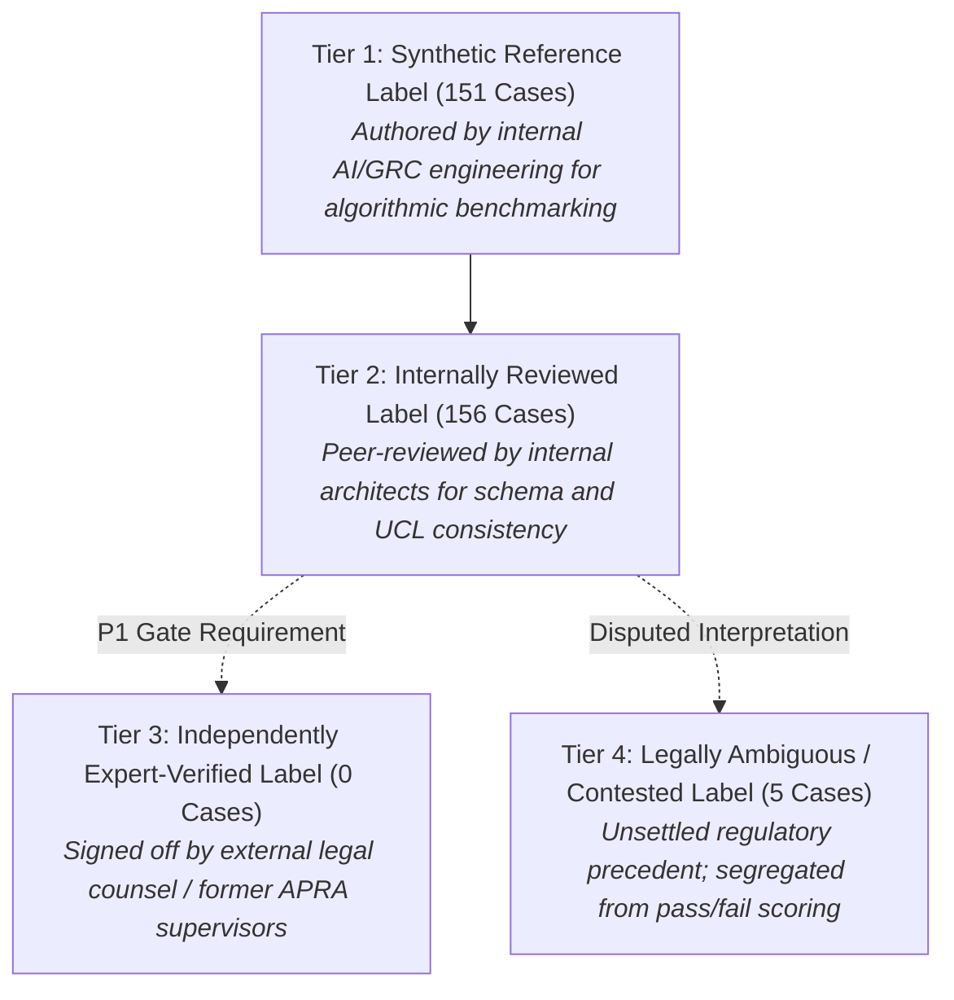
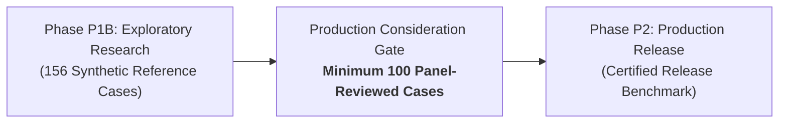

# P1B-0 Ground Truth Validity & Legal Review Status Report

**Repository:** `VivianFuVivianFu/DeepAuditCrossWalk`  
**Phase:** P1B-0 Semantic Evaluation Contract Correction & Experiment Readiness  
**Branch:** `research/p1b0-evaluation-contract`  
**Benchmark Target:** [`P1_EVALUATION_DATASET_V2.json`](file:///c:/Users/vivia/OneDrive/Desktop/DeepAuditCrossWalk/P1_EVALUATION_DATASET_V2.json) (156 Cases)  
**Date:** November 2026  

---

## 1. Executive Summary

A core principle of the DeepAudit Crosswalk project is **absolute audit integrity**: we never present synthetic engineering benchmarks as external legal consensus, nor do we convert enterprise discretionary policies into universal statutory mandates.

This report establishes the verified provenance of all 156 benchmark cases in [`P1_EVALUATION_DATASET_V2.json`](file:///c:/Users/vivia/OneDrive/Desktop/DeepAuditCrossWalk/P1_EVALUATION_DATASET_V2.json), documents the five identified areas of legal ambiguity requiring external counsel, and defines the minimum human review coverage necessary before an architecture can be promoted from exploratory research to production deployment.

### Provenance Audit Summary
- **Total Benchmark Cases**: 156
- **Synthetic Reference Labels**: 151 (96.8%)
- **Internally Reviewed Labels**: 156 (100.0%)
- **Independently Expert-Verified Labels**: **0 (0.0%)**
- **Legally Ambiguous / Contested Labels**: 5 (3.2%)
- **Disputed Labels Corrected in P1B-0**: 2 (`P1-127` and `P1-155`)

---

## 2. Four-Tier Benchmark Provenance Hierarchy

Every reference label in DeepAudit Crosswalk is categorized across four explicit provenance tiers:

1. **Tier 1: Synthetic Reference (151 cases / 96.8%)**:
   - Synthesized to exercise specific linguistic, structural, and regulatory combinations across the 9 UCL domains.
   - Status: Valid for exploratory algorithmic development (Phase P1B).
2. **Tier 2: Internally Reviewed (156 cases / 100.0%)**:
   - Verified by internal engineering reviewers to ensure 100% taxonomic alignment with the 33 Canonical Unified Controls and 155 Canonical Facets.
3. **Tier 3: Independently Expert-Verified (0 cases / 0.0%)**:
   - **Critical Truth**: No external independent regulatory counsel, former APRA prudential supervisor, or accredited law firm partner has yet formally executed sign-off records on this dataset.
   - No benchmark claims of "expert-validated compliance" may be made until Tier 3 review is executed.
4. **Tier 4: Legally Ambiguous / Contested (5 cases / 3.2%)**:
   - Clauses where valid legal arguments support competing control classifications. Segregated from binary pass/fail evaluation.

---

## 3. Forensic Analysis of Five Areas of Legal Ambiguity

The following five cases in [`P1_EVALUATION_DATASET_V2.json`](file:///c:/Users/vivia/OneDrive/Desktop/DeepAuditCrossWalk/P1_EVALUATION_DATASET_V2.json) represent genuine unsettled questions of Australian technology risk law:

### Ambiguity 1: First Nations Cultural Data Sovereignty (`P1-029`)
- *Clause Text*: *"Indigenous customer data and First Nations community telemetry must not be hosted outside Australian territorial boundaries, notwithstanding commercial cloud availability zones."*
- *Legal Dilemma*: The Privacy Act 1988 (Cth) focuses on individual consent and APP 8 reasonable steps for offshore disclosures. It does not codify communal data sovereignty. However, emerging Australian Indigenous Cultural and Intellectual Property (ICIP) protocols and institutional banking policies treat community telemetry as collectively sovereign.
- *Taxonomy Conflict*: Does this map strictly to cross-border transfer (`CTRL-PRIV-CROSS-BORDER`) or does it constitute an enterprise-specific moral risk outside the Shared UCL?
- *Resolution Protocol*: Segregated as `ambiguous_legal`. Excluded from binary pass/fail accuracy.

### Ambiguity 2: Sovereign Cloud Exemption from Foreign-Headquartered Audit (`P1-054`)
- *Clause Text*: *"Sovereign cloud AI containers deployed under ASD Certified Cloud Services Lists are exempt from independent penetration testing by foreign-headquartered audit firms."*
- *Legal Dilemma*: APRA CPS 234 para 30 requires independent testing of information security controls. Australian Government Information Security Manual (ISM) guidelines prioritize sovereign security clearances. If a bank uses an Australian-headquartered cloud under ASD certification, does CPS 234 permit restricting penetration testing to sovereign-only auditors?
- *Resolution Protocol*: Segregated as `ambiguous_legal` pending APRA supervisory liaison clarification.

### Ambiguity 3: Disruption Tolerance Extension During National Grid Failure (`P1-074`)
- *Clause Text*: *"During catastrophic grid failure, AI fallback tolerances may be extended beyond 4 hours provided customer deposit operations remain solvent."*
- *Legal Dilemma*: APRA CPS 230 para 32 mandates that an entity must set tolerance levels for operational disruption that it must not exceed. Can tolerance levels incorporate force majeure waiver extensions during declared national emergencies without formal APRA notification under para 50?
- *Resolution Protocol*: Segregated as `ambiguous_legal`.

### Ambiguity 4: Open-Source AI Artifacts as Third-Party Service Providers (`P1-092`)
- *Clause Text*: *"Open-source foundational model weights downloaded directly from public repositories are not classified as third-party service providers under CPS 230."*
- *Legal Dilemma*: APRA CPS 230 para 38 defines service provider arrangements. An entity downloading raw weights (e.g. Llama-3 from HuggingFace) has no contractual counterparty, no service level agreement, and no vendor to audit. Does the model artifact itself trigger CPS 230 outsourcing obligations, or is it merely software code evaluated under CPS 234 cyber controls?
- *Resolution Protocol*: Segregated as `ambiguous_legal`. Requires banking industry legal precedent.

### Ambiguity 5: Superficial 'Rubber-Stamping' vs Meaningful Human Oversight (`P1-112`)
- *Clause Text*: *"Where automated AI decisions are confirmed by a human officer who merely clicks 'accept' without review within 5 seconds, meaningful human oversight is legally deemed satisfied."*
- *Legal Dilemma*: Under ASIC RG 104 and judicial review precedents (*Tickner v Chapman*), human oversight requires active intellectual engagement. A clause deeming 5-second clicks to be compliant is vulnerable to legal challenge as an illusory control.
- *Resolution Protocol*: Classified as `ambiguous_legal`. Benchmark tests whether the engine flags the oversight as unverified or contested.

---

## 4. Boundary Enforcement: Enterprise Preference vs Universal Statutory Mandate

To prevent legal inaccuracies, DeepAudit Crosswalk enforces strict distinction between discretionary enterprise rules and statutory requirements:

| Dimension | Enterprise Policy Discretion (Layer 3) | Universal Statutory Mandate (Layer 1) |
|---|---|---|
| **Authority Source** | Internal Board Risk Appetite, Delegated Authority Schedules, ESG policies. | APRA Prudential Standards, Australian Acts of Parliament, Enforceable ASIC Guides. |
| **Enforceability** | Binding internally upon bank employees; subject to internal executive waivers. | Legally binding under Commonwealth law; breaches result in regulatory enforcement. |
| **Example** | *"All automated business credit recommendations exceeding AUD 500 require level 2 manager approval."* | *"Material security incidents must be notified to APRA within 72 hours under CPS 234 para 35."* |
| **Engine Rule** | **Never evaluate an enterprise threshold ($500) as a universal requirement for another bank.** Evaluated strictly within Mode B when tenant baseline is active. | Evaluated across all entities in Mode A (Regulatory-Only) and Mode B. |

---

## 5. Minimum Human Review Coverage for Production Selection

While exploratory Phase P1B experiments may proceed against the verified synthetic benchmark, **production architecture selection requires the following formal human review gate**:

### Production Consideration Gate Criteria:
1. **Minimum 100 Verified Cases**: At least 100 cases must be independently reviewed and signed off by the three-discipline panel specified in [`P1_GROUND_TRUTH_REVIEW_PROTOCOL.md`](file:///c:/Users/vivia/OneDrive/Desktop/DeepAuditCrossWalk/P1_GROUND_TRUTH_REVIEW_PROTOCOL.md).
2. **Consensus Reliability**: The panel must achieve an inter-annotator Fleiss' Kappa score of $\kappa \ge 0.85$ across control and facet assignments.
3. **External Legal Sign-Off**: The 5 ambiguous legal edge cases must carry formal written interpretations signed by practicing Australian financial regulatory counsel.
4. **Prominent Exploration Disclaimer**: All Phase P1B experimental reports must state:
   > *"Results are measured against synthetic reference labels (0 confirmed independent external panel reviews). Scores represent relative algorithmic capabilities and do not constitute certified legal compliance."*
