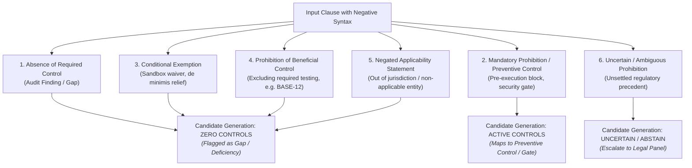

# P1B-0 Negation & Prohibition Semantics Audit: Restoring Legal and Engineering Accuracy

**Repository:** `VivianFuVivianFu/DeepAuditCrossWalk`  
**Phase:** P1B-0 Semantic Evaluation Contract Correction & Experiment Readiness  
**Branch:** `research/p1b0-evaluation-contract`  
**Date:** November 2026  
**Auditor:** Independent Semantic Architecture & Regulatory Compliance Review  

---

## 1. Executive Summary & Defect Statement

During Phase P1A, an evaluation metric defect was introduced in [`P1_SEMANTIC_ENGINE_EVALUATION_PROTOCOL.md`](file:///c:/Users/vivia/OneDrive/Desktop/DeepAuditCrossWalk/P1_SEMANTIC_ENGINE_EVALUATION_PROTOCOL.md):
```python
# P1A Defective Logic:
if case["is_negated"] and len(prediction.candidate_controls) > 0:
    results["false_control_triggers"] += 1
```

This metric design treated **any clause containing negation (`is_negated: true`) as a test case that must produce zero candidate controls**.

### Why This Metric is Defective
In banking governance and regulatory law, normative statements frequently use negative syntax (*"must not"*, *"shall not"*, *"prohibited from"*, *"cannot proceed without"*) to define **mandatory preventive controls, pre-execution gates, and protective compliance barriers**:
- *"AI developers shall not disable automated runtime dependency scanning or bypass static analysis security testing (SAST) in CI/CD pipelines"* (Case `P1-049`).
  - **Legal/Engineering Meaning**: This is a mandatory, affirmative information security control under APRA CPS 234. It correctly maps to `CTRL-SEC-COMMENSURATE` and facet `controls_commensurate`.
  - **P1A Flaw**: Under the P1A metric, an engine that correctly extracts `CTRL-SEC-COMMENSURATE` is penalized with a "false-control trigger"!
- *"The agent must not execute payment before approval"* / *"Junior credit analysts shall not override machine learning credit risk assessments for applications exceeding AUD 25,000 without written concurrence"* (Case `P1-108`).
  - **Legal/Engineering Meaning**: This defines an explicit pre-execution delegated authority threshold under `CTRL-DELEGATED-AUTHORITY-THRESHOLD` and `CTRL-HUMAN-OVERSIGHT`.
  - **P1A Flaw**: The P1A metric penalizes candidate generation on this crucial threshold gate.

This audit establishes a **six-class taxonomy of negation and prohibition semantics**, audits all negated cases in [`P1_EVALUATION_DATASET_V2.json`](file:///c:/Users/vivia/OneDrive/Desktop/DeepAuditCrossWalk/P1_EVALUATION_DATASET_V2.json), and replaces the blunt boolean flag with a semantically sound evaluation contract.

---

## 2. Six-Class Taxonomy of Negation and Prohibition Semantics

To evaluate candidate mappings accurately, DeepAudit Crosswalk establishes six distinct categories of negative and preventive syntax:



### Detailed Category Definitions:

1. **Category 1: Absence of a Required Control (Audit Finding / Implementation Gap)**
   - *Definition*: A descriptive statement noting that a control, policy, or logging mechanism is missing in the operational environment.
   - *Example*: *"The system does not currently log user prompts to an immutable store."*
   - *Expected Behavior*: Must **NOT** generate candidate compliance mappings. Must be flagged as an implementation gap (`GapRecord`).
2. **Category 2: Mandatory Prohibition or Preventive Control (Legitimate Control)**
   - *Definition*: A normative policy command that forbids unsafe actions, mandates pre-execution technical blocks, or establishes strict operational barriers.
   - *Example*: *"System architects shall not deploy models into production without an approved BCP"* (`P1-072`); *"Junior analysts must not override recommendations over $25k without concurrence"* (`P1-108`).
   - *Expected Behavior*: **MUST generate candidate controls**. Legitimate mapping to corresponding preventive Unified Controls (`CTRL-BCP-AI`, `CTRL-DELEGATED-AUTHORITY-THRESHOLD`, `CTRL-SEC-COMMENSURATE`).
3. **Category 3: Conditional Exemption or Regulatory Relief**
   - *Definition*: A clause that excuses a specific low-risk or non-material workflow from an otherwise mandatory control.
   - *Example*: *"Non-customer facing AI tools are exempt from formal BCP testing"* (`P1-065`); *"Sandbox environments do not require dual human authorization."*
   - *Expected Behavior*: Must **NOT** generate an unconditioned candidate control. If extracted, must carry explicit `has_exception: true` and conditionality qualifiers.
4. **Category 4: Explicit Prohibition of a Beneficial Control (False-Coverage Risk)**
   - *Definition*: An enterprise policy clause that explicitly forbids staff from executing a standard governance control (e.g. banning bias testing or disabling audit trails).
   - *Example*: *"Consumer credit scoring models shall not implement automated bias testing using synthetic demographic proxies"* (`BASE-12` / `P1-127`).
   - *Expected Behavior*: Must **NOT** generate candidate control `CTRL-AI-DRIFT-MONITORING` or facet `fairness_and_explainability_metrics_evaluated` as an approved or satisfied control! Generating candidate compliance here constitutes a severe False-Control defect.
5. **Category 5: Negated Statutory Applicability Statement**
   - *Definition*: A factual or legal determination that a statutory framework or regulatory standard does not apply to the entity or use-case.
   - *Example*: *"A domestic Australian credit union offering home loans strictly to residents of NSW... has zero EU AI Act compliance obligations"* (`P1-155`).
   - *Expected Behavior*: Must **NOT** generate active candidate compliance mappings. Evaluated under the statutory applicability engine (`decide_applicability()`).
6. **Category 6: Uncertain or Ambiguous Prohibition**
   - *Definition*: A negative clause whose interaction with statutory law is legally contested or subject to contradictory regulatory guidance.
   - *Example*: *"Credit underwriting staff shall not consider applicant age, except where actuarially validated mortality tables require it under Section 65."*
   - *Expected Behavior*: Model must flag ambiguity or abstain (`review_status: "uncertain"`), escalating to human compliance counsel.

---

## 3. Case-by-Case Forensic Audit of All Ten P1A Negated Cases

Below is the complete re-evaluation of all ten cases tagged `is_negated: true` in [`P1_EVALUATION_DATASET_V2.json`](file:///c:/Users/vivia/OneDrive/Desktop/DeepAuditCrossWalk/P1_EVALUATION_DATASET_V2.json):

| Case ID | Normative Text Snippet | Revised Category | Expected Controls | P1A Behavior vs Corrected Behavior |
|---|---|---|---|---|
| **P1-027** | *"Consumer credit evaluation algorithms are strictly prohibited from collecting or processing sensitive data regarding religious affiliations..."* | **Category 2**: Mandatory Prohibition (Preventive Privacy Control) | `CTRL-PRIV-COLLECTION` (`sensitive_information_consent`) | **P1A Flaw**: Penalized candidate generation.<br>**Corrected**: Correctly generates `CTRL-PRIV-COLLECTION` as a mandatory preventive collection barrier under APP 3. |
| **P1-049** | *"AI developers shall not disable automated runtime dependency scanning or bypass static analysis security testing (SAST) in CI/CD pipelines."* | **Category 2**: Mandatory Prohibition (Preventive Security Control) | `CTRL-SEC-COMMENSURATE` (`controls_commensurate`) | **P1A Flaw**: Penalized candidate generation.<br>**Corrected**: Correctly generates `CTRL-SEC-COMMENSURATE` as an enforceable preventive control. |
| **P1-072** | *"The bank shall not deploy automated loan approval models into critical operations without an approved and tested business continuity plan."* | **Category 2**: Mandatory Prohibition (Pre-Deployment Gate) | `CTRL-BCP-AI` (`continuity_plan_tested`) | **P1A Flaw**: Penalized candidate generation.<br>**Corrected**: Correctly generates `CTRL-BCP-AI`. The clause establishes a pre-condition gate for deployment. |
| **P1-090** | *"The bank shall not execute agreements with third-party AI providers that exclude liability for gross negligence or regulatory non-compliance."* | **Category 2**: Mandatory Prohibition (Contractual Safeguard) | `CTRL-THIRD-PARTY-AI` (`contract_controls_defined`) | **P1A Flaw**: Penalized candidate generation.<br>**Corrected**: Correctly generates `CTRL-THIRD-PARTY-AI` contractual terms under APRA CPS 230 para 41. |
| **P1-108** | *"Junior credit analysts shall not override machine learning credit risk assessments for applications exceeding AUD 25,000 without written concurrence..."* | **Category 2**: Mandatory Prohibition (Delegated Threshold Gate) | `CTRL-HUMAN-OVERSIGHT`, `CTRL-DELEGATED-AUTHORITY-THRESHOLD` | **P1A Flaw**: Penalized candidate generation.<br>**Corrected**: Correctly generates human oversight and delegated threshold controls ($25,000 limit). |
| **P1-127** | *"Consumer credit scoring models shall not implement automated bias testing using synthetic demographic proxies."* | **Category 4**: Prohibition of a Beneficial Control (False-Coverage Risk) | `[]` (Must NOT assert candidate compliance for bias testing!) | **P1A Flaw**: Listed `CTRL-AI-DRIFT-MONITORING` in `expected_controls`.<br>**Corrected**: This is `BASE-12`. Must **NOT** generate candidate control `CTRL-AI-DRIFT-MONITORING`. Candidate generation here is a false-control trigger! |
| **P1-139** | *"Customer service staff shall not refuse to register an oral expression of dissatisfaction simply because the customer cannot identify the specific AI algorithm..."* | **Category 2**: Mandatory Prohibition (Preventive Dispute Barrier) | `CTRL-IDR-HANDLING` (`complaints_broadly_recognised`, `complaints_recorded`) | **P1A Flaw**: Penalized candidate generation.<br>**Corrected**: Correctly generates `CTRL-IDR-HANDLING` under ASIC RG 271 dispute registration standards. |
| **P1-148** | *"Credit decisioning models shall not approve personal loans where applicant living expenses are estimated solely using benchmark poverty indexes without actual verification."* | **Category 2**: Mandatory Prohibition (Responsible Lending Gate) | `CTRL-CREDIT-UNSUITABILITY` (`financial_situation_verified_from_reliable_evidence`, `unsuitability_and_substantial_hardship_screen_enforced`) | **P1A Flaw**: Penalized candidate generation.<br>**Corrected**: Correctly generates `CTRL-CREDIT-UNSUITABILITY` unsuitability screen under NCCP Act s 131. |
| **P1-154** | *"AI systems that deploy subliminal techniques or exploit vulnerabilities of specific demographic groups to materially distort behavior are strictly prohibited under Article 5."* | **Category 2**: Mandatory Statutory Prohibition | `CTRL-EU-HIGH-RISK` (`article5_prohibited_practices_screened_out`) | **P1A Flaw**: Penalized candidate generation.<br>**Corrected**: Correctly generates `CTRL-EU-HIGH-RISK` Article 5 screening. |
| **P1-155** | *"A domestic Australian credit union offering home loans strictly to residents of NSW without any EU operations or marketing has zero EU AI Act compliance obligations."* | **Category 5**: Negated Statutory Applicability Statement | `[]` (Non-applicable; must NOT generate active EU compliance obligations) | **P1A Flaw**: Listed `CTRL-EU-HIGH-RISK` as expected control.<br>**Corrected**: Zero active compliance controls. Applicability engine returns `not_applicable`. |

---

## 4. Key Discovery: The `P1-127` and `P1-155` Dataset Inconsistencies

During this audit, two critical reference annotation errors were discovered in [`P1_EVALUATION_DATASET_V2.json`](file:///c:/Users/vivia/OneDrive/Desktop/DeepAuditCrossWalk/P1_EVALUATION_DATASET_V2.json):

1. **Defect in `P1-127` (Benchmark `BASE-12` Repetition)**:
   - In P0, `BASE-12` was the canonical example of a **false-control trigger**: a bank policy forbade bias testing using synthetic demographic proxies. If an engine matched `"bias testing"` and suggested `CTRL-FAIR-BIAS-DETECTION`, it was a defect.
   - However, in `P1_EVALUATION_DATASET_V2.json`, `P1-127` was mistakenly annotated with `expected_controls: ["CTRL-AI-DRIFT-MONITORING"]` and `expected_facets: ["fairness_and_explainability_metrics_evaluated"]` while simultaneously marked `is_negated: true`!
   - This created an impossible contradiction: the dataset expected `CTRL-AI-DRIFT-MONITORING`, while the evaluation harness asserted that any control generated on `is_negated: true` was a failure!
   - **Correction**: `P1-127` is classified as **Category 4 (Prohibition of a Beneficial Control)**. Its `expected_controls` is corrected to `[]` and its `expected_candidate_behavior` is set to `"must_not_generate_candidates"`. Generating candidate bias controls on this clause will be scored as a False-Control Trigger.
2. **Defect in `P1-155` (Statutory Non-Applicability)**:
   - In `P1-155`, a domestic credit union has zero EU AI Act nexus.
   - The dataset listed `expected_controls: ["CTRL-EU-HIGH-RISK"]`.
   - **Correction**: `P1-155` is classified as **Category 5 (Negated Applicability Statement)**. Its `expected_controls` is corrected to `[]` and `expected_candidate_behavior` set to `"must_not_generate_candidates"`. Generating EU high-risk obligations on a non-applicable domestic entity is a False-Control Trigger.

---

## 5. Revised Dataset Schema Additions

To preserve complete historical traceability while enabling semantically accurate evaluation, [`P1_EVALUATION_DATASET_V2.json`](file:///c:/Users/vivia/OneDrive/Desktop/DeepAuditCrossWalk/P1_EVALUATION_DATASET_V2.json) and [`scripts/build_p1_dataset.py`](file:///c:/Users/vivia/OneDrive/Desktop/DeepAuditCrossWalk/scripts/build_p1_dataset.py) are updated with three explicit fields:

```json
{
  "case_id": "P1-049",
  "is_negated": true,
  "normative_type": "mandatory_prohibition",
  "expected_candidate_behavior": "should_generate_candidates",
  "negation_audit_notes": "Mandatory CI/CD security gate forbidding bypass of dependency and SAST scanning under APRA CPS 234."
}
```

### Supported Values for `normative_type`:
- `mandatory_requirement`: Standard affirmative obligation.
- `mandatory_prohibition`: Preventive prohibition or operational pre-execution barrier (Category 2).
- `conditional_exemption`: Discretionary or conditional waiver (Category 3).
- `harmful_practice_prohibition`: Policy excluding standard governance mechanisms (Category 4).
- `applicability_boundary`: Factual or legal statement of statutory non-applicability (Category 5).
- `absence_of_control`: Factual finding of missing operational controls (Category 1).
- `uncertain_prohibition`: Ambiguous legal prohibition (Category 6).

### Supported Values for `expected_candidate_behavior`:
- `should_generate_candidates`: Engine must extract the designated canonical controls and facets.
- `must_not_generate_candidates`: Engine must suppress candidate generation. Any generated candidate constitutes a **False-Control Trigger**.
- `undetermined_ambiguity`: Evaluation harness records model output for qualitative review without binary penalty.

---

## 6. Revised Evaluation Contract for False-Control Triggers

In the revised evaluation harness, the defective P1A metric is replaced with the following semantically accurate rule:

```python
# REVISED EVALUATION CONTRACT:
def evaluate_false_control_triggers(prediction, case):
    """
    Measures false candidate control assertions against expected candidate behavior,
    NOT against crude syntactic negation.
    """
    expected_behavior = case.get("expected_candidate_behavior", "should_generate_candidates")
    
    if expected_behavior == "must_not_generate_candidates":
        # Any candidate control generated on Category 3, 4, or 5 is a False-Control Trigger!
        if len(prediction.candidate_controls) > 0:
            return 1, f"False-control trigger on {case['normative_type']} clause: generated {prediction.candidate_controls}"
    
    # In addition, any candidate control that contradicts expected controls is a precision error
    return 0, None
```

---

## 7. Conclusion

By separating negative grammar from normative regulatory semantics, this audit restores legal and engineering integrity to the DeepAudit Crosswalk evaluation suite:
1. **Legitimate preventive controls** (P1-027, P1-049, P1-072, P1-090, P1-108, P1-139, P1-148, P1-154) are recognized as valid candidate mapping targets.
2. **True false-coverage vulnerabilities** (P1-127 / `BASE-12` and P1-155) are strictly penalized when models spuriously assert compliance.
3. **Historical traceability** is preserved by retaining original `is_negated` booleans alongside the new normative semantics.
