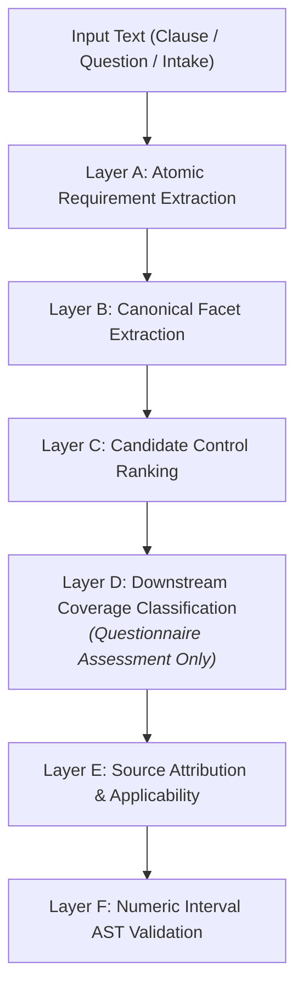

# P1B-0 Revised Multi-Layer Evaluation Contract

**Repository:** `VivianFuVivianFu/DeepAuditCrossWalk`  
**Phase:** P1B-0 Semantic Evaluation Contract Correction & Experiment Readiness  
**Branch:** `research/p1b0-evaluation-contract`  
**Supersedes:** `P1_SEMANTIC_ENGINE_EVALUATION_PROTOCOL.md` (Section 4 defective negation rule)  
**Date:** November 2026  

---

## 1. Executive Summary & Core Contract Changes

This document establishes the revised mathematical and algorithmic contract for evaluating candidate semantic mapping architectures in Phase P1B.

### Key Corrections from P1A:
1. **Replacement of Syntactic Negation Penalty**: Replaces the crude `if case["is_negated"] and len(controls) > 0` metric with a semantically sound rule based on `expected_candidate_behavior` and canonical control matching. Legitimate preventive controls (e.g. *cannot execute without approval*, *shall not bypass SAST*) are now evaluated as valid targets.
2. **Strict Canonical Identifiers**: All evaluation layers mandate output conforming to the **33 Canonical Unified Controls** and **155 Canonical Facets** defined in [`UNIFIED_CONTROL_LIBRARY.json`](file:///c:/Users/vivia/OneDrive/Desktop/DeepAuditCrossWalk/UNIFIED_CONTROL_LIBRARY.json).
3. **Explicit Multi-Label Formulations**: Formally defines micro- and macro-averaged precision, recall, and F1 to handle multi-facet and multi-control policy clauses.
4. **Honest Scope Bounding**: Downstream assessment targets lacking production execution engines (AI Governance Strategy and Standalone Use Case Telemetry) truthfully return `HTTP 501 Not Implemented` and are excluded from synthetic accuracy claims.

---

## 2. Mathematical Metric Formulations Across Layers A – F



---

### Layer A — Atomic Requirement Extraction
Evaluates whether the engine segments complex text into discrete normative requirements.
- **Precision ($P_A$)**:
  $$P_A = \frac{|\text{Extracted Atomic Segments} \cap \text{Valid Normative Obligations}|}{|\text{Total Extracted Segments}|}$$
- **Recall ($R_A$)**:
  $$R_A = \frac{|\text{Extracted Atomic Segments} \cap \text{Valid Normative Obligations}|}{|\text{Reference Atomic Obligations}|}$$
- **Boundary Preservation Score ($BPS_A$)**: Percentage of conditional qualifiers (`if`, `unless`, `subject to`) that remain syntactically attached to their operative requirements.

---

### Layer B — Canonical Facet Extraction (Multi-Label)
Evaluates classification into the 155 Canonical UCL Facets.
Let $N$ be the number of test cases. For case $i$, let $Y_i$ be the set of reference facets and $\hat{Y}_i$ be the set of predicted candidate facets.

- **Micro-Averaged Facet Precision ($P_{B,\text{micro}}$)**:
  $$P_{B,\text{micro}} = \frac{\sum_{i=1}^N |Y_i \cap \hat{Y}_i|}{\sum_{i=1}^N |\hat{Y}_i|}$$
- **Micro-Averaged Facet Recall ($R_{B,\text{micro}}$)**:
  $$R_{B,\text{micro}} = \frac{\sum_{i=1}^N |Y_i \cap \hat{Y}_i|}{\sum_{i=1}^N |Y_i|}$$
- **Micro-Averaged Facet F1 ($F1_{B,\text{micro}}$)**:
  $$F1_{B,\text{micro}} = \frac{2 \times P_{B,\text{micro}} \times R_{B,\text{micro}}}{P_{B,\text{micro}} + R_{B,\text{micro}}}$$
- **Per-Facet Macro-Averaged F1 ($F1_{B,\text{macro}}$)**: Unweighted mean of $F1$ scores across all 155 canonical facets.

---

### Layer C — Candidate Unified Control Ranking & False-Control Triggers
Evaluates mapping to the 33 Canonical Unified Controls.
Let $C_i$ be the reference control set and $\hat{C}_i = [\hat{c}_{i,1}, \hat{c}_{i,2}, \dots, \hat{c}_{i,k}]$ be the ranked candidate suggestions.

- **Top-1 Recall ($R_{C@1}$)**:
  $$R_{C@1} = \frac{1}{N_{\text{ctrl}}} \sum_{i: |C_i| > 0} \mathbb{I}(\hat{c}_{i,1} \in C_i)$$
- **Top-3 Recall ($R_{C@3}$)**:
  $$R_{C@3} = \frac{1}{N_{\text{ctrl}}} \sum_{i: |C_i| > 0} \mathbb{I}(\exists j \le 3 : \hat{c}_{i,j} \in C_i)$$
- **Top-5 Recall ($R_{C@5}$)**:
  $$R_{C@5} = \frac{1}{N_{\text{ctrl}}} \sum_{i: |C_i| > 0} \mathbb{I}(\exists j \le 5 : \hat{c}_{i,j} \in C_i)$$

#### Revised False-Control Trigger Rate ($FCR_C$)
A False-Control Trigger is defined strictly as:
1. Generating candidate controls on a clause marked `expected_candidate_behavior == "must_not_generate_candidates"` (e.g. Category 4 harmful practice prohibitions like `P1-127` / `BASE-12`, or Category 5 non-applicability like `P1-155`).
2. Generating candidate controls on unmapped/discretionary enterprise preamble (`category == "unmapped_enterprise"`).

$$FCR_C = \frac{\sum_{i \in \text{Suppressed}} \mathbb{I}(|\hat{C}_i| > 0)}{|\text{Suppressed Cases}|}$$

*Target for all architectures*: $\mathbf{FCR_C = 0.0\%}$.

---

### Layer D — Downstream Coverage Classification (Questionnaire Only)
Evaluates coverage determination on actual executed questionnaire workflows.
- Evaluates confusion matrix across coverage states: `full_coverage`, `partial_coverage`, `gap`, `undetermined`.
- **False Full-Coverage Rate ($FFCR_D$)**:
  $$FFCR_D = \frac{\text{Cases marked Full Coverage with missing facets/evidence}}{\text{Total Assessed Cases}}$$
- **False Gap Rate ($FGR_D$)**:
  $$FGR_D = \frac{\text{Cases marked Gap despite verified complete coverage}}{\text{Total Assessed Cases}}$$

---

### Layer E — Source Attribution & Applicability
- **Citation Precision**: Proportion of generated rationales that cite exact, verified statutory instruments and sections (e.g. *Privacy Act 1988 Sch 1 APP 11.2*) without hallucinated numbers.
- **Statutory Applicability Accuracy**: Deterministic evaluation of statutory triggers (e.g. APRA ADI entity test, Privacy Act personal info nexus, EU AI Act territorial nexus).

---

### Layer F — Numeric Interval AST Validation
- **Numeric Extraction Accuracy**: Exact match on parsed numerical limits (currency amounts, retention years, review frequency).
- **Interval Compatibility Accuracy**: Correct assignment of comparison operators ($<, \le, >, \ge, =$) and detection of use-case vs baseline exposure intervals (e.g. `(500, 1000]`).

---

## 3. The Executable Evaluation Harness Contract

The evaluation script must execute the following contract logic:

```python
def evaluate_case(engine, case):
    """
    Revised P1B-0 Evaluation Contract.
    """
    prediction = engine.extract_and_map(case["input_text"])
    
    # 1. Layer B: Facet Evaluation
    pred_facets = set(prediction.candidate_facets)
    exp_facets = set(case["expected_facets"])
    
    tp_facets = len(pred_facets & exp_facets)
    fp_facets = len(pred_facets - exp_facets)
    fn_facets = len(exp_facets - pred_facets)
    
    # 2. Layer C: Control Evaluation
    pred_ctrls = [m.control_id for m in prediction.ranked_mappings]
    exp_ctrls = set(case["expected_controls"])
    expected_behavior = case.get("expected_candidate_behavior", "should_generate_candidates")
    
    # False-Control Trigger Detection
    false_control_trigger = False
    if expected_behavior == "must_not_generate_candidates" and len(pred_ctrls) > 0:
        false_control_trigger = True
        
    top1_match = len(pred_ctrls) > 0 and pred_ctrls[0] in exp_ctrls
    top3_match = any(c in exp_ctrls for c in pred_ctrls[:3])
    top5_match = any(c in exp_ctrls for c in pred_ctrls[:5])
    
    # 3. Layer F: Numeric Threshold AST Validation
    threshold_correct = True
    if case.get("threshold_constraint"):
        exp_t = case["threshold_constraint"]
        pred_t = prediction.threshold_ast
        threshold_correct = (
            pred_t is not None 
            and pred_t.amount == exp_t["amount"]
            and pred_t.operator == exp_t["operator"]
        )
        
    return {
        "facet_tp": tp_facets,
        "facet_fp": fp_facets,
        "facet_fn": fn_facets,
        "top1": top1_match,
        "top3": top3_match,
        "top5": top5_match,
        "false_control_trigger": false_control_trigger,
        "threshold_correct": threshold_correct,
    }
```

---

## 4. Operational Boundaries & Truthful Scope Enforcement

| Target Workflow | Production Engine Status | Benchmark Scoring Rule |
|---|---|---|
| **AIAF Assessment Questionnaire** | Production Pipeline Active ([`coverage.py`](file:///c:/Users/vivia/OneDrive/Desktop/DeepAuditCrossWalk/backend/banking_crosswalk/coverage.py)) | Scored end-to-end on Layer D (Coverage Classification). |
| **Enterprise Policy Baseline** | Production Pipeline Active ([`policy.py`](file:///c:/Users/vivia/OneDrive/Desktop/DeepAuditCrossWalk/backend/banking_crosswalk/policy.py)) | Scored on Layer B (Facets), Layer C (Controls), Layer F (Thresholds). |
| **AI Governance Strategy** | **NOT IMPLEMENTED (HTTP 501)** | **Excluded from Layer D scoring**. Calling `/assessments/strategy` returns 501. Never score proxy simulations as product accuracy. |
| **Standalone Use Case Telemetry**| **NOT IMPLEMENTED (HTTP 501)** | **Excluded from Layer D scoring**. Calling `/assessments/use-case` returns 501. Telemetry ingestion is a Phase P2 roadmap item. |

---

## 5. Statistical Safety Disclaimer

A result of **0 false triggers** on a synthetic benchmark (whether 25 or 156 cases) is a **positive regression test finding**, not an empirical guarantee of universal legal safety.

In accordance with APRA CPS 234 and enterprise risk principles, machine-generated candidate mappings must remain bounded by mandatory human review gates before entering active production baselines.
