# P1B-1 Engine A0 (Historical Production Baseline) Evaluation Report

**Repository:** `VivianFuVivianFu/DeepAuditCrossWalk`  
**Phase:** P1B-1 Executable Evaluation Harness, Canonical Mapping Adapter & Deterministic Baseline Experiment  
**Branch:** `research/p1b1-deterministic-experiment`  
**Engine:** Engine A0 (`backend/banking_crosswalk/policy.py` wrapped via `CanonicalMappingAdapter`)  
**Execution Timestamp:** November 2026  
**Artifacts Generated:**  
- `scripts/experiments/artifacts/a0_dev_results.json`  
- `scripts/experiments/artifacts/a0_supp_results.json`  
- `scripts/experiments/artifacts/a0_holdout_results.json`  

---

## 1. Executive Summary

Engine A0 represents the production deterministic extraction algorithm developed across P0 milestones (PR #13–#16). It relies on 8 regex pattern groups in `ENTERPRISE_FACET_PATTERNS` to extract enterprise policy facets, translate them into ad-hoc control IDs, and parse numerical threshold amounts.

When subjected to the standardized, multi-layer evaluation harness across the 156-case V2 benchmark and the 36-case Supplemental Adversarial dataset, Engine A0 exhibited severe architectural limitations:
- **Baseline Extraction Recall on Development Split**: **3.73%** (Facet Micro F1: **6.37%**).
- **Canonical Control Top-1 Recall on Development Split**: **3.81%** (MRR: **0.0381**).
- **Canonical UCL Facet Coverage**: **3.23%** (5 out of 155 canonical facets covered).
- **False-Control Trigger Rate on Supplemental Prohibitions**: **16.67%** (3 false alarms out of 18 non-affirmative cases).
- **False-Control Trigger Rate on Holdout Prohibitions**: **50.00%** (1 false alarm out of 2 non-affirmative cases, triggering falsely on `P1-127`).

While Engine A0 operates at sub-millisecond execution speeds (mean latency: **0.10 ms**), its recall is catastrophically low, confirming that historical heuristic rules are completely inadequate for broad enterprise policy onboarding.

---

## 2. Quantitative Performance Summary Across Dataset Splits

```mermaid
xychart-beta
    title "Engine A0 Performance Across Dataset Splits"
    x-axis ["V2 Development (105)", "Supplemental Adversarial (36)", "V2 Holdout (51)"]
    y-axis "Percentage (%)" 0 --> 100
    bar [6.37, 30.00, 14.81]
    bar [3.81, 11.11, 8.16]
    bar [8.40, 16.67, 13.11]
```


*(Legend: Bar 1 = Facet Micro F1, Bar 2 = Top-1 Control Recall, Bar 3 = Control Micro F1)*

### Complete Layer Metrics Table

| Evaluation Layer | Metric | V2 Development (105 Cases) | Supplemental Adversarial (36 Cases) | V2 Holdout (51 Cases) |
|---|---|:---:|:---:|:---:|
| **Layer A: Atomic Extraction** | Precision ($P_A$) | 43.14% | 46.51% | 46.34% |
| | Recall ($R_A$) | 34.92% | 44.44% | 34.55% |
| | F1 Score ($F1_A$) | 38.60% | 45.45% | 39.58% |
| **Layer B: Canonical Facets** | Micro Precision ($P_{B}$) | 28.57% | 36.00% | 44.44% |
| | Micro Recall ($R_{B}$) | 3.73% | 25.71% | 9.09% |
| | **Micro F1 ($F1_{B}$)** | **6.37%** | **30.00%** | **14.81%** |
| | Unique Facets Predicted | 5 | 8 | 5 |
| | Canonical UCL Coverage | **3.23%** (5/155) | **5.16%** (8/155) | **3.23%** (5/155) |
| **Layer C: Unified Controls** | Top-1 Recall ($R_{C@1}$) | **3.81%** | **11.11%** | **8.16%** |
| | Top-3 Recall ($R_{C@3}$) | 3.81% | 11.11% | 8.16% |
| | Top-5 Recall ($R_{C@5}$) | 3.81% | 11.11% | 8.16% |
| | Mean Reciprocal Rank (MRR) | **0.0381** | **0.1111** | **0.0816** |
| | Control Micro Precision | 28.57% | 25.00% | 44.44% |
| | Control Micro Recall | 4.88% | 12.50% | 7.69% |
| | **Control Micro F1** | **8.40%** | **16.67%** | **13.11%** |
| **Normative Safety** | Suppression Target Cases | 0 | 18 | 2 |
| | Correct Suppressions | 0 | 15 | 1 |
| | Suppression Accuracy | 100.0% (N/A) | 83.33% | 50.00% |
| | **False Trigger Rate** | **0.00%** | **16.67%** | **50.00%** |
| **Layer F: Numeric AST** | Evaluated Threshold Cases | 0 | 1 | 0 |
| | Threshold Accuracy | 100.0% (N/A) | 100.0% (1/1) | 100.0% (N/A) |
| **System Latency** | Mean Execution Time | **0.10 ms** | **0.09 ms** | **0.09 ms** |
| | 95th Percentile (P95) | 0.22 ms | 0.18 ms | 0.19 ms |

---

## 3. Deep Root Cause Analysis of A0 Failures

### 3.1 Root Cause 1: Complete Absence of Taxonomy Coverage (The "147 Missing Facets" Dilemma)
Engine A0 defines regex patterns for exactly 8 heuristic pattern groups. Of those 8, only 3 match canonical facet strings verbatim (`human_approval_required`, `approval_threshold_defined`, `pre_execution_block`). 

Out of the **155 canonical facets** in `UNIFIED_CONTROL_LIBRARY.json`, Engine A0 has zero patterns for **147 facets**. Consequently:
- In the V2 Development split (105 cases), which spans diverse regulatory obligations (APRA CPS 230, CPS 234, Privacy Act APPs 1–13, ASIC RG 271, EU AI Act), Engine A0 was completely blind to 96% of reference obligations.
- For controls such as `CTRL-SEC-TESTING`, `CTRL-BCP-AI`, `CTRL-IDR-HANDLING`, `CTRL-INDEPENDENT-AUDIT-ASSURANCE`, and `CTRL-PRIV-ACCESS-CORRECTION`, A0 generated **zero candidate controls across all 105 development cases**.

### 3.2 Root Cause 2: Syntactic Negation Brittleness & False Control Triggers
In Engine A0, negation handling is implemented via a single flat regex:
```python
NEGATION_OR_EXEMPTION_PATTERN = re.compile(
    r"\b(does not require|do not require|not required|no requirement for|no requirement to|is exempt|are exempt|exemption|must not be used)\b",
    re.IGNORECASE,
)
```
When evaluated against the 18 non-affirmative cases in the Supplemental Adversarial dataset and the 2 holdout suppression cases:
- A0 triggered false control mappings on `SUPP-002` ("Personnel are strictly prohibited from transmitting unencrypted customer information..."), extracting `CTRL-PRIV-COLLECTION` because the phrase `strictly prohibited` was not in `NEGATION_OR_EXEMPTION_PATTERN`.
- A0 triggered a false control mapping on `SUPP-020` ("Personnel are strictly forbidden from publicly disclosing...").
- A0 triggered a false control mapping on `P1-127` (harmful practice prohibition under Category 4), emitting a candidate control when candidate generation should have been strictly suppressed.
- Overall, A0 suffered a **16.67% False Trigger Rate** on supplemental non-affirmative cases and a **50.00% False Trigger Rate** on holdout non-affirmative cases.

### 3.3 Root Cause 3: Inelastic Vocabulary & Lack of Synonym Generalization
Because A0 relies strictly on literal string substring matching (e.g. `"human approval"`, `"manual approval"`, `"dual sign-off"`), any syntactic variation or legal paraphrasing completely breaks detection:
- Phrase: `"Frontline underwriters must retain manual override authority over all automated loan pre-qualification recommendations."` (`SUPP-029`)
- Result: A0 emitted 0 controls because it searches for `"human approval"`, failing to recognise `"manual override authority"`.

---

## 4. Operational Assessment

Engine A0 is exceptionally fast (0.10 ms per clause) and deterministic. However, its low recall (3.81% Top-1 Recall) and 16.67%–50% false trigger rate on non-affirmative legal statements make it unsuitable as a standalone enterprise onboarding engine. It serves strictly as a historical lower-bound baseline against which future semantic architectures must be measured.
