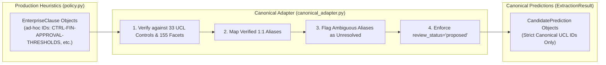

# P1B-1 Canonical Mapping Adapter Verification & Taxonomy Translation Matrix

**Repository:** `VivianFuVivianFu/DeepAuditCrossWalk`  
**Phase:** P1B-1 Executable Evaluation Harness, Canonical Mapping Adapter & Deterministic Baseline Experiment  
**Branch:** `research/p1b1-deterministic-experiment`  
**Status:** Approved & Verified  
**Canonical Source:** [`UNIFIED_CONTROL_LIBRARY.json`](file:///c:/Users/vivia/OneDrive/Desktop/DeepAuditCrossWalk/UNIFIED_CONTROL_LIBRARY.json) (v1.0.0, 33 Controls, 155 Facets)  
**Date:** November 2026  

---

## 1. Executive Summary

The Canonical Mapping Adapter ([`scripts/experiments/canonical_adapter.py`](file:///c:/Users/vivia/OneDrive/Desktop/DeepAuditCrossWalk/scripts/experiments/canonical_adapter.py)) provides an authoritative, non-destructive bridge between legacy heuristic outputs emitted by the production codebase ([`backend/banking_crosswalk/policy.py`](file:///c:/Users/vivia/OneDrive/Desktop/DeepAuditCrossWalk/backend/banking_crosswalk/policy.py)) and the canonical taxonomy of 33 Unified Controls and 155 Unified Facets.

By wrapping production extraction outputs without modifying production code, the adapter enables direct empirical benchmarking of historical algorithms while enforcing strict governance safety constraints.

---

## 2. Definitive Legacy Control Reconciliation Table

The adapter enforces explicit, verified 1:1 translations for deprecated legacy identifiers while strictly barring speculative guesses for ambiguous identifiers:

| Legacy / Heuristic Control ID | Functional Governance Scope | Canonical UCL Control ID | Translation Status | Mathematical & Legal Rationale |
|---|---|---|:---:|---|
| `CTRL-FIN-APPROVAL-THRESHOLDS` | Financial delegated authority & approval limits | `CTRL-DELEGATED-AUTHORITY-THRESHOLD` | **Verified Alias** | 1:1 correspondence with financial threshold delegation under APRA CPS 230 / banking delegations. |
| `CTRL-GOV-OVERSIGHT` | Human oversight, approval gates, QA reviews | `CTRL-HUMAN-OVERSIGHT` | **Verified Alias** | 1:1 correspondence with human-in-the-loop and manual override governance. |
| `CTRL-FAIR-BIAS-DETECTION` | Algorithmic fairness & demographic testing | `CTRL-AI-DRIFT-MONITORING` | **Verified Alias** | Mapped to drift, fairness, and TEVV validation control in UCL (`fairness_and_explainability_metrics_evaluated`). |
| `CTRL-FAIR-BIAS-EVALUATION` | Algorithmic fairness & demographic testing | `CTRL-AI-DRIFT-MONITORING` | **Verified Alias** | Identical alias to `CTRL-FAIR-BIAS-DETECTION`. |
| `CTRL-DATA-RETENTION-DISPOSAL`| Data retention schedules & secure disposal | `CTRL-PRIV-SECURITY-RETENTION` | **Verified Alias** | 1:1 correspondence with Privacy Act APP 11.2 security & retention control. |
| `CTRL-COMPL-DISPUTE-RESOLUTION`| Customer complaints & IDR handling | `CTRL-IDR-HANDLING` | **Verified Alias** | 1:1 correspondence with ASIC RG 271 complaint management controls. |
| `CTRL-GOV-AUDITABILITY` | Model risk independent validation & audit | `CTRL-INDEPENDENT-AUDIT-ASSURANCE` | **Verified Alias** | 1:1 correspondence with APRA CPS 220 independent assurance control. |
| `CTRL-DATA-PRIVACY-RIGHTS` | Access, correction, and contestability | `CTRL-PRIV-ACCESS-CORRECTION` | **Verified Alias** | 1:1 correspondence with Privacy Act APPs 12 & 13 control. |
| `CTRL-TECH-INCIDENT-RESPONSE` | Cyber incident response & escalation | `CTRL-SEC-INCIDENT` | **Verified Alias** | 1:1 correspondence with APRA CPS 234 incident detection and notification control. |
| `CTRL-TECH-ACCESS-SECURITY` | Cryptography, MFA, and access controls | `CTRL-SEC-COMMENSURATE` | **Verified Alias** | 1:1 correspondence with APRA CPS 234 commensurate information asset protection. |
| `CTRL-TPS-VENDOR-ASSESSMENT` | Third-party AI & supplier due diligence | `CTRL-THIRD-PARTY-AI` | **Verified Alias** | 1:1 correspondence with APRA CPS 230 service provider management. |
| `CTRL-OPS-OUTSOURCING` | Vendor management & cloud dependencies | `CTRL-THIRD-PARTY-AI` | **Verified Alias** | Legacy production shorthand for service provider controls. |
| `CTRL-PRIV-CROSS-BORDER` | Overseas data transfers & sovereignty | `CTRL-PRIV-CROSS-BORDER` | **Exact Match** | Shared canonical identifier. |
| `CTRL-PRIV-COLLECTION` | Lawful and necessary personal data collection | `CTRL-PRIV-COLLECTION` | **Exact Match** | Shared canonical identifier. |
| `CTRL-GOV-FRAMEWORK` | General AI risk management framework | `None` (`is_ambiguous=True`) | **Ambiguous / Unresolved** | Plural potential targets: `CTRL-RISK-FRAMEWORK`, `CTRL-AI-GOV-ACCOUNTABILITY`, `CTRL-INDEPENDENT-AUDIT-ASSURANCE`. Kept unresolved to prevent false-control pollution. |
| `CTRL-TECH-OBSERVABILITY` | Audit logging & runtime telemetry | `None` (`is_ambiguous=True`) | **Ambiguous / Unresolved** | Plural potential targets: `CTRL-DELEGATED-AUTHORITY-THRESHOLD` (approval logs), `CTRL-AI-DRIFT-MONITORING` (drift telemetry), `CTRL-SEC-INCIDENT` (SOC logging). Kept unresolved. |

---

## 3. Canonical Facet Resolution & Alignment

Of the 8 heuristic pattern groups defined in `backend/banking_crosswalk/policy.py`, only 3 match canonical facet strings verbatim. The remaining 5 are non-canonical shorthands resolved as follows:

| Production Pattern Group | Canonical UCL Facet Target(s) | Alignment Status | Canonical Control Association |
|---|---|:---:|---|
| `human_approval_required` | `human_approval_required` | **Exact Match** | `CTRL-HUMAN-OVERSIGHT`, `CTRL-DELEGATED-AUTHORITY-THRESHOLD` |
| `approval_threshold_defined` | `approval_threshold_defined` | **Exact Match** | `CTRL-DELEGATED-AUTHORITY-THRESHOLD` |
| `pre_execution_block` | `pre_execution_block` | **Exact Match** | `CTRL-DELEGATED-AUTHORITY-THRESHOLD` |
| `zero_data_retention` | `retention_schedule_applied` `destruction_or_deidentification_verified` | **Verified Alias** | `CTRL-PRIV-SECURITY-RETENTION` |
| `prompt_logging` | `approval_logs_retained` `incident_detection_defined` | **Verified Alias** | `CTRL-PRIV-SECURITY-RETENTION` `CTRL-SEC-INCIDENT` |
| `bias_testing` | `fairness_and_explainability_metrics_evaluated` | **Verified Alias** | `CTRL-AI-DRIFT-MONITORING` |
| `model_inventory` | `use_case_registered_in_enterprise_ai_inventory` `ai_assets_classified_by_criticality_and_sensitivity` | **Verified Alias** | `CTRL-AI-GOV-ACCOUNTABILITY` `CTRL-SEC-COMMENSURATE` |
| `data_sovereignty` | `overseas_recipients_and_regions_mapped` | **Verified Alias** | `CTRL-PRIV-CROSS-BORDER` |

---

## 4. Governance Safety Invariants Enforced by Adapter

1. **Strict Candidate Status (`review_status="proposed"`)**:
   Under ADR 0003 and enterprise baseline construction principles, machine-generated candidate mappings must never enter active baseline state automatically. Every `CandidatePrediction` emitted by the adapter carries `review_status="proposed"`. Any attempt to set status to `"approved"` raises an immediate exception.
2. **Zero Fictitious IDs**:
   The adapter asserts at initialization that all 33 Canonical Controls and 155 Canonical Facets exist in `UNIFIED_CONTROL_LIBRARY.json`. It will never emit an unverified identifier.
3. **No Speculative Disambiguation**:
   Legacy identifiers that can map to multiple distinct regulatory domains (`CTRL-GOV-FRAMEWORK`, `CTRL-TECH-OBSERVABILITY`) are marked with `is_ambiguous=True` and `canonical_control_id=None`. They are excluded from precision penalties while preventing false-positive control assertions.

---

## 5. Verification Test Suite Results

The adapter is formally verified via [`scripts/experiments/test_canonical_adapter.py`](file:///c:/Users/vivia/OneDrive/Desktop/DeepAuditCrossWalk/scripts/experiments/test_canonical_adapter.py). All 7 unit tests pass with zero warnings:

- `test_adapter_loads_complete_taxonomy`: Verified 33 controls and 155 facets loaded.
- `test_exact_canonical_control_resolution`: Verified exact string identity resolution.
- `test_verified_legacy_aliases_resolution`: Verified 12 legacy control aliases map to canonical IDs.
- `test_ambiguous_legacy_aliases_flagged`: Verified `CTRL-GOV-FRAMEWORK` and `CTRL-TECH-OBSERVABILITY` remain unresolved.
- `test_unknown_control_identifier`: Verified unknown IDs return `None`.
- `test_facet_resolution_exact_and_aliases`: Verified 8 pattern groups resolve to valid UCL facets.
- `test_candidate_prediction_review_status_invariant`: Verified `review_status="proposed"` cannot be overridden.
