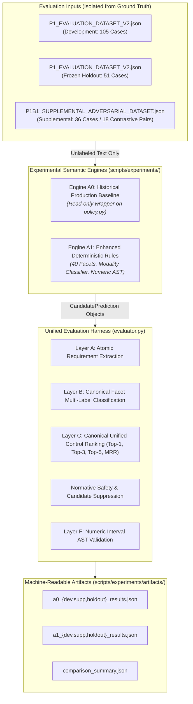

# P1B-1 Evaluation Harness Design & Multi-Layer Evaluation Architecture

**Repository:** `VivianFuVivianFu/DeepAuditCrossWalk`  
**Phase:** P1B-1 Executable Evaluation Harness, Canonical Mapping Adapter & Deterministic Baseline Experiment  
**Branch:** `research/p1b1-deterministic-experiment`  
**Status:** Approved & Executed  
**Date:** November 2026  

---

## 1. Executive Summary

Phase P1B-1 establishes the definitive experimental evaluation infrastructure for candidate semantic mapping architectures in DeepAudit Crosswalk. Prior evaluation scripts in P0 relied on fragmented proxy methods and syntactic negation heuristics that penalized valid preventive controls.

The P1B-1 Evaluation Harness implements the multi-layer mathematical contract specified in [`P1B0_REVISED_EVALUATION_CONTRACT.md`](file:///c:/Users/vivia/OneDrive/Desktop/DeepAuditCrossWalk/P1B0_REVISED_EVALUATION_CONTRACT.md). It operates strictly within a dedicated research package (`scripts/experiments/`), ensuring that **zero production assessment logic, baseline construction logic, API endpoints, or shared regulatory catalogues are modified**.



---

## 2. Standardised Prediction & Evaluation Interface

To guarantee that candidate models cannot access ground-truth labels during inference, candidate engines receive only the raw clause string and an optional tracking identifier:

```python
def extract_and_map(self, input_text: str, case_id: str = "") -> ExtractionResult:
    ...
```

### 2.1 Core Data Structures (`scripts/experiments/models.py`)

1. **`CandidatePrediction`**:
   Represents a single candidate mapping hypothesis emitted by an engine.
   - `clause_id: str`: Unique tracking ID for the clause segment.
   - `canonical_control_id: Optional[str]`: Must match one of the 33 Unified Controls in [`UNIFIED_CONTROL_LIBRARY.json`](file:///c:/Users/vivia/OneDrive/Desktop/DeepAuditCrossWalk/UNIFIED_CONTROL_LIBRARY.json), or `None` if unmapped or ambiguous.
   - `canonical_facet_id: Optional[str]`: Must match one of the 155 Unified Facets.
   - `score: float`: Confidence or ranking weight.
   - `review_status: str`: **Enforced Invariant**: Always `"proposed"`. Any candidate instantiated with `"approved"` or `"active"` raises an immediate runtime error.
   - `normative_type: Optional[str]`: Modality detected by the engine (`affirmative_obligation`, `prohibition_absolute`, etc.).
   - `is_suppressed: bool`: Flag indicating whether candidate generation was intentionally withheld.
   - `is_ambiguous: bool`: Flag indicating unresolved taxonomy ambiguity.
   - `rationale: str`: Explanatory derivation string.
   - `threshold_ast: Optional[ThresholdAST]`: Parsed numeric constraint if present.

2. **`ExtractionResult`**:
   The full output payload emitted by an engine for a single case.
   - `case_id: str`
   - `extracted_clauses: list[str]`
   - `candidate_facets: list[str]`
   - `candidate_controls: list[str]`
   - `ranked_mappings: list[CandidatePrediction]`
   - `threshold_ast: Optional[ThresholdAST]`
   - `is_suppressed: bool`
   - `detected_normative_type: Optional[str]`
   - `execution_time_ms: float`

3. **`CaseEvaluationResult`**:
   Per-case scorecard recording true positives, false positives, false negatives, ranking hits, suppression accuracy, and threshold exact matches.

---

## 3. Mathematical Metric Formulations Across Evaluation Layers

### 3.1 Layer A: Atomic Requirement Extraction
Evaluates segmentation of raw text into operative requirements.
- **Precision ($P_A$)**: Fraction of extracted segments matching valid reference requirements ($IoU \ge 0.25$).
- **Recall ($R_A$)**: Fraction of reference atomic requirements successfully captured.
- **$F1_A$**: Harmonic mean of $P_A$ and $R_A$.

### 3.2 Layer B: Canonical Facet Multi-Label Classification
Evaluates classification across the **155 Canonical UCL Facets**.
Let $N$ be the number of cases, $Y_i$ reference facets, and $\hat{Y}_i$ predicted facets:
- **Micro-Averaged Facet Precision ($P_{B,\text{micro}}$)**:
  $$P_{B,\text{micro}} = \frac{\sum_{i=1}^N |Y_i \cap \hat{Y}_i|}{\max\left(1, \sum_{i=1}^N |\hat{Y}_i|\right)}$$
- **Micro-Averaged Facet Recall ($R_{B,\text{micro}}$)**:
  $$R_{B,\text{micro}} = \frac{\sum_{i=1}^N |Y_i \cap \hat{Y}_i|}{\max\left(1, \sum_{i=1}^N |Y_i|\right)}$$
- **Micro-Averaged Facet F1 ($F1_{B,\text{micro}}$)**:
  $$F1_{B,\text{micro}} = \frac{2 \cdot P_{B,\text{micro}} \cdot R_{B,\text{micro}}}{P_{B,\text{micro}} + R_{B,\text{micro}}}$$
- **Canonical Facet Coverage Rate**:
  $$\text{Coverage Rate} = \frac{|\bigcup_{i=1}^N \hat{Y}_i|}{155}$$

### 3.3 Layer C: Canonical Unified Control Ranking & Safety
Evaluates mapping to the **33 Canonical Unified Controls**.
Let $C_i$ be reference controls and $\hat{C}_i = [\hat{c}_{i,1}, \hat{c}_{i,2}, \dots]$ be ranked candidate controls:
- **Top-1 Recall ($R_{C@1}$)**: $\frac{1}{N_{\text{ctrl}}} \sum_{i: |C_i| > 0} \mathbb{I}(\hat{c}_{i,1} \in C_i)$
- **Top-3 Recall ($R_{C@3}$)**: $\frac{1}{N_{\text{ctrl}}} \sum_{i: |C_i| > 0} \mathbb{I}(\exists j \le 3 : \hat{c}_{i,j} \in C_i)$
- **Top-5 Recall ($R_{C@5}$)**: $\frac{1}{N_{\text{ctrl}}} \sum_{i: |C_i| > 0} \mathbb{I}(\exists j \le 5 : \hat{c}_{i,j} \in C_i)$
- **Mean Reciprocal Rank (MRR)**:
  $$\text{MRR} = \frac{1}{N_{\text{ctrl}}} \sum_{i: |C_i| > 0} \frac{1}{\min \{j : \hat{c}_{i,j} \in C_i\} \cup \{\infty\}}$$

### 3.4 Normative Safety & Candidate Suppression
Replaces the defective syntactic negation metric from P1A. Evaluates whether the engine properly suppresses candidate controls on non-affirmative text:
- **Suppression Target Cases**: Cases where `expected_candidate_behavior == "must_not_generate_candidates"`.
- **Correct Suppression (True Negative)**: Engine emits 0 candidate controls and 0 candidate facets.
- **False Control Trigger (False Positive)**: Engine generates $\ge 1$ candidate control or facet on a suppressed case.
- **Suppression Accuracy**:
  $$\text{Suppression Accuracy} = \frac{\sum_{i \in \text{Suppressed}} \mathbb{I}(|\hat{C}_i| = 0)}{|\text{Suppressed Cases}|}$$
- **False Trigger Rate**:
  $$\text{False Trigger Rate} = 1.0 - \text{Suppression Accuracy}$$

### 3.5 Layer F: Numeric Interval AST Validation
For cases with numerical constraints (`threshold_constraint`):
- Exact match on parsed amount: $|\hat{a} - a^*| < 10^{-4}$
- Exact match on comparison operator: $\hat{op} == op^*$ (`>=`, `>`, `<=`, `<`, `=`)
- Accuracy: % of threshold cases meeting both criteria.

---

## 4. Stratified Slicing Architecture

The evaluation runner automatically slices results across four orthogonal dimensions:
1. **By Dataset Split**:
   - `development`: 105 synthetic reference cases.
   - `development_supplemental`: 36 synthetic contrastive adversarial cases.
   - `holdout`: 51 frozen synthetic reference cases.
2. **By Normative Class**:
   - `affirmative_obligation`
   - `prohibition_absolute`
   - `prohibition_conditional`
   - `scope_exemption`
   - `permissive_guidance`
   - `aspirational_statement`
   - `harmful_practice_prohibition`
   - `uncertain_prohibition`
3. **By Benchmark Category**:
   - `exact_match`, `synonym_paraphrase`, `adversarial_distractor`, `cross_regulatory_conflict`, `boundary_scope_edge_case`, `negation_exemption`, `contrastive_obligation`, `contrastive_prohibition`, `contrastive_exemption`, etc.
4. **By Length Tier**:
   - `short` (< 100 characters)
   - `medium` (100 – 300 characters)
   - `long` (> 300 characters)

---

## 5. Artifact Provenance & Immutability Standard

Every evaluation run executed by `scripts/experiments/run_experiments.py` records:
- **Git Commit Hash**: e.g., `65b9a08a2e31ed56cc6b7292bd463842f22ff7e4`
- **Dataset Hashes (SHA-256)**:
  - `P1_EVALUATION_DATASET_V2.json`: `3ee3241ce557b423584c9cda805f534001ed044178d465025d9c9e1ef3007569`
  - `P1B1_SUPPLEMENTAL_ADVERSARIAL_DATASET.json`: `5f164cdcb69f9034f3b7ce70fc8e84bc2257d00f682f934241e7a6ce15b74c47`
  - `UNIFIED_CONTROL_LIBRARY.json`: `d961ce0a0e6691fd97fe91b2c6e6113840742d4a69666fcf88894df623190be9`
- **Timestamp (UTC)**
- **Serialized JSON Artifacts**: Preserved in `scripts/experiments/artifacts/` for permanent auditability.
