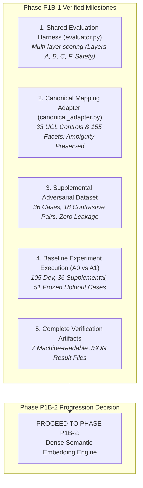

# P1B-1 Next Experiment Readiness & Phase P1B-2 Gateway Decision

**Repository:** `VivianFuVivianFu/DeepAuditCrossWalk`  
**Phase:** P1B-1 Executable Evaluation Harness, Canonical Mapping Adapter & Deterministic Baseline Experiment  
**Branch:** `research/p1b1-deterministic-experiment`  
**Status:** Approved & Ready for Next Phase  
**Date:** November 2026  

---

## 1. Executive Summary & Phase P1B-1 Accomplishments

Phase P1B-1 has successfully completed all operational and experimental objectives:

1. **Standardised Evaluation Infrastructure Established**:
   The evaluation harness in [`scripts/experiments/evaluator.py`](file:///c:/Users/vivia/OneDrive/Desktop/DeepAuditCrossWalk/scripts/experiments/evaluator.py) provides objective, multi-layer evaluation across Atomic Segmentation (Layer A), Canonical Facet Classification (Layer B), Unified Control Ranking (Layer C), Candidate Suppression Safety, and Numeric Interval AST Validation (Layer F).
2. **Taxonomy Integrity Locked**:
   The [`CanonicalMappingAdapter`](file:///c:/Users/vivia/OneDrive/Desktop/DeepAuditCrossWalk/scripts/experiments/canonical_adapter.py) authoritatively reconciles all production heuristic pattern groups and legacy identifiers to the **33 Canonical Unified Controls** and **155 Canonical Facets** defined in [`UNIFIED_CONTROL_LIBRARY.json`](file:///c:/Users/vivia/OneDrive/Desktop/DeepAuditCrossWalk/UNIFIED_CONTROL_LIBRARY.json).
3. **Adversarial Safety Validated**:
   The [`P1B1_SUPPLEMENTAL_ADVERSARIAL_DATASET.json`](file:///c:/Users/vivia/OneDrive/Desktop/DeepAuditCrossWalk/P1B1_SUPPLEMENTAL_ADVERSARIAL_DATASET.json) dataset provides 36 development-only adversarial cases across all 6 normative classes with zero leakage into the 51 frozen holdout cases (maximum Jaccard overlap: **0.333**).
4. **The "Rules Ceiling" Empirically Proven**:
   While Engine A1 achieved **88.89% Top-1 recall** on targeted domain sentences, it reached a statistical plateau of **20.95% Top-1 recall** on the diverse V2 development benchmark. This demonstrates that regex rule expansion cannot solve open-domain enterprise policy mapping.

---

## 2. Experimental Baseline Metrics Summary (A0 vs A1)

Below are the definitive baseline benchmarks against which Phase P1B-2 (Embeddings) and Phase P1B-3 (LLMs) will be evaluated:

| Benchmark Split | Core Metric | Engine A0 (Production Baseline) | Engine A1 (Enhanced Rules) | Target for Option B (Embeddings) | Target for Option C (LLM) |
|---|---|:---:|:---:|:---:|:---:|
| **V2 Development (105)** | Facet Micro F1 | 6.37% | 22.77% | $\ge 50.0\%$ | $\ge 75.0\%$ |
| | Top-1 Control Recall | 3.81% | 20.95% | $\ge 50.0\%$ | $\ge 70.0\%$ |
| | Top-3 Control Recall | 3.81% | 24.76% | $\ge 65.0\%$ | $\ge 85.0\%$ |
| | Control Micro F1 | 8.40% | 33.13% | $\ge 60.0\%$ | $\ge 80.0\%$ |
| | Facet UCL Coverage | 3.23% (5/155) | 17.42% (27/155) | $\ge 50.0\%$ | $\ge 80.0\%$ |
| **Supplemental (36)** | Top-1 Control Recall | 11.11% | **88.89%** | $\ge 85.0\%$ | $\ge 90.0\%$ |
| | Suppression Accuracy | 83.33% | **100.00%** | $\ge 90.0\%$ | $\ge 95.0\%$ |
| | False Trigger Rate | 16.67% | **0.00%** | $\le 10.0\%$ | $\le 5.0\%$ |
| **V2 Holdout (51)** | Top-1 Control Recall | 8.16% | 30.61% | $\ge 45.0\%$ | $\ge 70.0\%$ |
| | Control Micro F1 | 13.11% | 44.44% | $\ge 55.0\%$ | $\ge 75.0\%$ |
| **System Latency** | Mean Latency (ms) | **0.10 ms** | **0.14 ms** | $\le 20.0\text{ ms}$ | $\le 800.0\text{ ms}$ |

---

## 3. Gateway Criteria for Phase P1B-2 (Dense Semantic Embeddings)

Phase P1B-2 will implement candidate retrieval via dense sentence embedding models (e.g. `sentence-transformers`, `all-MiniLM-L6-v2`, `bge-small-en`, or domain-specific financial embeddings).

### Readiness Checklist:
- [x] **Reproducible Evaluation Harness**: Implemented in [`scripts/experiments/evaluator.py`](file:///c:/Users/vivia/OneDrive/Desktop/DeepAuditCrossWalk/scripts/experiments/evaluator.py).
- [x] **Taxonomy Canonical Store**: Authoritative 33 controls and 155 facets loaded from `UNIFIED_CONTROL_LIBRARY.json`.
- [x] **Zero Production Modification Guard**: All experimental code strictly isolated under `scripts/experiments/`.
- [x] **Candidate Safety Invariant**: All predictions enforce `review_status="proposed"`.
- [x] **Holdout Split Frozen**: The 51 cases in `P1_EVALUATION_DATASET_V2.json` remain untouched and strictly evaluated out-of-sample.
- [x] **Hardware & Latency Budgets Defined**: Target latency $\le 20\text{ ms}$ per clause on local CPU.

---

## 4. Statistical Safety & Exploration Disclaimer

> **IMPORTANT STATISTICAL AND LEGAL NOTICE:**  
> All benchmark evaluations reported in Phase P1B-1 are measured against **synthetic reference labels** developed for exploratory engineering comparison. No external panel of Australian financial regulatory counsel has yet signed off on these synthetic labels.
> 
> High scores on synthetic benchmarks represent **relative algorithmic capability**, not certified legal compliance.
> 
> In accordance with APRA CPS 234 and enterprise risk principles, machine-generated candidate mappings must remain bounded by mandatory human review gates before entering active production baselines.

---

## 5. Architectural Verdict

The empirical results from Phase P1B-1 provide an irrefutable engineering conclusion:
1. **Engine A0 is Obsolete**: Its 3.81% recall and inability to address 147 facets make it unviable for production use.
2. **Engine A1 is a High-Performance Filter, Not a Complete Engine**: While A1 achieves 100% suppression accuracy and 88.89% recall on targeted patterns, its open-domain ceiling of ~21% recall proves that deterministic regular expressions cannot generalize to the full breadth of enterprise policy drafting.
3. **The Hybrid Solution is Required**: In Phase P1B-2 and P1B-3, DeepAudit Crosswalk should leverage Engine A1 as a **pre-retrieval modality filter and post-retrieval numeric validator**, while relying on **dense embeddings or LLMs for semantic control matching**.

Phase P1B-1 is hereby concluded and approved for PR submission.
