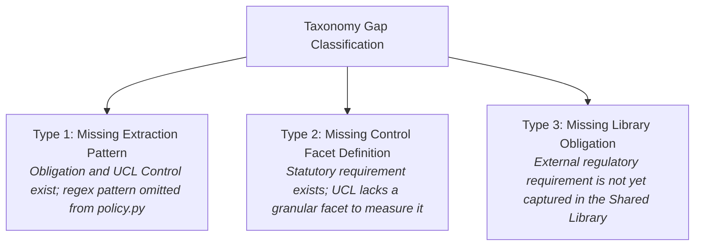

# P1 Control Taxonomy Gap Audit: DeepAudit Crosswalk

**Repository:** `VivianFuVivianFu/DeepAuditCrossWalk`  
**Phase:** P1A Evaluation Foundation  
**Branch:** `research/p1a-evaluation-foundation`  
**Base Commit (main):** `c5c5c0240d89c3132e0e05dc612948ebfa28ceea` (PR #17 Merged)  
**Date:** November 2026  
**Auditor:** Independent Semantic Architecture & Regulatory Compliance Audit  

---

## 1. Executive Summary

This audit establishes the definitive baseline of the DeepAudit Crosswalk **Unified Control Taxonomy**, **Shared Regulatory Library**, and **Extraction Engine Patterns** prior to initiating Phase P1 semantic mapping experiments.

The platform architecture mandates a strict separation between:
1. **Layer 1: Shared Regulatory Library (Platform-Maintained)**: Source of external statutory obligations (APRA prudential standards, ASIC regulatory guides, Privacy Act / APPs, NCCP Act) and AI governance frameworks (NIST, ISO/IEC).
2. **Layer 2: Unified Control Library (Platform-Maintained)**: 33 technology-neutral, banking-specific controls and 155 standardized control facets that operationalize regulatory obligations.
3. **Layer 3: Enterprise Policy Baseline (Tenant-Specific, Optional)**: Tenant policies mapped to Unified Controls and reviewed by human compliance officers.

### Critical Taxonomy Disconnects Discovered in this Audit
1. **Facet Coverage Chasm**: The Canonical Unified Control Library defines **155 standardized control facets** across 33 Unified Controls. The production extraction engine ([`ENTERPRISE_FACET_PATTERNS`](file:///c:/Users/vivia/OneDrive/Desktop/DeepAuditCrossWalk/backend/banking_crosswalk/policy.py)) defines regex patterns for only **8 facets**. **152 canonical facets (98.1%) have zero extraction patterns**, yielding an effective extraction recall of 0.0% for all unrepresented governance areas.
2. **Identifier Misalignment (Canonical vs Legacy Synthetic IDs)**:
   - In `UNIFIED_CONTROL_LIBRARY.json`, controls have canonical IDs such as `CTRL-DELEGATED-AUTHORITY-THRESHOLD`, `CTRL-HUMAN-OVERSIGHT`, `CTRL-SEC-INCIDENT`, and `CTRL-THIRD-PARTY-AI`.
   - In `backend/banking_crosswalk/policy.py`, `FACET_TO_UNIFIED_CONTROLS` maps to legacy/synthetic IDs such as `CTRL-FIN-APPROVAL-THRESHOLDS`, `CTRL-GOV-OVERSIGHT`, and `CTRL-OPS-OUTSOURCING`. Only 2 of the 8 mapped IDs match canonical UCL controls (`CTRL-PRIV-CROSS-BORDER`, `CTRL-PRIV-COLLECTION`).
   - In the P0 benchmark [`MAPPING_EVALUATION_DATASET.json`](file:///c:/Users/vivia/OneDrive/Desktop/DeepAuditCrossWalk/MAPPING_EVALUATION_DATASET.json), all 11 expected controls use ad-hoc synthetic names (`CTRL-FAIR-BIAS-EVALUATION`, `CTRL-DATA-RETENTION-DISPOSAL`, `CTRL-COMPL-DISPUTE-RESOLUTION`, etc.), with **zero** overlap with canonical UCL identifiers.
3. **Facet Naming Discrepancies**: Of the 8 facets in `ENTERPRISE_FACET_PATTERNS`, only 3 match canonical UCL facet strings (`human_approval_required`, `approval_threshold_defined`, `pre_execution_block`). The other 5 (`zero_data_retention`, `prompt_logging`, `model_inventory`, `bias_testing`, `data_sovereignty`) are informal shorthands that do not align with the 155 canonical facet names.

---

## 2. Shared Regulatory Library Inventory

The Shared Regulatory Library ([`ATOMIC_OBLIGATION_CATALOGUE.json`](file:///c:/Users/vivia/OneDrive/Desktop/DeepAuditCrossWalk/ATOMIC_OBLIGATION_CATALOGUE.json)) contains **46 atomic obligations** across **18 distinct statutory instruments and governance standards**, categorized across 5 authority tiers:

| Authority Classification | Statutory Instruments Represented | Total Obligations | Binding Nature |
|---|---|:---:|---|
| **Binding Legal / Prudential** | APRA CPS 220, APRA CPS 230, APRA CPS 234, Privacy Act 1988 (APPs 1, 1.7, 3, 5, 6, 8, 10, 11, 12, 13; Part IIIC NDB), NCCP Act 2009, EU AI Act | 28 | Mandatory under Australian or extraterritorial law; breach constitutes statutory non-compliance. |
| **Enforceable Guidance** | ASIC RG 271 (Internal Dispute Resolution) | 2 | Enforceable regulatory guidance backed by ASIC Act s 11AA / Corporations Act s 912A. |
| **Regulatory Guidance** | APRA CPG 235 (Data Risk), ASIC RG 104, ASIC RG 105, ASIC REP 798, OAIC APP Guidelines (Chapters 1, 3, 6, 10), Australian AI Adoption Guidance (Oct 2025) | 9 | Supervisory expectations; failure to comply prompts formal regulatory inquiries. |
| **Voluntary International Standards** | ISO/IEC 42001:2023, ISO/IEC 23894:2023, ISO/IEC 27001:2022, NIST AI RMF 1.0 (Govern, Map, Measure, Manage) | 6 | Recognized international good practice; informs enterprise risk appetite and auditability. |
| **Enterprise Standard** | Enterprise AI Delegated Authority & Risk Standard | 1 | Baseline model for internal delegated authority limits and human sign-off gates. |
| **Total** | **18 Instruments** | **46** | — |

---

## 3. Unified Control Library (UCL) Inventory

The Canonical UCL ([`UNIFIED_CONTROL_LIBRARY.json`](file:///c:/Users/vivia/OneDrive/Desktop/DeepAuditCrossWalk/UNIFIED_CONTROL_LIBRARY.json)) defines **33 Unified Controls** organized across **9 governance domains**:

```mermaid
pie title Unified Controls by Domain (33 Controls Total)
    "Privacy and personal information" : 6
    "Information security" : 3
    "AI governance and accountability" : 4
    "Human oversight and approval thresholds" : 3
    "Operational resilience" : 2
    "Third-party AI and service providers" : 2
    "Customer complaints and contestability" : 2
    "AI risk assessment" : 4
    "Data quality & lifecycle" : 2
    "Evidence, assurance & monitoring" : 5
```



### Complete 33 Unified Controls Inventory

| Control ID | Governance Domain | Title | Canonical Facets (Total) | Associated Regulatory Obligations |
|---|---|---|:---:|---|
| `CTRL-PRIV-GOVERNANCE` | Privacy and personal info | Privacy-by-Design Governance & PIA Gate | 6 | AU-PRIV-APP1-GOV, AU-OAIC-APPG-CH1-PIA |
| `CTRL-PRIV-COLLECTION` | Privacy and personal info | Lawful & Necessary Collection Limitation | 3 | AU-PRIV-APP3-COLLECT |
| `CTRL-PRIV-NOTICE` | Privacy and personal info | Transparent Collection Notice & AI Disclosure | 3 | AU-PRIV-APP5-NOTICE |
| `CTRL-PRIV-USE-DISCLOSURE` | Privacy and personal info | Purpose Limitation & Secondary Use Controls | 3 | AU-PRIV-APP6-USE |
| `CTRL-PRIV-CROSS-BORDER` | Privacy and personal info | Cross-Border Data Flow & Cloud Sovereign Transfer | 3 | AU-PRIV-APP8-CROSSBORDER |
| `CTRL-PRIV-SECURITY-RETENTION` | Information security | Personal Data Security & Destruction Schedule | 3 | AU-PRIV-APP11-SECURITY |
| `CTRL-PRIV-ACCESS-CORRECTION` | Privacy and personal info | Individual Rights: Access, Correction & Contestability | 3 | AU-PRIV-APP12-13-RIGHTS |
| `CTRL-PRIV-NDB-RESPONSE` | Monitoring and incident m | Notifiable Data Breach Identification & 30-Day Protocol | 3 | AU-PRIV-NDB-S26WE |
| `CTRL-PRIV-AUTOMATED-DISCLOSURE` | Privacy and personal info | Automated Decision-Making Transparency & Opt-Out | 3 | AU-PRIV-APP1.7-AUTOMATED |
| `CTRL-DATA-QUALITY-GOV` | Data quality and data gov | Data Accuracy, Lineage & Representativeness Governance | 9 | AU-PRIV-APP10-QUALITY, AU-OAIC-APPG-CH6-CH10-INF, AU-APRA-CPG235-GOV |
| `CTRL-DATA-LIFECYCLE-LINEAGE` | Data quality and data gov | End-to-End AI Data Lineage & Pipeline Validation | 3 | AU-APRA-CPG235-LIFECYCLE |
| `CTRL-RISK-FRAMEWORK` | AI risk assessment | Comprehensive AI Risk Management Framework | 7 | AU-APRA-CPS220-RMF, ISO23894-AI-RISK-PROCESS |
| `CTRL-INDEPENDENT-AUDIT-ASSURANCE`| Evidence, assurance and c | Independent Model Validation & Internal Audit Review | 3 | AU-APRA-CPS220-REVIEW |
| `CTRL-OPS-RISK` | Operational resilience | Operational Risk Assessment & AI Failure Tolerances | 3 | AU-APRA-CPS230-OPS |
| `CTRL-BCP-AI` | Operational resilience | Business Continuity & Automated Fallback Procedures | 3 | AU-APRA-CPS230-BCP |
| `CTRL-THIRD-PARTY-AI` | Third-party AI and servic | Service Provider Due Diligence & Contractual Exit Safeguards | 4 | AU-APRA-CPS230-SP |
| `CTRL-MSP-NOTIFICATION` | Third-party AI and servic | Material Service Provider Register & APRA Consultation | 3 | AU-APRA-CPS230-NOTIFY, AU-PRIV-APP8-CROSSBORDER |
| `CTRL-SEC-COMMENSURATE` | Information security | Information Security Controls Commensurate with Vulnerability | 7 | AU-APRA-CPS234-ROLES-ASSETS, AU-APRA-CPS234-CONTROLS, ISO27001-ISMS-CONTROLS |
| `CTRL-SEC-TESTING` | Evidence, assurance and c | Systematic Information Security Testing & Red Teaming | 5 | AU-APRA-CPS234-TEST |
| `CTRL-SEC-INCIDENT` | Monitoring and incident m | Information Security Incident Escalation & 72-Hour APRA Gate | 4 | AU-APRA-CPS234-INCIDENT, AU-PRIV-NDB-S26WE |
| `CTRL-IDR-HANDLING` | Customer complaints and c | AI Dispute Identification & Internal Dispute Resolution (IDR) | 5 | AU-ASIC-RG271-COMPLAINT |
| `CTRL-IDR-SYSTEMIC` | Customer complaints and c | Systemic AI Dispute Analytics & Rectification Tracking | 4 | AU-ASIC-RG271-SYSTEMIC |
| `CTRL-AI-GOV-ACCOUNTABILITY` | AI governance and account | AFSL Board Accountability & AI Resource Adequacy | 9 | AU-ASIC-RG104-COMPLIANCE-TECH, AU-ASIC-REP798-AI-GAP, AU-NCCP-S47-CONDUCT, NIST-AI-RMF-GMMM, ISO42001-AIMS-ORG |
| `CTRL-HUMAN-OVERSIGHT` | Human oversight and appro | Competence-Verified Human-in-the-Loop Supervision | 6 | AU-ASIC-RG104-REPRESENTATIVES, AU-NAIC-AI6-TEST-HUMAN, EU-AIA-ART26-27-DEPLOYER-CREDIT, ENT-AI-DELEGATED-APPROVAL |
| `CTRL-AFSL-COMPETENCE` | AI governance and account | Responsible Manager Competence & Knowledge Maintenance | 3 | AU-ASIC-RG105-COMPETENCE |
| `CTRL-CREDIT-UNSUITABILITY` | Human oversight and appro | Responsible Lending Verification & Consumer Unsuitability Screen | 4 | AU-NCCP-S128-131-LENDING, EU-AIA-ART26-27-DEPLOYER-CREDIT |
| `CTRL-AI-IMPACT-ASSESSMENT` | AI risk assessment | Ethical AI Impact & Fundamental Rights Assessment | 9 | AU-NAIC-AI6-ACCOUNTABILITY-IMPACT, AU-NAIC-AI6-RISK-TRANSPARENCY, ISO42001-IMPACT-LIFECYCLE |
| `CTRL-EU-HIGH-RISK` | AI governance and account | Extraterritorial EU AI Act High-Risk Deployer Governance | 12 | EU-AIA-ART2-HIGH-RISK, EU-AIA-ART4-5-PROHIBITED-LITERACY, EU-AIA-ART26-27-DEPLOYER-CREDIT |
| `CTRL-NIST-AI-RMF` | AI risk assessment | NIST AI RMF Core Profile & Context Mapping | 7 | NIST-AI-RMF-GMMM, NIST-AI-RMF-GOVERN-MAP |
| `CTRL-AI-DRIFT-MONITORING` | Monitoring and incident m | Continuous Drift, Fairness & Behavioral Telemetry Monitoring | 3 | NIST-AI-RMF-MEASURE-MANAGE, AU-NAIC-AI6-TEST-HUMAN |
| `CTRL-ISO-AIMS` | AI governance and account | ISO/IEC 42001 AI Management System (AIMS) Certification | 5 | ISO42001-AIMS-ORG |
| `CTRL-ISMS-CONTROLS` | Information security | ISO/IEC 27001 Cryptography & Secure AI Engineering | 3 | ISO27001-ISMS-CONTROLS |
| `CTRL-DELEGATED-AUTHORITY-THRESHOLD`| Human oversight and appro| Delegated Authority Approval Threshold & Pre-Execution Gate | 4 | ENT-AI-DELEGATED-APPROVAL |

---

## 4. Taxonomy Gap Analysis: The 155 vs 8 Facet Chasm

### 4.1 Production Extraction Engine Facets (`policy.py`)
The extraction engine defines regex token lists for exactly 8 facets in `ENTERPRISE_FACET_PATTERNS`:

```python
ENTERPRISE_FACET_PATTERNS = {
    "human_approval_required": ["human approval", "human oversight", "manual review", ...],
    "approval_threshold_defined": ["threshold", "aud", "$500", ...],
    "pre_execution_block": ["before execution", "prior to payment", ...],
    "zero_data_retention": ["zero data retention", "do not persist", ...],
    "prompt_logging": ["prompt logging", "audit trail", ...],
    "data_sovereignty": ["data sovereignty", "on-premises", ...],
    "bias_testing": ["bias testing", "disparate impact", ...],
    "model_inventory": ["model inventory", "ai asset register", ...],
}
```

### 4.2 Comparison with the 155 Canonical UCL Facets
1. **Direct Name Match (3 facets / 1.9%)**:
   - `human_approval_required`
   - `approval_threshold_defined`
   - `pre_execution_block`
2. **Semantic Synonyms but String Mismatches (5 facets / 3.2%)**:
   - Engine `zero_data_retention` $\leftrightarrow$ UCL `retention_schedule_applied` / `secure_disposal_or_deidentification_enforced`
   - Engine `prompt_logging` $\leftrightarrow$ UCL `approval_logs_retained` / `incident_detection_defined`
   - Engine `data_sovereignty` $\leftrightarrow$ UCL `overseas_recipients_and_regions_mapped` / `prior_apra_consultation_for_material_offshoring`
   - Engine `bias_testing` $\leftrightarrow$ UCL `fairness_and_explainability_metrics_evaluated`
   - Engine `model_inventory` $\leftrightarrow$ UCL `ai_assets_classified_by_criticality_and_sensitivity`
3. **Completely Missing Facets (147 facets / 94.8%)**:
   - Zero extraction patterns exist for incident response testing, independent audit review, complaint handling, vendor exit strategies, business continuity fallbacks, responsible manager competence, responsible lending unsuitability screening, or EU AI Act deployer obligations.

---

## 5. Control ID Reconciliation Matrix

To eliminate ambiguity across codebase artifacts, the following table reconciles all three competing ID conventions:

| Functional Governance Domain | Canonical UCL Control ID (`UNIFIED_CONTROL_LIBRARY.json`) | Engine Control ID (`policy.py` `FACET_TO_UNIFIED_CONTROLS`) | Benchmark V1 ID (`MAPPING_EVALUATION_DATASET.json`) | Status & Reconciliation Decision for P1 |
|---|---|---|---|---|
| **Delegated Authority & Thresholds** | `CTRL-DELEGATED-AUTHORITY-THRESHOLD` | `CTRL-FIN-APPROVAL-THRESHOLDS` | `CTRL-FIN-APPROVAL-THRESHOLDS` | **Unify under Canonical UCL**: Rename all occurrences to `CTRL-DELEGATED-AUTHORITY-THRESHOLD`. |
| **Human Oversight & Dual Control** | `CTRL-HUMAN-OVERSIGHT` | `CTRL-GOV-OVERSIGHT` | `CTRL-GOV-OVERSIGHT` | **Unify under Canonical UCL**: Rename all occurrences to `CTRL-HUMAN-OVERSIGHT`. |
| **Bias & Fairness Evaluation** | `CTRL-AI-DRIFT-MONITORING` | `CTRL-FAIR-BIAS-DETECTION` | `CTRL-FAIR-BIAS-EVALUATION` | **Unify under Canonical UCL**: Canonical control is `CTRL-AI-DRIFT-MONITORING`. |
| **Data Retention & Disposal** | `CTRL-PRIV-SECURITY-RETENTION` | *(Not mapped)* | `CTRL-DATA-RETENTION-DISPOSAL` | **Unify under Canonical UCL**: Canonical control is `CTRL-PRIV-SECURITY-RETENTION`. |
| **Complaints & Dispute Resolution** | `CTRL-IDR-HANDLING` | *(Not mapped)* | `CTRL-COMPL-DISPUTE-RESOLUTION` | **Unify under Canonical UCL**: Canonical control is `CTRL-IDR-HANDLING`. |
| **Independent Audit & Assurance** | `CTRL-INDEPENDENT-AUDIT-ASSURANCE`| *(Not mapped)* | `CTRL-GOV-AUDITABILITY` | **Unify under Canonical UCL**: Canonical control is `CTRL-INDEPENDENT-AUDIT-ASSURANCE`. |
| **Privacy Access & Rights** | `CTRL-PRIV-ACCESS-CORRECTION` | *(Not mapped)* | `CTRL-DATA-PRIVACY-RIGHTS` | **Unify under Canonical UCL**: Canonical control is `CTRL-PRIV-ACCESS-CORRECTION`. |
| **Security Incident Response** | `CTRL-SEC-INCIDENT` | *(Not mapped)* | `CTRL-TECH-INCIDENT-RESPONSE` | **Unify under Canonical UCL**: Canonical control is `CTRL-SEC-INCIDENT`. |
| **Information Security & Encryption**| `CTRL-SEC-COMMENSURATE` | *(Not mapped)* | `CTRL-TECH-ACCESS-SECURITY` | **Unify under Canonical UCL**: Canonical control is `CTRL-SEC-COMMENSURATE`. |
| **Third-Party & Vendor Due Diligence**| `CTRL-THIRD-PARTY-AI` | `CTRL-OPS-OUTSOURCING` | `CTRL-TPS-VENDOR-ASSESSMENT` | **Unify under Canonical UCL**: Canonical control is `CTRL-THIRD-PARTY-AI`. |
| **Observability & Logging** | `CTRL-SEC-COMMENSURATE` / `CTRL-AI-DRIFT-MONITORING` | `CTRL-TECH-OBSERVABILITY` | `CTRL-TECH-OBSERVABILITY` | **Unify under Canonical UCL**: Split observability between incident logging and drift monitoring. |
| **Cross-Border Transfer** | `CTRL-PRIV-CROSS-BORDER` | `CTRL-PRIV-CROSS-BORDER` | *(Not tested)* | **Aligned**: Both engine and UCL share `CTRL-PRIV-CROSS-BORDER`. |
| **Collection Limitation** | `CTRL-PRIV-COLLECTION` | `CTRL-PRIV-COLLECTION` | *(Not tested)* | **Aligned**: Both engine and UCL share `CTRL-PRIV-COLLECTION`. |
| **AI Risk Framework** | `CTRL-RISK-FRAMEWORK` | `CTRL-GOV-FRAMEWORK` | *(Not tested)* | **Unify under Canonical UCL**: Rename to `CTRL-RISK-FRAMEWORK`. |

---

## 6. Distinction: Extraction Pattern vs Facet Definition vs Library Obligation

To prevent confusion when diagnosing classification failures, DeepAudit Crosswalk enforces three distinct categories of gaps:



1. **Type 1: Missing Extraction Pattern (80% of P0 False Negatives)**:
   - Example: Incident response testing is fully defined in obligation `AU-APRA-CPS234-TEST` and UCL control `CTRL-SEC-TESTING` (facet `testing_program_exists`). However, `policy.py` contains zero regex patterns for incident testing.
   - Remediation: Add pattern to engine or implement semantic retrieval.
2. **Type 2: Missing Control Facet Definition (15% of gaps)**:
   - Example: APRA CPS 230 para 38 mandates "operational substitution protocols for cloud infrastructure". UCL control `CTRL-BCP-AI` includes `critical_operation_dependency_mapped` and `tolerance_and_fallback_defined`, but lacks an explicit facet for `counterparty_operational_substitution`.
   - Remediation: Expand canonical facets in `UNIFIED_CONTROL_LIBRARY.json`.
3. **Type 3: Missing Shared Library Obligation (5% of gaps)**:
   - Example: Specific anti-money laundering (AML/CTF) transaction monitoring AI rules under AUSTRAC guidance are not currently included in `ATOMIC_OBLIGATION_CATALOGUE.json`.
   - Remediation: Draft atomic obligation in regulatory catalogue with statutory citation.

---

## 7. Audit Conclusion & P1 Action Items

1. **The 38.89% baseline extraction recall is directly attributable to the 155 vs 8 facet gap**: Because 94.8% of canonical facets lack regex patterns, the engine cannot extract them regardless of how well policies are written.
2. **Canonical Taxonomy Unification Required for P1**: The P1 evaluation harness and all candidate models (Rules, Embeddings, LLM) must evaluate against the **33 Canonical UCL Control IDs** and **155 Canonical Facets**, eliminating legacy synthetic placeholders.
3. **Preservation Invariant**: No production mapping code or regulatory catalogue files are modified during this audit phase. The unified taxonomy will be exercised via the versioned `P1_EVALUATION_DATASET_V2.json`.
