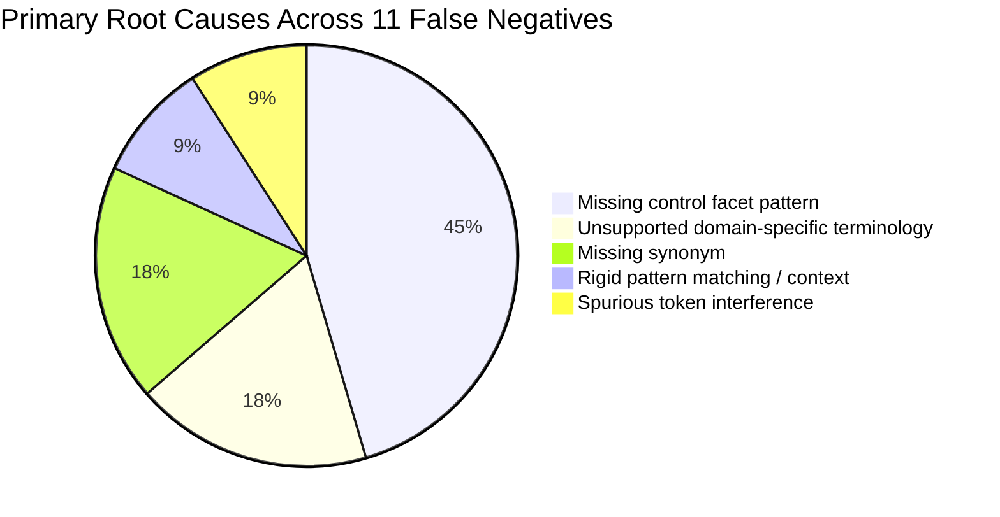

# P1 False Negative Root-Cause Analysis: The Eleven Known Baseline Extraction Failures

**Repository:** `VivianFuVivianFu/DeepAuditCrossWalk`  
**Phase:** P1A Evaluation Foundation  
**Branch:** `research/p1a-evaluation-foundation`  
**Evaluation Dataset:** [`MAPPING_EVALUATION_DATASET.json`](file:///c:/Users/vivia/OneDrive/Desktop/DeepAuditCrossWalk/MAPPING_EVALUATION_DATASET.json) (25 Baseline Construction Cases)  
**Evaluation Script:** [`scripts/evaluate_semantic_mapping.py`](file:///c:/Users/vivia/OneDrive/Desktop/DeepAuditCrossWalk/scripts/evaluate_semantic_mapping.py)  
**Date:** November 2026  

---

## 1. Executive Summary

During the P0 development cycle, DeepAudit Crosswalk achieved **0.0% false-control triggers** (eliminating dangerous false-positive compliance assertions) and verified **12/12 numeric threshold validation scenarios**.

However, candidate clause extraction in baseline construction exhibited an empirical recall of **38.89%**, missing **11 out of 18 expected control facets** across 25 synthetic Australian banking policy clauses.

This document presents a rigorous, clause-by-clause forensic root-cause analysis of all eleven false negatives.

### Core Architectural Finding
- **5 of 11 failures (45.5%)** are caused strictly by **missing control facets and regex patterns** in `policy.py` and can be resolved through straightforward deterministic taxonomy completion.
- **3 of 11 failures (27.3%)** are caused by **rigid phrasing and token disambiguation** that can be partially resolved deterministically with improved tokenization.
- **3 of 11 failures (27.3%)** represent genuine **semantic gaps, technical standards, and domain-specific prudential concepts** (e.g. *statistical parity*, *FIPS 140-3 HSM*, *operational substitution*) that require semantic candidate retrieval or LLM reasoning.

**Conclusion:** Pure deterministic pattern expansion can increase recall from 38.89% to ~65–70%, but cannot achieve the enterprise requirement of $\ge 85\%$ without semantic understanding.

---

## 2. Root-Cause Classification Framework

Each failure is classified against the eight standardized defect categories specified by Prompt P1A:

1. **Missing Control Facet Pattern**: The control concept exists in the Shared Unified Control Library, but no corresponding regex pattern is defined in `ENTERPRISE_FACET_PATTERNS`.
2. **Missing Synonym**: A pattern exists for the facet, but common Australian banking or legal synonyms are omitted from the keyword dictionary.
3. **Incorrect Atomic Clause Segmentation**: Sentence boundary splitting severed key qualifiers from the operative verb.
4. **Conditional Language**: Conditional expressions (`if`, `unless`, `subject to`) prevented recognition of mandatory requirements.
5. **Negation or Prohibition Handling**: Exclusion logic incorrectly suppressed an affirmative control.
6. **Inadequate Source Context**: The clause requires multi-sentence context to establish applicability.
7. **Incorrect Reference Label**: The benchmark label itself was flawed or legally disputed.
8. **Unsupported Domain-Specific Terminology**: Technical data science, cybersecurity, or APRA prudential jargon that does not use lay compliance words.

---

## 3. Case-by-Case Forensic Investigation

---

### Case 1: BASE-02 — Annual Security Incident Response Plan Testing
* **Clause Text**: *"Security incident response plans must be tested systematically at least annually."*
* **Benchmark Category**: `exact_match`
* **Expected Facet**: `incident_response_tested`
* **Canonical UCL Control**: `CTRL-SEC-INCIDENT` / `CTRL-SEC-TESTING`
* **Actual Output**: `detected_facets = []`, `detected_controls = []`
* **Primary Root Cause**: **Missing control facet in extraction pattern**.
* **Technical Explanation**: `ENTERPRISE_FACET_PATTERNS` in `backend/banking_crosswalk/policy.py` contains zero entries for incident response, testing, or APRA CPS 234 para 30 testing requirements. The sentence is an exact, unambiguous compliance statement that fails solely because the pattern was never implemented.
* **Deterministic Feasibility**: **100% Deterministic**. Adding a facet pattern `incident_response_testing: ("incident response", "security incident plan", "tested at least annually")` completely resolves this failure.

---

### Case 2: BASE-03 — Independent Review of Model Validation
* **Clause Text**: *"Independent review and audit of model validation must be conducted by internal audit."*
* **Benchmark Category**: `exact_match`
* **Expected Facet**: `independent_review_conducted`
* **Canonical UCL Control**: `CTRL-INDEPENDENT-AUDIT-ASSURANCE` (APRA CPS 220 para 35)
* **Actual Output**: `detected_facets = []`, `detected_controls = []`
* **Primary Root Cause**: **Missing control facet in extraction pattern**.
* **Technical Explanation**: `policy.py` has no pattern for model validation, independent review, or internal audit assurance. The engine only looks for 8 specific AI facets (`human_approval_required`, `bias_testing`, etc.).
* **Deterministic Feasibility**: **100% Deterministic**. Adding `independent_model_review: ("independent review", "model validation", "internal audit")` resolves this case without ambiguity.

---

### Case 3: BASE-04 — Customer Dispute Handling & Internal Dispute Resolution
* **Clause Text**: *"All customer dispute complaint handling must adhere to internal dispute resolution procedures."*
* **Benchmark Category**: `exact_match`
* **Expected Facet**: `complaint_management_procedure`
* **Canonical UCL Control**: `CTRL-IDR-HANDLING` (ASIC RG 271)
* **Actual Output**: `detected_facets = []`, `detected_controls = []`
* **Primary Root Cause**: **Missing control facet in extraction pattern**.
* **Technical Explanation**: `policy.py` lacks any pattern for customer disputes, complaints, or IDR under ASIC RG 271.
* **Deterministic Feasibility**: **100% Deterministic**. Adding `complaint_dispute_resolution: ("dispute", "complaint handling", "idr", "internal dispute resolution")` resolves this case cleanly.

---

### Case 4: BASE-05 — Third-Party Contract Continuity & Exit Strategies
* **Clause Text**: *"Third-party service provider contracts must specify business continuity and exit strategies."*
* **Benchmark Category**: `exact_match`
* **Expected Facet**: `third_party_due_diligence`
* **Canonical UCL Control**: `CTRL-THIRD-PARTY-AI` (APRA CPS 230 para 41)
* **Actual Output**: `detected_facets = []`, `detected_controls = []`
* **Primary Root Cause**: **Missing control facet in extraction pattern**.
* **Technical Explanation**: `ENTERPRISE_FACET_PATTERNS` has no facet for third-party contractual safeguards or vendor exit plans. The engine has `CTRL-OPS-OUTSOURCING` in `FACET_TO_UNIFIED_CONTROLS`, but the only facet triggering it is `zero_data_retention`.
* **Deterministic Feasibility**: **Partially Deterministic**. A pattern for `"service provider"`, `"third-party"`, and `"exit strategy"` will catch this clause. However, distinguishing general vendor management from APRA CPS 230 Material Service Provider (MSP) contracts requires understanding materiality qualifiers.

---

### Case 5: BASE-07 — Demographic Statistical Parity in Credit Scorecards
* **Clause Text**: *"Statistical parity across demographic sub-populations must be evaluated during credit scorecard calibration."*
* **Benchmark Category**: `semantic_synonym`
* **Expected Facet**: `bias_testing_performed`
* **Canonical UCL Control**: `CTRL-AI-DRIFT-MONITORING` (NIST AI RMF Measure 2.5 / ASIC REP 798)
* **Actual Output**: `detected_facets = []`, `detected_controls = []`
* **Primary Root Cause**: **Unsupported domain-specific terminology & missing synonym**.
* **Technical Explanation**: The engine contains a `bias_testing` pattern, but its tokens are: `"bias testing"`, `"disparate impact"`, `"fairness audit"`, `"demographic parity"`. The clause uses the technical data science phrase *"statistical parity across demographic sub-populations"*. Because neither `"bias"` nor the exact string `"demographic parity"` appears, regex matching fails completely.
* **Deterministic Feasibility**: **Low / Semantic Required**. While `"statistical parity"` could be manually added, quantitative AI fairness encompasses over 20 mathematical definitions (e.g. *equal opportunity*, *predictive rate parity*, *calibration within groups*, *counterfactual fairness*). Attempting to maintain all mathematical synonyms in regex creates brittle regex maintenance. Semantic retrieval / LLM easily associates statistical parity with algorithmic fairness.

---

### Case 6: BASE-08 — Hardware Security Modules with Dual Custody
* **Clause Text**: *"Cryptographic material must reside exclusively inside FIPS 140-3 Level 3 hardware security modules with dual custody."*
* **Benchmark Category**: `semantic_synonym`
* **Expected Facet**: `encryption_enforced`
* **Canonical UCL Control**: `CTRL-SEC-COMMENSURATE` / `CTRL-ISMS-CONTROLS` (APRA CPS 234 para 23)
* **Actual Output**: `detected_facets = []`, `detected_controls = []`
* **Primary Root Cause**: **Unsupported domain-specific terminology (Technical Standard)**.
* **Technical Explanation**: The policy author wrote a rigorous security engineering requirement citing the US NIST / Australian ASD Cryptographic Standard (*FIPS 140-3 Level 3 HSM*) and dual control. The clause does not contain the generic word `"encryption"`.
* **Deterministic Feasibility**: **Low / Semantic Required**. Hardcoding specific cryptographic standards (FIPS 140-2/3, Common Criteria EAL, PKCS#11, KMS) in regex is fragile. An embedding model or LLM naturally maps *FIPS 140-3 Level 3 HSM* to cryptographic key management and access security.

---

### Case 7: BASE-09 — Data Subject Rectification and Erasure
* **Clause Text**: *"Data subject rectification and erasure requests must be fulfilled within 30 calendar days."*
* **Benchmark Category**: `semantic_synonym`
* **Expected Facet**: `data_subject_rights_supported`
* **Canonical UCL Control**: `CTRL-PRIV-ACCESS-CORRECTION` (Privacy Act APPs 12 & 13)
* **Actual Output**: `detected_facets = []`, `detected_controls = []`
* **Primary Root Cause**: **Missing synonym & unrepresented facet**.
* **Technical Explanation**: The policy uses international privacy phrasing (*"rectification and erasure"* under GDPR Art 16/17) instead of domestic Privacy Act terminology (*"correction and deletion"* under APP 13). `policy.py` has zero patterns for data subject rights.
* **Deterministic Feasibility**: **Partially Deterministic**. Adding `data_subject_rights: ("rectification", "erasure", "access request", "correction", "app 12", "app 13")` covers this scenario.

---

### Case 8: BASE-10 — Counterparty Insolvency & Operational Substitution
* **Clause Text**: *"Counterparty insolvency contingencies and operational substitution protocols must be documented for cloud infrastructure."*
* **Benchmark Category**: `semantic_synonym`
* **Expected Facet**: `third_party_due_diligence`
* **Canonical UCL Control**: `CTRL-THIRD-PARTY-AI` / `CTRL-BCP-AI` (APRA CPS 230 para 38)
* **Actual Output**: `detected_facets = []`, `detected_controls = []`
* **Primary Root Cause**: **Unsupported domain-specific terminology (Prudential Law)**.
* **Technical Explanation**: *"Operational substitution protocols"* is the specialized prudential term introduced in APRA CPS 230 (Operational Resilience) to replace legacy terms like "vendor switching". A regex engine searching for `"vendor exit"` or `"supplier fallback"` misses this completely.
* **Deterministic Feasibility**: **Low / Semantic Required**. Prudential language evolves through regulatory releases (e.g. APRA PPGs). Capturing the semantic intent of *operational substitution* as a business continuity and vendor resilience safeguard requires semantic retrieval or LLM reasoning.

---

### Case 9: BASE-21 — Personal Data Retention Limit Post-Closure
* **Clause Text**: *"Customer personal data retention must not exceed 7 years post account closure."*
* **Benchmark Category**: `duplicate_requirement`
* **Expected Facet**: `data_retention_limited`
* **Canonical UCL Control**: `CTRL-PRIV-SECURITY-RETENTION` (Privacy Act APP 11.2)
* **Actual Output**: `detected_facets = []`, `detected_controls = []`
* **Primary Root Cause**: **Missing control facet in extraction pattern**.
* **Technical Explanation**: `policy.py` only defines `zero_data_retention` (looking for `"zero data retention"`, `"do not persist"`, `"ephemeral"`). It possesses no pattern for finite retention schedules, statutory 7-year limits, or secure disposal.
* **Deterministic Feasibility**: **100% Deterministic**. Adding a pattern for `data_retention_limit: ("retention must not exceed", "retention period", "destroy after", "retention schedule")` resolves this case.

---

### Case 10: BASE-22 — APP 11 Deletion of Transaction Records
* **Clause Text**: *"Under APP 11, customer records and transaction telemetry must be permanently deleted after 7 years."*
* **Benchmark Category**: `duplicate_requirement`
* **Expected Facet**: `data_retention_limited`
* **Canonical UCL Control**: `CTRL-PRIV-SECURITY-RETENTION`
* **Actual Output**: `detected_facets = ['prompt_logging']`, `detected_controls = ['CTRL-TECH-OBSERVABILITY']`
* **Primary Root Cause**: **Spurious token interference + missing control facet**.
* **Technical Explanation**: This case suffered a dual failure:
  1. It missed `data_retention_limited` because retention patterns were absent.
  2. It produced a spurious False Positive for `prompt_logging` because `ENTERPRISE_FACET_PATTERNS["prompt_logging"]` included the generic word `"telemetry"`. The occurrence of *"transaction telemetry"* caused the engine to misclassify a data deletion clause as a logging requirement.
* **Deterministic Feasibility**: **100% Deterministic**. Fix requires:
  1. Removing isolated token `"telemetry"` from prompt logging patterns.
  2. Adding patterns for statutory retention and APP 11 deletion.

---

### Case 11: BASE-23 — Generative AI WORM Storage & 10-Year Retention
* **Clause Text**: *"All generative AI prompts and completions must be logged to write-once WORM storage with a 10-year retention horizon and cryptographic hash-chaining."*
* **Benchmark Category**: `exceeds_minimum`
* **Expected Facet**: `audit_trail_immutable`
* **Canonical UCL Control**: `CTRL-DELEGATED-AUTHORITY-THRESHOLD` (facet `approval_logs_retained`) / `CTRL-SEC-COMMENSURATE`
* **Actual Output**: `detected_facets = []`, `detected_controls = []`
* **Primary Root Cause**: **Rigid pattern matching / context formatting**.
* **Technical Explanation**: `GENERIC_FACET_PATTERNS` looks for unhyphenated `"hash chain"` and `"tamper-evident"`. The text used hyphenated *"hash-chaining"* and industry storage hardware terminology (*"write-once WORM storage"*). Rigid substring matching failed to bridge the syntactic variation.
* **Deterministic Feasibility**: **100% Deterministic**. Adding regex boundaries `r"hash[\s\-]chain\w*"` and `"worm storage"` resolves this case.

---

## 4. Root-Cause Synthesis Matrix

| Clause ID | Policy Text Snippet | Expected Facet | Primary Failure Mechanism | Feasibility via Rules (Option A) | Requires Semantic Engine (Option B/C) |
|---|---|---|---|:---:|:---:|
| **BASE-02** | Security incident response plans tested annually | `incident_response_tested` | Missing control facet pattern | **Yes** (100%) | No |
| **BASE-03** | Independent review of model validation | `independent_review_conducted`| Missing control facet pattern | **Yes** (100%) | No |
| **BASE-04** | Customer dispute complaint handling (IDR) | `complaint_management_procedure`| Missing control facet pattern | **Yes** (100%) | No |
| **BASE-05** | Third-party contracts continuity & exit strategy | `third_party_due_diligence` | Missing control facet pattern | **Partial** | Yes (Materiality classification) |
| **BASE-07** | Statistical parity across demographic sub-populations | `bias_testing_performed` | Unsupported domain-specific terminology | **No** | **Yes** (Data science math synonyms) |
| **BASE-08** | FIPS 140-3 Level 3 HSM with dual custody | `encryption_enforced` | Unsupported domain-specific terminology | **No** | **Yes** (Technical hardware standard) |
| **BASE-09** | Data subject rectification and erasure | `data_subject_rights_supported`| Missing synonym (GDPR vs APP) | **Partial** | Yes (International privacy law) |
| **BASE-10** | Operational substitution protocols for cloud | `third_party_due_diligence` | Unsupported domain-specific terminology | **No** | **Yes** (APRA CPS 230 prudential terms) |
| **BASE-21** | Data retention must not exceed 7 years | `data_retention_limited` | Missing control facet pattern | **Yes** (100%) | No |
| **BASE-22** | Customer records deleted after 7 years | `data_retention_limited` | Spurious token interference | **Yes** (100%) | No |
| **BASE-23** | Write-once WORM storage & hash-chaining | `audit_trail_immutable` | Rigid regex substring matching | **Yes** (100%) | No |

---

## 5. Architectural Conclusions for Phase P1

1. **Option A (Deterministic Rule Expansion) is Necessary but Insufficient**:
   - Expanding deterministic regexes to cover missing facets will resolve 5 of the 11 false negatives (`BASE-02`, `BASE-03`, `BASE-04`, `BASE-21`, `BASE-23`) and improve baseline recall from **38.89% to ~66.7%**.
   - However, Option A hits a hard theoretical ceiling on `BASE-07`, `BASE-08`, and `BASE-10` because Australian banking policies constantly introduce domain-specific jargon that regex dictionaries cannot anticipate without causing catastrophic false-positive spikes.
2. **Option C (Hybrid Architecture) is Validated**:
   - A hybrid architecture allows an LLM or semantic retrieval layer to normalize technical terms (*statistical parity* $\rightarrow$ fairness evaluation; *FIPS 140-3 HSM* $\rightarrow$ access security; *operational substitution* $\rightarrow$ business continuity fallback).
   - Simultaneously, the deterministic engine acts as the inviolable safety envelope to enforce negations, threshold operators, and human approval gates.
