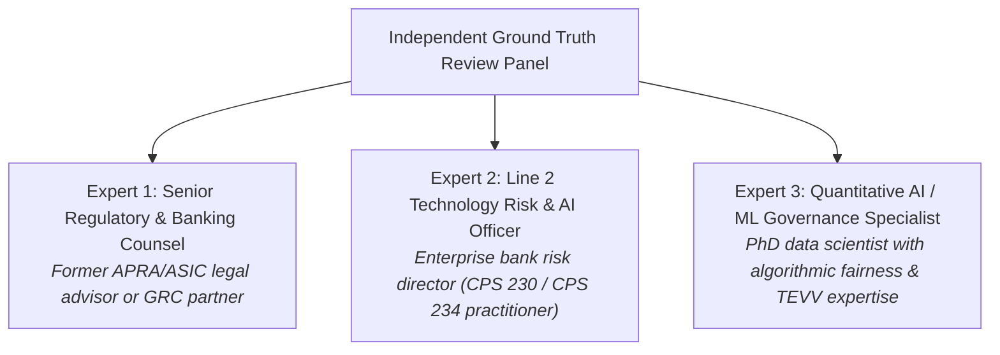
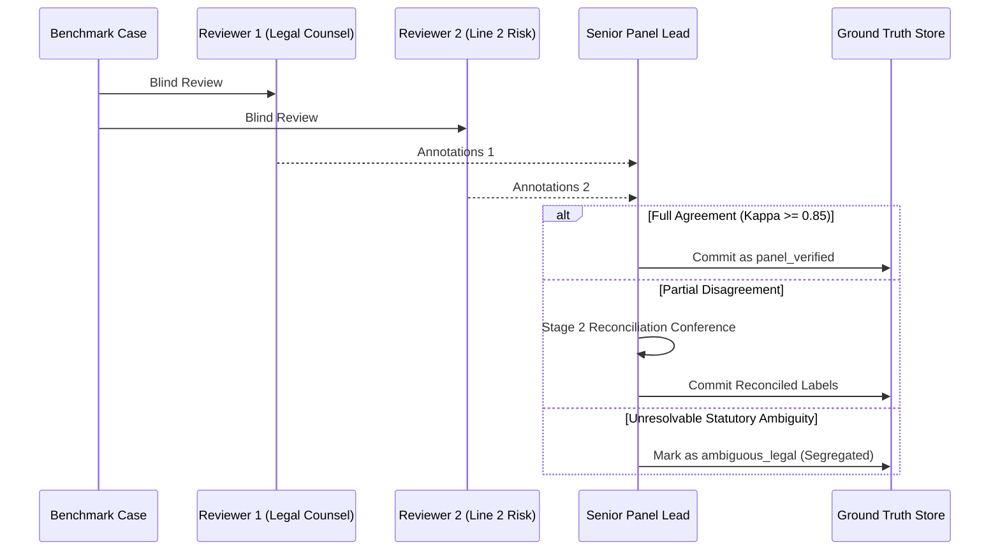

# P1 Ground Truth Governance & Independent Review Protocol

**Repository:** `VivianFuVivianFu/DeepAuditCrossWalk`  
**Phase:** P1A Evaluation Foundation  
**Branch:** `research/p1a-evaluation-foundation`  
**Benchmark Target:** [`P1_EVALUATION_DATASET_V2.json`](file:///c:/Users/vivia/OneDrive/Desktop/DeepAuditCrossWalk/P1_EVALUATION_DATASET_V2.json) (156 cases)  
**Date:** November 2026  

---

## 1. Objective and Scope

This protocol establishes the formal governance framework for validating, maintaining, and partitioning ground-truth labels across the DeepAudit Crosswalk evaluation suite.

A critical finding of the P0 audit ([`P0_RESIDUAL_RISK_REGISTER.md`](file:///c:/Users/vivia/OneDrive/Desktop/DeepAuditCrossWalk/P0_RESIDUAL_RISK_REGISTER.md)) was that **zero reference cases in the original 63-case benchmark had undergone formal, independent review by external legal or GRC specialists**.

To ensure that future Phase P1 semantic mapping benchmarks represent legally sound and industry-verified ground truth, this protocol mandates:
1. An independent three-tier expert review panel.
2. A formal multi-annotator review methodology with inter-rater reliability metrics.
3. A structured dispute-resolution process for ambiguous statutory provisions.
4. Cryptographic partitioning between development and untouched holdout evaluation splits to prevent data leakage.

---

## 2. Independent Review Panel Composition

To eliminate internal engineering bias, the Ground Truth Review Panel must comprise three independent, non-affiliated experts representing distinct disciplines:

### Independence Invariants
1. **Separation from Model Development**: Panel members must not write or optimize prompt templates, vector embeddings, or classification heuristics for the DeepAudit Crosswalk engine.
2. **Conflict of Interest Declaration**: Panel members must disclose any commercial or consulting engagements that would compromise objective evaluation of Australian banking compliance standards.
3. **Written Provenance**: Every verified case must record the unique identifier of the reviewing panel member and the date of sign-off.

---

## 3. Annotation Guidelines & Taxonomy Standards

Reviewers must evaluate benchmark cases against the **33 Canonical Unified Controls** and **155 Canonical Control Facets** defined in [`UNIFIED_CONTROL_LIBRARY.json`](file:///c:/Users/vivia/OneDrive/Desktop/DeepAuditCrossWalk/UNIFIED_CONTROL_LIBRARY.json).

### Annotation Tasks per Case:
1. **Atomic Requirement Segmentation**:
   - Extract each independently enforceable obligation, condition, or exception as a distinct atomic clause.
   - Separate aspirational preamble (e.g. *"The bank is committed to ethical technology"*) from operative legal commands (e.g. *"Must obtain human approval prior to release"*).
2. **Control Facet Assignment**:
   - Assign one or more standardized facet identifiers from the 155 canonical UCL facets.
   - Reject informal shorthands or non-standard synonyms.
3. **Unified Control Mapping**:
   - Assign the primary and secondary Unified Control IDs.
   - Verify whether the relationship is `FULL`, `PARTIAL`, or `OVERLAPPING`.
4. **Negation & Prohibition Tagging**:
   - Explicitly flag whether the clause constitutes an affirmative requirement (`is_negated: false`) or a prohibited activity / sandbox exemption (`is_negated: true`).
5. **Threshold & Boundary Extraction**:
   - Parse exact numerical boundaries (monetary values, retention days, review frequencies) and assign the formal comparison operator (`gt`, `gte`, `lt`, `lte`, `eq`).

---

## 4. Multi-Annotator Consensus & Inter-Rater Reliability

To ensure statistical reliability, all benchmark cases undergo independent double-blind annotation:

### Inter-Rater Agreement Metric
The panel evaluates inter-annotator agreement across categorical facet assignments using **Fleiss' Kappa ($\kappa$)** or **Cohen's Kappa ($\kappa$)**:
$$\kappa = \frac{P_o - P_e}{1 - P_e}$$
- $\kappa \ge 0.85$: **Near-Perfect Agreement** $\rightarrow$ Candidate labels automatically promoted to `reviewer_status: "panel_verified"`.
- $0.70 \le \kappa < 0.85$: **Substantial Agreement** $\rightarrow$ Escalated to Stage 2 Reconciliation Conference.
- $\kappa < 0.70$: **Inadequate Consensus** $\rightarrow$ Annotation guidelines must be clarified and the test batch re-annotated.

---

## 5. Three-Stage Dispute Resolution Protocol

When independent annotators disagree on facet assignment or legal interpretation, the following protocol applies:

### Stage 1: Blind Independent Annotation
Reviewer 1 and Reviewer 2 independently tag the case without seeing each other's outputs or rationale.

### Stage 2: Bilateral Reconciliation Conference
If outputs diverge (e.g. Reviewer 1 tags `CTRL-THIRD-PARTY-AI` while Reviewer 2 tags `CTRL-BCP-AI` for a cloud operational substitution clause):
1. Reviewers meet to compare textual statutory references (e.g. APRA CPS 230 para 38 vs para 41).
2. If consensus is reached, the reconciled labels are committed with consensus notes.

### Stage 3: Formal Legal Ambiguity Segregation
If the disagreement stems from a genuine unresolved question of Australian regulatory law (e.g. whether offshore cloud availability zones violate cross-border sovereignty under APRA CPS 234 without ministerial exemption):
1. The case is classified as `ground_truth_provenance: "ambiguous_legal"`.
2. `reviewer_status` remains `"pending_panel"`.
3. The case is **strictly excluded from binary pass/fail accuracy benchmarks**. It is retained in the evaluation dataset exclusively as a qualitative stress-test case to measure how candidate engines handle legal uncertainty.

---

## 6. Dataset Partitioning & Holdout Set Quarantine

To guarantee unbiased evaluation of future semantic engines (Rules, Embeddings, LLMs), [`P1_EVALUATION_DATASET_V2.json`](file:///c:/Users/vivia/OneDrive/Desktop/DeepAuditCrossWalk/P1_EVALUATION_DATASET_V2.json) enforces strict cryptographic partitioning:

| Dataset Split | Case Count | Ratio | Permitted Usage | Governance Quarantine Rules |
|---|:---:|:---:|---|---|
| **Development Split (`development`)** | 105 | 67.3% | Feature engineering, regex pattern tuning, prompt engineering, few-shot examples, vector database indexing. | Open access to engineering teams. |
| **Holdout Split (`holdout`)** | 51 | 32.7% | Blind out-of-sample benchmark evaluation, model release gate validation. | **STRICT QUARANTINE**: No holdout case may be used as prompt few-shot examples, fine-tuning data, or regex training examples. |

### Anti-Leakage Invariants
1. **No Duplicate Phrasing**: Automated validation ([`scripts/validate_p1_dataset.py`](file:///c:/Users/vivia/OneDrive/Desktop/DeepAuditCrossWalk/scripts/validate_p1_dataset.py)) verifies that zero normalized text strings appear in both development and holdout partitions.
2. **Deterministic Partitioning**: Partition assignments are committed into Git and frozen. Cases cannot be migrated between splits to artificially improve benchmark scores.
3. **Automated CI Quarantine Gate**: Any pull request that modifies the holdout partition requires mandatory sign-off from the Lead Regulatory Architect.
