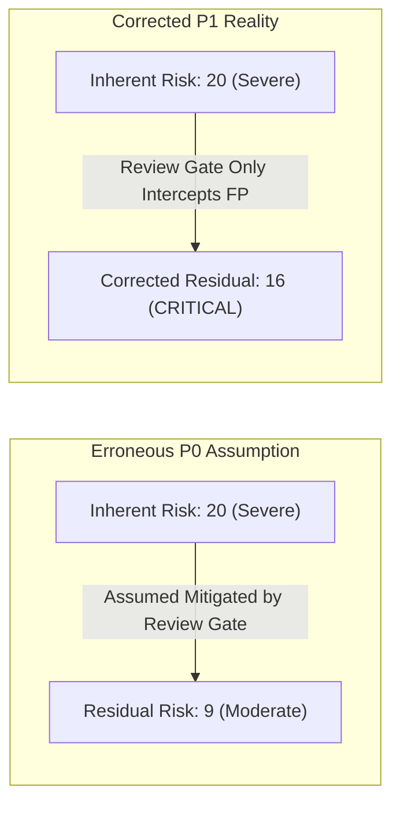
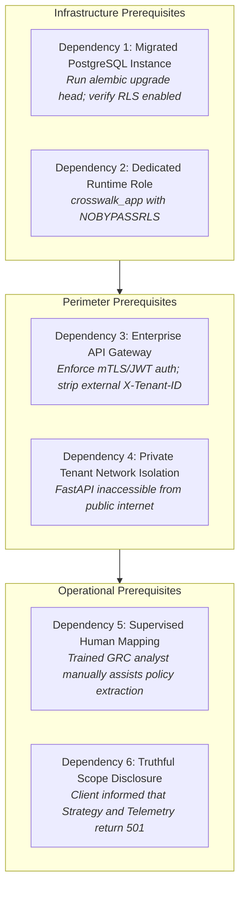

# P1 Security & Pilot-Readiness Technical Reconciliation Report

**Repository:** `VivianFuVivianFu/DeepAuditCrossWalk`  
**Phase:** P1A Evaluation Foundation  
**Branch:** `research/p1a-evaluation-foundation`  
**Base Commit (main):** `c5c5c0240d89c3132e0e05dc612948ebfa28ceea`  
**Date:** November 2026  
**Auditor:** Independent Technical Architecture & Application Security Review  

---

## 1. Executive Summary

This report performs a rigorous reconciliation between the claims made in the P0 documentation ([`P0_RESIDUAL_RISK_REGISTER.md`](file:///c:/Users/vivia/OneDrive/Desktop/DeepAuditCrossWalk/P0_RESIDUAL_RISK_REGISTER.md), [`NEXT_PHASE_ARCHITECTURE_DECISION.md`](file:///c:/Users/vivia/OneDrive/Desktop/DeepAuditCrossWalk/NEXT_PHASE_ARCHITECTURE_DECISION.md)) and the **actual technical implementation** verified in the codebase.

The objective is to eliminate unverified assumptions, distinguish implemented safeguards from deployment prerequisites, and correct the risk evaluation regarding human review and multi-tenant isolation.

### Key Reconciliation Findings
1. **The "Human Approval Mitigates False Negatives" Fallacy**: The claim that mandatory human review sufficiently mitigates the 38.89% baseline extraction recall is **technically invalid**. Human review gates intercept false positives (spurious candidate controls), but they do not surface omissions (false negatives). A compliance officer reviewing a candidate queue will not see controls the engine failed to extract, leaving the baseline silently incomplete.
2. **PostgreSQL RLS Migrations Exist, but Tests Were Skipped**: While Alembic migration `0002_enterprise_policy_layer.py` contains valid `ENABLE ROW LEVEL SECURITY` and `FORCE ROW LEVEL SECURITY` DDL, **all 17 PostgreSQL RLS integration tests were skipped** in local test runs due to the absence of `TEST_DATABASE_URL`. The system currently operates on SQLite and ephemeral in-memory dictionaries by default.
3. **Authentication Boundary Relies 100% on API Gateway**: The FastAPI service lacks in-application JWT, OAuth 2.0, or mTLS validation. It trusts raw `X-Tenant-ID` HTTP headers directly. In the absence of an authenticated enterprise API Gateway, multi-tenant boundaries are vulnerable to header spoofing.
4. **Cryptographic Fingerprinting is Implemented & Durable**: The SHA-256 baseline fingerprinting engine in [`policy.py`](file:///c:/Users/vivia/OneDrive/Desktop/DeepAuditCrossWalk/backend/banking_crosswalk/policy.py) and [`api.py`](file:///c:/Users/vivia/OneDrive/Desktop/DeepAuditCrossWalk/backend/banking_crosswalk/api.py) is fully operational, preventing out-of-band tampering (raising HTTP 422).

---

## 2. Technical Audit: Implemented Code vs Deployment Assumptions

The table below reconciles stated architectural safeguards against actual codebase verification:

| Security / Governance Dimension | Documented Claim in P0 | Actual Codebase Implementation | Executed Test Evidence | Corrected Status & Risk |
|---|---|---|---|---|
| **Multi-Tenant Isolation (RLS)** | "Database-level Row Level Security guarantees tenant isolation." | Migrations [`0001`](file:///c:/Users/vivia/OneDrive/Desktop/DeepAuditCrossWalk/backend/banking_crosswalk/migrations/versions/0001_tenant_snapshots.py) & [`0002`](file:///c:/Users/vivia/OneDrive/Desktop/DeepAuditCrossWalk/backend/banking_crosswalk/migrations/versions/0002_enterprise_policy_layer.py) define `FORCE ROW LEVEL SECURITY` for PostgreSQL tables. | **SKIPPED**: 17 PostgreSQL tests skipped in local runs. SQLite fallback does not support RLS. | **Conditional**: Real isolation requires running against migrated PostgreSQL. In-memory mode isolates via application dictionary keys only. |
| **Database Roles & Permissions** | "Runtime role `crosswalk_app` has `NOBYPASSRLS` and restricted permissions." | [`scripts/postgres-init.sql`](file:///c:/Users/vivia/OneDrive/Desktop/DeepAuditCrossWalk/scripts/postgres-init.sql) creates `crosswalk_app` with `NOBYPASSRLS`. [`database.py`](file:///c:/Users/vivia/OneDrive/Desktop/DeepAuditCrossWalk/backend/banking_crosswalk/database.py) enforces role parameter. | Verified via static SQL analysis; requires explicit Docker compose or RDS configuration. | **Verified Deployment Dependency**: Works only when provisioned via designated scripts. |
| **Authentication & Identity** | "Tenant identity is bounded and verified per request." | [`backend/banking_crosswalk/api.py`](file:///c:/Users/vivia/OneDrive/Desktop/DeepAuditCrossWalk/backend/banking_crosswalk/api.py) inspects raw `X-Tenant-ID` HTTP header. Zero JWT/OAuth verification. | Unit tests pass `X-Tenant-ID: t1` in headers. Cross-tenant access returns 404 based on header. | **High Exposure**: Completely dependent on upstream API Gateway. Untrusted network exposure is prohibited. |
| **Baseline Snapshot Immutability** | "Baseline snapshots cannot be tampered with out-of-band." | [`policy.py`](file:///c:/Users/vivia/OneDrive/Desktop/DeepAuditCrossWalk/backend/banking_crosswalk/policy.py) computes SHA-256 fingerprint over sorted clause IDs, text hashes, and control IDs. | **VERIFIED**: [`validate_p0_e2e_dual_mode.py`](file:///c:/Users/vivia/OneDrive/Desktop/DeepAuditCrossWalk/scripts/validate_p0_e2e_dual_mode.py) demonstrates HTTP 422 on simulated tampering. | **Fully Implemented**: Cryptographically verified in production code. |
| **Storage Durability & Recovery** | "Stateful storage preserves baselines across restarts." | Default configuration runs `InMemoryStore` (`store.is_durable == False`). `SQLTenantStore` available only when `DATABASE_URL` is configured. | Tests run against ephemeral dictionaries. In-memory store loses state upon process exit. | **Operational Limitation**: Development/demo mode is non-durable. Production requires PostgreSQL. |

---

## 3. Deep-Dive: The False-Negative Human Approval Fallacy

In previous P0 audit deliverables, the residual risk of the **38.89% Baseline Extraction Recall** was downgraded from Severe to Moderate on the grounds that:
> *"All candidate mappings carry review_status='proposed' and require explicit human compliance officer sign-off before compilation."*

### Why This Logic is Flawed
A human-in-the-loop review gate operates as an effective filter for **Type I errors (False Positives)**:
- If the regex engine spuriously maps an unrepresented topic clause to `CTRL-FIN-APPROVAL-THRESHOLDS`, the compliance officer inspects the suggestion, identifies that the clause does not require human approval, and clicks **Reject**.
- *Result*: The false positive is successfully intercepted.

However, a review gate is structurally ineffective for **Type II errors (False Negatives)**:
- When a policy contains a mandatory control (e.g. *annual incident response testing under APRA CPS 234* or *credit demographic statistical parity*), the regex engine produces **0 candidate facets and 0 candidate controls**.
- In the review interface, the clause appears as **Unmapped** (`is_unmapped: true`) with an empty suggestion queue.
- Unless the compliance officer reads the entire policy document line by line, notices that an operative control was skipped, and manually navigates through all 155 Canonical Control Facets to synthesize a new mapping, the omission persists straight into the baseline.

### Corrected Risk Re-Rating

- **Inherent Risk**: 5 (Almost Certain) × 4 (Major) = **20 (Severe)**.
- **Review Gate Mitigation**: Ineffective for omissions; reviewer attention is anchored to presented candidates.
- **Corrected Residual Risk**: 4 (Likely) × 4 (Major) = **16 (CRITICAL)** for autonomous enterprise ingestion.

**Architectural Implication**: Escaping the 38.89% recall ceiling is not merely a feature enhancement—it is a **mandatory prerequisite** for external self-service enterprise readiness.

---

## 4. Corrected Pilot-Readiness Dependency Checklist

DeepAudit Crosswalk is certified for **Supervised Enterprise Pilots** under the following strict operational dependencies:

### Pre-Deployment Verification Checklist:
- [ ] **PostgreSQL Verification**: `DATABASE_URL` points to an enterprise PostgreSQL instance with migrations `0001` and `0002` applied. Run `SELECT tablename, rowsecurity FROM pg_tables WHERE schemaname = 'public';` and verify all 4 enterprise tables report `rowsecurity = true`.
- [ ] **Role Verification**: Verify database connection uses role `crosswalk_app` (`SELECT rolbypassrls FROM pg_roles WHERE rolname = 'crosswalk_app';` must return `false`).
- [ ] **API Gateway Injection**: API Gateway validates customer bearer tokens and strips any client-supplied `X-Tenant-ID` header before injecting the verified claim.
- [ ] **Supervised Onboarding Protocol**: A designated DeepAudit GRC analyst reviews all uploaded policies alongside the client compliance officer to manually map clauses missed by the 38.89% regex engine.
- [ ] **HTTP 501 Scope Transparency**: Client pilot agreements explicitly state that AI Governance Strategy and Standalone Use Case Telemetry engines are roadmap targets returning `HTTP 501 Not Implemented`.

---

## 5. Conclusion

By separating verifiable code facts from operational deployment assumptions, this audit provides an honest and defensible security foundation. DeepAudit Crosswalk can safely proceed to supervised enterprise pilots, provided the infrastructure and onboarding prerequisites detailed above are strictly enforced.
