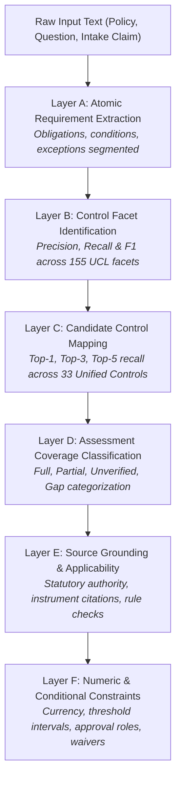
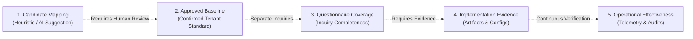

# P1 Multi-Layer Semantic Engine Evaluation Protocol

**Repository:** `VivianFuVivianFu/DeepAuditCrossWalk`  
**Phase:** P1A Evaluation Foundation  
**Branch:** `research/p1a-evaluation-foundation`  
**Benchmark Target:** [`P1_EVALUATION_DATASET_V2.json`](file:///c:/Users/vivia/OneDrive/Desktop/DeepAuditCrossWalk/P1_EVALUATION_DATASET_V2.json) (156 cases)  
**Date:** November 2026  

---

## 1. Executive Summary & Purpose

A critical vulnerability identified during the P0 Semantic Mapping Audit was the practice of collapsing diverse evaluation dimensions into a single misleading "product accuracy" metric.

For example, using policy clause extraction as a proxy for strategy document assessment or treating questionnaire question matches as proof of operational control effectiveness obscures severe gaps in regulatory compliance engines.

This protocol establishes a **six-layer evaluation architecture (Layers A through F)** that independently measures every step in the semantic mapping and compliance assessment lifecycle. It also enforces **five non-equivalence boundaries** to prevent legal and operational misrepresentations.

---

## 2. The Six Evaluation Layers (Layers A – F)



---

### Layer A — Atomic Requirement Extraction
* **Objective**: Measure whether the semantic engine segments complex regulatory or policy text into discrete, independently enforceable requirements without omitting qualifiers, conditions, or exceptions.
* **Input**: Unstructured policy documents or regulatory standards.
* **Ground Truth**: Expected atomic requirements list (`expected_atomic_requirements`).
* **Metrics**:
  - **Segmentation Precision ($P_A$)**: Fraction of extracted segments that represent genuine, independent normative requirements.
  - **Segmentation Recall ($R_A$)**: Fraction of reference atomic obligations successfully captured as separate clauses.
  - **Boundary Completeness Score ($BCS_A$)**: Measure of whether conditionality clauses (`if`, `unless`, `subject to`) remain bound to their operative verbs.

---

### Layer B — Control Facet Identification
* **Objective**: Measure the engine's ability to classify extracted text into the **155 Canonical Control Facets** defined in [`UNIFIED_CONTROL_LIBRARY.json`](file:///c:/Users/vivia/OneDrive/Desktop/DeepAuditCrossWalk/UNIFIED_CONTROL_LIBRARY.json).
* **Input**: Atomic policy clauses or questionnaire questions.
* **Ground Truth**: Canonical facet identifiers (`expected_facets`).
* **Metrics**:
  - **Facet Precision ($P_B$)**: $\frac{TP_B}{TP_B + FP_B}$
  - **Facet Recall ($R_B$)**: $\frac{TP_B}{TP_B + FN_B}$
  - **Facet F1 ($F1_B$)**: $\frac{2 \times P_B \times R_B}{P_B + R_B}$
  - **False-Facet Assertion Rate ($FFR_B$)**: Rate at which negated or irrelevant clauses trigger active facets.

---

### Layer C — Candidate Control Mapping
* **Objective**: Measure the accuracy with which extracted facets and clauses are associated with the **33 Canonical Unified Controls**.
* **Input**: Classified facets and clause text.
* **Ground Truth**: Canonical control identifiers (`expected_controls`).
* **Metrics**:
  - **Top-1 Recall ($R_{C@1}$)**: Percentage of cases where the primary expected control is ranked #1.
  - **Top-3 Recall ($R_{C@3}$)**: Percentage of cases where the expected control is within the top 3 candidate suggestions.
  - **Top-5 Recall ($R_{C@5}$)**: Percentage of cases where the expected control is within the top 5 candidate suggestions.
  - **False-Control Trigger Rate ($FCR_C$)**: Percentage of negated clauses, sandbox exemptions, or unmapped enterprise clauses that generate candidate controls (Target = **0.0%**).

---

### Layer D — Assessment Coverage Classification
* **Objective**: Evaluate the downstream engine's classification of obligation coverage (Full, Partial, Unverified, Missing/Gap).
* **Input**: Assessment target (Questionnaire or Intake Form) evaluated against the Shared Regulatory Library and active baselines.
* **Ground Truth**: Verified coverage status.
* **Metrics**:
  - **False Full-Coverage Rate ($FFCR_D$)**: Critical defect where an obligation is marked fully covered despite missing required facets or evidence.
  - **False Gap Rate ($FGR_D$)**: Frustration defect where a well-governed entity is incorrectly flagged with non-existent compliance gaps.
  - **Coverage Resolution Accuracy**: Micro- and macro-averaged F1 across all four coverage states (`covered`, `partially_covered`, `gap`, `undetermined`).

---

### Layer E — Source Grounding and Applicability
* **Objective**: Measure whether every asserted mapping is strictly traceable to authentic statutory instruments without hallucination or spurious legal authority claims.
* **Ground Truth**: Mandatory statutory citations and applicability rules (`applicability_conditions`).
* **Metrics**:
  - **Citation Precision**: Percentage of generated rationale statements that cite verified statutory provisions (e.g. *Privacy Act 1988 Sch 1 APP 11.2* vs generic *privacy laws*).
  - **Applicability Rule Accuracy**: Deterministic execution accuracy across statutory applicability rules (e.g. EU AI Act territorial nexus, APRA ADI entity scope).
  - **Hallucinated Authority Rate**: Frequency of non-existent regulatory standards or hallucinated clause numbers generated by the model (Target = **0.0%**).

---

### Layer F — Numeric and Conditional Constraints
* **Objective**: Evaluate the parsing and validation of mathematical thresholds, currency symbols, duration horizons, and operational exception waivers.
* **Input**: Clauses containing quantitative limits (e.g. *AUD 500*, *7 years*, *30 days*, *4 hours*).
* **Ground Truth**: Structured threshold objects (`threshold_constraint`).
* **Metrics**:
  - **Numeric Value Extraction Accuracy**: Exact match between extracted numeric float and ground truth.
  - **Operator Compatibility Accuracy**: Correct assignment of interval operators (`gt`, `gte`, `lt`, `lte`, `eq`).
  - **Currency & Unit Normalization Accuracy**: Correct extraction of currency codes (AUD, USD, EUR, GBP) and time units (hours, days, months, years).
  - **Conflict Detection Accuracy**: Successful detection of policy vs use-case threshold discrepancies (as verified across the 12 P0 scenarios).

---

## 3. The Five Operational Boundaries (Non-Equivalences)

To prevent regulatory misrepresentations, evaluation reports must maintain strict separation between the following five tiers:



### Boundary Definitions
1. **Candidate Mapping $\neq$ Approved Mapping**:
   - A candidate mapping (`review_status: "proposed"`) generated by an AI model or regex pattern has **zero legal authority**. It is an unverified suggestion presented to a compliance officer.
   - Only approved mappings (`review_status: "approved"`) compile into an active baseline.
2. **Questionnaire Coverage $\neq$ Control Effectiveness**:
   - Demonstrating that an internal questionnaire asks about algorithmic drift proves **inquiry completeness**.
   - It does **NOT** prove that drift monitoring is operational, effective, or calibrated in production.
3. **Use Case Intake Form $\neq$ Implementation Evidence**:
   - A developer's textual assertion that *"all data is encrypted with AES-256"* is an **unsubstantiated intake claim**.
   - It must never be evaluated as verified evidence without cryptographic configuration proofs, KMS key policies, or automated telemetry.
4. **Strategy Document $\neq$ Engineering Telemetry**:
   - An AI Governance Strategy document establishes executive risk appetite, committee oversight, and ethical principles.
   - It must be evaluated against governance commitment facets, never penalized for lacking low-level API test scripts.
5. **Regulatory Obligation $\neq$ Enterprise Preference**:
   - External statutory obligations under APRA and the Privacy Act are binding external legal mandates.
   - Internal enterprise guidelines (e.g. preferred cloud vendors, internal ESG pledges) are discretionary tenant policies. They must be evaluated in separate report buckets.

---

## 4. Evaluation Protocol Execution Harness Specification

Automated evaluation of candidate semantic mapping engines in Phase P1 must adhere to the following execution loop:

```python
def evaluate_p1_engine(engine, dataset_path, split="holdout"):
    """Standardized multi-layer evaluation harness."""
    dataset = load_dataset(dataset_path, split=split)
    
    results = {
        "layer_a_segmentation": [],
        "layer_b_facets": {"tp": 0, "fp": 0, "fn": 0},
        "layer_c_controls": {"top1": 0, "top3": 0, "top5": 0, "total": 0},
        "layer_f_thresholds": {"correct": 0, "total": 0},
        "false_control_triggers": 0,
    }
    
    for case in dataset:
        # 1. Execute Candidate Extraction
        prediction = engine.extract_and_map(case["input_text"])
        
        # 2. Evaluate Layer B: Facet Identification
        pred_facets = set(prediction.candidate_facets)
        exp_facets = set(case["expected_facets"])
        results["layer_b_facets"]["tp"] += len(pred_facets & exp_facets)
        results["layer_b_facets"]["fp"] += len(pred_facets - exp_facets)
        results["layer_b_facets"]["fn"] += len(exp_facets - pred_facets)
        
        # 3. Evaluate False-Control Triggers on Negations
        if case["is_negated"] and len(prediction.candidate_controls) > 0:
            results["false_control_triggers"] += 1
            
        # 4. Evaluate Layer C: Ranked Control Retrieval
        exp_ctrls = set(case["expected_controls"])
        ranked_ctrls = [m.control_id for m in prediction.ranked_mappings]
        if exp_ctrls:
            results["layer_c_controls"]["total"] += 1
            if ranked_ctrls and ranked_ctrls[0] in exp_ctrls:
                results["layer_c_controls"]["top1"] += 1
            if any(c in exp_ctrls for c in ranked_ctrls[:3]):
                results["layer_c_controls"]["top3"] += 1
            if any(c in exp_ctrls for c in ranked_ctrls[:5]):
                results["layer_c_controls"]["top5"] += 1

    return compile_multi_layer_report(results)
```

---

## 5. Acceptance Thresholds for Phase P1 Gate

To qualify for production deployment consideration, any candidate semantic architecture evaluated under this protocol must satisfy the following minimum performance gates on the **untouched holdout partition (51 cases)**:

| Metric Layer | Specific Measurement | Minimum Acceptance Gate | Rationale |
|---|---|:---:|---|
| **Layer B: Facets** | Holdout Facet Recall ($R_B$) | $\ge \mathbf{80.0\%}$ | Must decisively escape the 38.89% P0 regex ceiling. |
| **Layer B: Facets** | Holdout Facet Precision ($P_B$) | $\ge \mathbf{75.0\%}$ | Prevents noisy facet suggestions from overwhelming reviewers. |
| **Layer C: Controls** | False-Control Trigger Rate | $\mathbf{0.0\%}$ | **Zero-Tolerance Safety Gate**: Negations must never trigger controls. |
| **Layer C: Controls** | Top-3 Candidate Control Recall | $\ge \mathbf{85.0\%}$ | Guarantees compliance officers see the correct control in top 3. |
| **Layer E: Grounding** | Hallucinated Authority Rate | $\mathbf{0.0\%}$ | Models must never invent non-existent regulatory citations. |
| **Layer F: Thresholds**| Numeric Interval Validation Accuracy | $\mathbf{100.0\%}$ | Preserves the mathematical safety of the P0 AST engine. |
