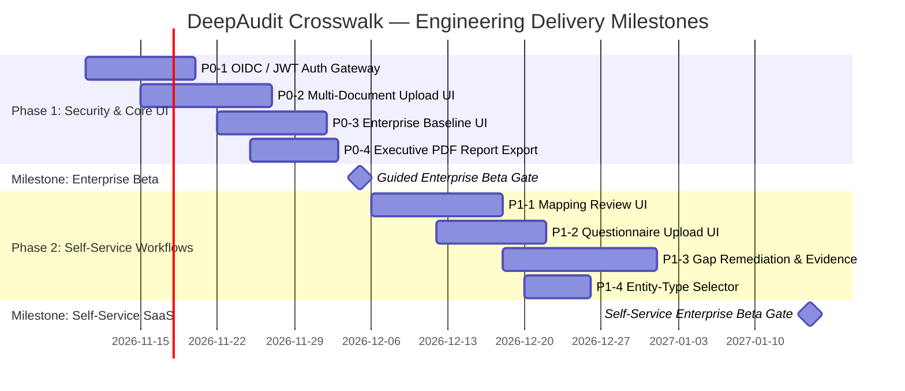

# DeepAudit Crosswalk — Prioritised Product Roadmap

**Date:** 2026-11-04  
**Planning Horizon:** Enterprise Beta & General Availability (GA)  
**Author:** DeepAudit Product Management & Enterprise GRC Architecture

---

## 1. Roadmap Prioritisation Framework

Initiatives are classified into three strict priority tiers based on the findings from the **Current Product Capability Audit**, the **End-to-End Validation Report**, and the **Enterprise Beta Readiness Assessment**:

* **P0 — Critical Beta Blockers**: Mandatory security, data isolation, correctness, or core workflow capabilities required before any external enterprise user can safely evaluate the product.
* **P1 — Self-Service Enablers**: High-value governance workflows and user interfaces necessary for enterprise self-service pilots without manual engineering intervention.
* **P2 — Advanced Capabilities & Scale**: Enterprise integrations, OCR, telemetry, and automated compliance tooling for general commercial availability.

```
┌────────────────────────────────────────────────────────────────────────┐
│ P0: Enterprise Beta Blockers (Sprint 1–2)                              │
│ 1. OIDC / JWT Gateway Authentication & Cryptographic Tenant Binding   │
│ 2. Multi-Document File Upload UI (PDF, DOCX, XLSX Drag & Drop)        │
│ 3. Enterprise Baseline Multi-Policy Assessment in Frontend             │
│ 4. Executive Gap Assessment Report Generation (PDF / Word Export)      │
├────────────────────────────────────────────────────────────────────────┤
│ P1: Self-Service Enablers (Sprint 3–4)                                 │
│ 1. Candidate Mapping Review & Human Sign-Off UI                        │
│ 2. AIAF & Custom Questionnaire Upload UI                               │
│ 3. Gap Lifecycle, Assignment & Evidence Management UI                  │
│ 4. Institution Profile Selector (ADI / AFSL / ACL Entity Types)        │
├────────────────────────────────────────────────────────────────────────┤
│ P2: Advanced Capabilities & Scale (Sprint 5+)                          │
│ 1. Scanned Document OCR Pipeline                                       │
│ 2. Private Licensed Standard Overlay UI (ISO 42001)                   │
│ 3. Automated Model Telemetry & Evidence Verification Connectors        │
│ 4. Policy Remediation Clause Generator                                 │
└────────────────────────────────────────────────────────────────────────┘
```

---

## 2. P0 Initiatives — Critical Beta Blockers

### P0-1: OIDC / JWT Cryptographic Tenant Identity Binding
* **Problem**: The backend currently trusts the `X-Tenant-ID` header supplied by callers. In an untrusted network or direct SaaS exposure, an unauthorized caller could spoof another tenant's ID.
* **Recommended Solution**:
  * Implement JWT verification middleware in FastAPI (`api.py` / `auth.py`).
  * Verify token signatures against an identity provider (e.g. Supabase Auth, Auth0, Okta, Azure AD) via JWKS.
  * Extract `tenant_id`, `sub` (actor), and `roles` directly from cryptographically validated claims, overriding untrusted HTTP headers.
* **Affected Components**:
  * `backend/banking_crosswalk/api.py`
  * `backend/banking_crosswalk/app.py`
  * `web/app/api/analysis/route.ts`
* **Dependencies**: Identity Provider JWKS endpoint or shared Supabase JWT secret.
* **Acceptance Criteria**:
  1. Direct API requests without a valid Bearer JWT return `401 Unauthorized`.
  2. Supplying a tampered or expired JWT returns `401 Unauthorized`.
  3. `tenant_id` used for PostgreSQL RLS is bound strictly to the verified token claims.

---

### P0-2: Multi-Document & Policy File Upload UI
* **Problem**: The web portal only offers a single text box for pasting one policy excerpt. Enterprise users cannot upload their actual corporate policies (PDF, Word, Excel) without writing custom API scripts.
* **Recommended Solution**:
  * Build a dedicated **Enterprise Policy Library** tab in the Next.js frontend (`web/app/policies/`).
  * Add a drag-and-drop file uploader supporting `.pdf`, `.docx`, `.xlsx`, and `.txt`.
  * Convert files to Base64 in the browser and invoke `/v1/enterprise/policies/import-file`.
  * Display a list of uploaded policies showing title, authority level, category, version, and SHA-256 fingerprint.
* **Affected Components**:
  * `web/app/page.tsx`
  * `web/app/policies/page.tsx` (new)
  * `web/app/analysis.ts`
* **Dependencies**: None (backend `/v1/enterprise/policies/import-file` is already operational).
* **Acceptance Criteria**:
  1. User can drag-and-drop 4 enterprise policies simultaneously.
  2. Ingestion status and extraction summary (clauses extracted, warnings) display upon completion.
  3. Duplicate file uploads trigger a warning banner displaying the matching policy name.

---

### P0-3: Enterprise Baseline Multi-Policy Assessment in Frontend
* **Problem**: The UI only evaluates the single policy excerpt currently in the textarea. It cannot evaluate a comprehensive enterprise baseline composed of multiple documents (e.g. AI Governance + Privacy + CPS 234 + Delegated Authority).
* **Recommended Solution**:
  * Enable users to select one or more policies from their library (or an entire Enterprise Baseline) when configuring an assessment.
  * Update the frontend proxy to invoke `/v1/enterprise/assessments/gaps` with `policy_ids` or `baseline_id`.
  * Render findings aggregated across the combined policy baseline.
* **Affected Components**:
  * `web/app/page.tsx`
  * `web/app/api/analysis/route.ts`
  * `backend/banking_crosswalk/api.py`
* **Dependencies**: P0-2 (Policy Library UI).
* **Acceptance Criteria**:
  1. User can select 4 uploaded enterprise policies and trigger an assessment.
  2. Gaps correctly reflect omissions across the combined set of documents.
  3. Conflicting thresholds between selected policies (e.g. AUD 500 vs AUD 1,000) are flagged as `control_conflict` gaps in the UI.

---

### P0-4: Executive Gap Assessment Report Generation (PDF / Word)
* **Problem**: The web app only downloads raw technical JSON (`crosswalk-<id>.json`). Enterprise risk committees, boards, and external auditors require formal PDF/Word deliverables.
* **Recommended Solution**:
  * Add an executive report generation service using Python `reportlab` (or browser-side PDF printing).
  * Generate a formatted PDF report containing:
    1. Executive Summary & Compliance Heatmap (by Authority Layer).
    2. Use Case Profile & Ingested Policy Inventory.
    3. Detailed Findings Matrix (Regulation $\to$ Unified Control $\to$ Policy Clause $\to$ Gap).
    4. Prioritised Remediation Plan with required evidence.
    5. Immutable Audit Trail & Formal Sign-Off Block.
* **Affected Components**:
  * `backend/banking_crosswalk/reporting.py` (new)
  * `backend/banking_crosswalk/api.py` (`GET /v1/assessments/{id}/report.pdf`)
  * `web/app/page.tsx` (Add `Export PDF ↓` button)
* **Dependencies**: None.
* **Acceptance Criteria**:
  1. Clicking `Export PDF ↓` downloads a publication-grade, branded PDF report.
  2. PDF includes all statutory citations, exact policy excerpts, and audit trail events.
  3. APRA/ASIC legal disclaimers are prominently displayed on cover and conclusion pages.

---

## 3. P1 Initiatives — Self-Service Enablers

### P1-1: Candidate Mapping Review & Human Sign-Off UI
* **Problem**: Candidate mappings generated by facet matching remain `proposed` by default and cannot be confirmed or rejected via the UI.
* **Recommended Solution**:
  * Create a **Crosswalk Review** screen displaying extracted clauses and their candidate mappings to the 33 Unified Controls.
  * Provide `Confirm`, `Reject`, and `Adjust` actions for compliance officers (`X-Role: risk|legal`).
  * Record human review comments, timestamps, and reviewer IDs.
* **Affected Components**: `web/app/reviews/`, `backend/banking_crosswalk/api.py`.
* **Acceptance Criteria**: Confirmed mappings immediately update the Confirmed Coverage Rate on subsequent assessments.

---

### P1-2: AIAF & Custom Questionnaire Upload UI
* **Problem**: Customers are restricted to the 19 pre-bundled synthetic questions unless an administrator imports workbooks via the CLI.
* **Recommended Solution**:
  * Provide an **Assessment Questionnaires** management tab in the UI.
  * Allow users to upload official Australian AI Assurance Framework (AIAF) `.xlsx` workbooks.
  * Validate sheet structures and cell counts with clear client-side progress indicators.
* **Affected Components**: `web/app/questionnaires/`, `backend/banking_crosswalk/questionnaires.py`.
* **Acceptance Criteria**: Uploading a valid AIAF workbook activates all 184 full-scope assessment questions for that tenant.

---

### P1-3: Gap Lifecycle, Assignment & Evidence Management UI
* **Problem**: The UI presents gaps as static findings. Users cannot track remediation, assign owners, or upload evidence to close gaps.
* **Recommended Solution**:
  * Add a **Remediation Tracker** allowing gaps to transition: `Open` $\to$ `In Review` $\to$ `Closed` / `Risk Accepted`.
  * Require evidence document attachment (e.g. penetration test report, policy revision) before a gap can be closed.
* **Affected Components**: `web/app/gaps/`, `backend/banking_crosswalk/api.py`.
* **Acceptance Criteria**: Gaps cannot transition to `Closed` without at least one verified evidence artifact ID.

---

### P1-4: Institution / Entity-Type Profile Selector
* **Problem**: The web UI assumes the institution is an APRA-regulated ADI. Wealth managers (AFSL) and consumer credit providers (ACL) cannot customize their baseline profile.
* **Recommended Solution**:
  * Add institution entity-type selector: `ADI (Bank)`, `AFSL (Investments/Advice)`, `ACL (Credit Licensee)`.
  * Automatically adjust obligation applicability rules based on selected license type.
* **Affected Components**: `web/app/page.tsx`, `backend/banking_crosswalk/models.py`.
* **Acceptance Criteria**: Selecting AFSL marks APRA-specific obligations as `not_applicable` while preserving ASIC RG 104 and RG 105.

---

## 4. P2 Initiatives — Advanced Capabilities & Scale

| Initiative | Description | Value Proposition | Dependencies |
| :--- | :--- | :--- | :--- |
| **P2-1: Scanned Document OCR Pipeline** | Integrate AWS Textract or Tesseract OCR for scanned PDF policy documents without embedded text layers. | Ingest legacy scanned enterprise documents. | P0-2 (File Upload) |
| **P2-2: Licensed Standard Overlay Portal** | Secure portal for customers to upload copyrighted standards (ISO/IEC 42001, ISO 27001) as private overlays. | Broaden governance coverage to international ISO standards without IP infringement. | P0-1 (OIDC Auth) |
| **P2-3: Telemetry & Automated Evidence Connectors** | Connect DeepAudit directly to OpenTelemetry traces, Splunk/Datadog logs, and CI/CD pipelines to verify control operational effectiveness. | Replace manual evidence upload with continuous compliance monitoring. | P1-3 (Evidence Tracker) |
| **P2-4: AI Policy Clause Generator** | Generate drafted policy clauses for identified gaps based on statutory text and banking industry best practices. | Accelerate policy gap remediation from weeks to hours. | P0-3 (Baseline Engine) |

---

## 5. Release Milestones & Target Schedule



