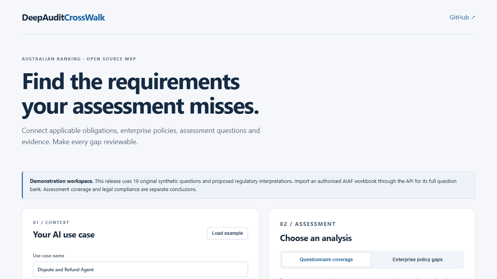

# DeepAuditCrossWalk

[](https://github.com/VivianFuVivianFu/DeepAuditCrossWalk/actions/workflows/ci.yml)
[](LICENSE)

**Find the applicable requirements your AI questionnaire and enterprise policies do not sufficiently assess.**

DeepAuditCrossWalk is an independent, open-source AI governance assessment engine,
starting with Australian banking. It shares an obligation-and-control library
across questionnaire coverage validation and enterprise policy gap detection.

> Status: experimental MVP, v0.1.0. Results support expert review. Coverage of an
> assessment question does not establish control implementation or regulatory compliance.



## What it does

- Imports an authorised AIAF Excel workbook, including hidden sheets, source
  hashes, question IDs, tags, formula text, cached values, risks and treatments.
- Keeps the original question bank separate from banking overlay questions.
- Selects obligations using explicit applicability rules: applicable, conditional,
  not applicable, or undetermined. Unknown facts remain unknown.
- Compares required control facets with question candidates. Only approved,
  version-bound mappings contribute to confirmed questionnaire coverage.
- Finds regulatory-to-policy gaps, policy-to-questionnaire gaps, possible control
  conflicts, and missing implementation evidence.
- Parses policy text, PDF and DOCX files with resource limits and inert treatment
  of embedded instructions.
- Records reviewer decisions, closure requirements, retest references and audit
  events within a local, tenant-scoped workspace.

```text
Applicable obligation → Control objective → Assessment question
                     → Evidence requirement → Reviewer decision

                 Shared obligation and control library
                    /                          \
       Questionnaire coverage             Enterprise policy gaps
                    \                          /
                     Gaps and remediation report
```

## Quick start

Prerequisites: Python 3.11+, Node.js 22 or 24, or Docker Compose.

```bash
git clone https://github.com/VivianFuVivianFu/DeepAuditCrossWalk.git
cd DeepAuditCrossWalk
python -m venv .venv
# Activate .venv using your shell's usual activation command.
pip install -e './backend[dev]'
uvicorn banking_crosswalk.app:app --host 127.0.0.1 --port 8000
```

In a second terminal:

```bash
cd web
npm ci
npm run dev
```

Open **http://localhost:3000** for the app and **http://localhost:8000/docs** for
the independent API. The web app calls only this project's backend; it does not
depend on the original DeepAudit deployment, login service or database.

Alternatively:

```bash
docker compose up --build
```

## Demo data and AIAF

The bundled questionnaire contains **16 original synthetic core questions and 3
synthetic focus questions**. It is explicitly labelled as demonstration data.
The original NSW workbook and its full extracted text are not redistributed.

Import your own authorised workbook with `POST /v1/questionnaires/import` and
create a routing snapshot with `POST /v1/questionnaires/route`. Supply the returned
questionnaire and snapshot IDs to assess the imported questions. Counts and
versions are derived from the workbook; they are not fixed at 436 or 446.
NSW AIAF is not itself an Australian commercial-banking legal standard.

The initial regulatory pack contains engineering interpretations referencing the
Privacy Act/APPs, APRA CPS 220/230/234, ASIC RG 271, EU AI Act scope, NIST AI RMF
and selected ISO 42001 concepts. All proposed mappings require expert review.
Source versions are snapshots, not a continuously updated legal service. NIST
and ISO alignment is reported separately from binding obligations. Licensed ISO
standard text is not distributed.

## API workflow

All `/v1` analysis routes require `X-Tenant-ID`. When configured, also supply
`X-API-Key`. Human review routes additionally require `X-Actor` and `X-Role`.
These headers belong behind a trusted identity-aware gateway in an enterprise deployment.

```bash
curl -X POST http://localhost:8000/v1/assessments/coverage \
  -H 'Content-Type: application/json' -H 'X-Tenant-ID: example-bank' \
  -d '{"use_case":{"name":"Refund agent","apra_regulated":true,"handles_personal_information":true},"questionnaire_pack":"DEMO_BANKING_V1","persist":false}'
```

| Endpoint | Purpose |
| --- | --- |
| `GET /health`, `GET /v1/demo` | Health, synthetic data provenance and pack metadata |
| `POST /v1/questionnaires/import` | Read-only base64 XLSX import |
| `POST /v1/questionnaires/route` | Version-bound focus-question selection |
| `POST /v1/regulatory-packs/validate` | Validate the active obligation pack |
| `POST /v1/use-cases` | Store a local use-case context |
| `POST /v1/assessments/coverage` | Questionnaire coverage and remediation |
| `POST /v1/policies/import`, `/import-file` | Text or base64 PDF/DOCX/TXT/MD policy import |
| `POST /v1/assessments/policy-gaps` | Regulatory/policy/questionnaire comparisons |
| `POST /v1/mappings/review` | Approve or reject a version-bound mapping |
| `GET /v1/assessments/{id}/gaps` | Assessment gaps |
| `POST /v1/gaps/{id}/review` | Review and evidence-gated closure |
| `GET /v1/assessments/{id}/report` | JSON report and audit events |

## Current boundaries

- The repository is in memory. Records disappear when the process restarts; use a
  single process for local evaluation. **Production stateful routes return 503**
  until durable persistence is implemented. `DATABASE_URL` alone enables nothing.
- The public web demo uses non-persistent inline analyses and the synthetic core
  questions. Full workbook import, routing, mapping review and gap closure are
  available through the API for local evaluation, not yet through the web UI.
- Matching and policy extraction are deterministic heuristics. They propose
  candidates; they cannot approve their own interpretations or prove operating
  effectiveness. No external model API is required or contacted.
- PDF extraction supports text PDFs, not scanned-document OCR. DOCX extraction
  currently covers body paragraphs and tables; headers, footnotes and tracked
  changes require reviewer inspection in the original document. PDF page
  delimiters remain in extracted text; clause-level page references are pending.
- JSON export is available. PDF/CSV reports, durable PostgreSQL persistence,
  federated RBAC, and behavioural-test evidence integration remain roadmap items.

## Verification and contribution

```bash
python -m pytest backend/tests -q
python -m ruff check backend
python scripts/check_secrets.py
cd web
npm test
npm run typecheck
npm run build
npm audit --audit-level=high
```

See [architecture](docs/ARCHITECTURE.md), [deployment](docs/DEPLOYMENT.md),
[contributing](CONTRIBUTING.md), [security](SECURITY.md) and [roadmap](ROADMAP.md).
The [verification record](docs/VERIFICATION.md) distinguishes local checks from CI/container checks.
We welcome control mappings with source citations, applicability edge cases,
false-coverage regressions, deployment improvements and early evaluation feedback.

## License and provenance

Apache-2.0 for project code; dependency licenses remain their own. The Crosswalk
core originated in DeepAudit and was extracted into this independent project.
See [NOTICE](NOTICE) and [third-party notices](THIRD_PARTY_NOTICES.md). No original
DeepAudit Git history, credentials, private policies, or source workbooks are included.
