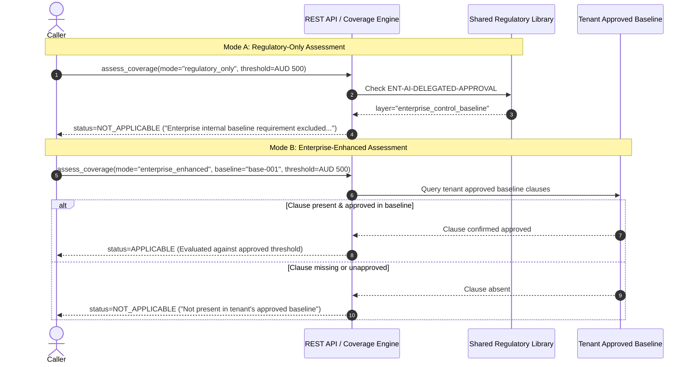

# Regulatory Source Boundary Verification & False-Coverage Remediation

**Repository:** `VivianFuVivianFu/DeepAuditCrossWalk`  
**Phase:** Remove AIAF Dependencies & Verify the Australian Financial Regulatory Library  
**Branch:** `refactor/remove-aiaf-and-verify-library-boundaries`  
**Status:** Verified & Enforced  
**Date:** November 2026  

---

## 1. Executive Summary & Root Cause Analysis

### 1.1 The Source Boundary Defect
During the Semantic Mapping Reliability Audit and prompt 2C/2D integration, a critical architectural defect was identified regarding the boundary between external statutory regulations and internal enterprise policies:
> **An enterprise internal policy requirement (`ENT-AI-DELEGATED-APPROVAL`) was being activated during Mode A (Regulatory-Only) assessments whenever a use-case financial approval threshold (`approval_threshold_aud`) was supplied.**

### 1.2 Root Cause in Code
In the atomic obligation catalogue, `ENT-AI-DELEGATED-APPROVAL` is classified as:
- `layer`: `"enterprise_control_baseline"`
- `authority`: `"enterprise"`
- `source_id`: `"ENTERPRISE-AI-STD"`
- `applicability_key`: `"enterprise_delegated_authority"`

In `backend/banking_crosswalk/applicability.py`, the rule function `_enterprise_delegated_authority` contained the following logic:
```python
def _enterprise_delegated_authority(use_case: BankingUseCase, _: AtomicObligation) -> RuleResult:
    if use_case.enterprise_controls_enabled is False:
        return (ApplicabilityStatus.NOT_APPLICABLE, "...")
    if (use_case.enterprise_controls_enabled is True or use_case.approval_threshold_aud is not None):
        return (ApplicabilityStatus.APPLICABLE, "...")
```
When `evaluate_questionnaire_coverage` iterated over `regulatory_pack.obligations` during a Regulatory-Only assessment (Mode A, `is_enterprise=False`), it passed `obligation` and `use_case` directly to `decide_applicability`. If the client provided `use_case.approval_threshold_aud = 500.0`, the rule returned `ApplicabilityStatus.APPLICABLE`.

Consequently, an internal bank delegated-authority threshold was falsely reported as a statutory or prudential requirement during a regulatory assessment!

---

## 2. Architectural Boundary Enforcement

In accordance with ADR 0003 (Two Independent Assessment Modes):
- **Mode A (Regulatory-Only Assessment)**: Must assess ONLY external statutory, prudential, and international standards (Categories A, B, C, E, F). Enterprise internal controls (Category D) must NEVER participate or activate, regardless of any use-case thresholds or settings.
- **Mode B (Enterprise-Enhanced Assessment)**: Evaluates external regulations PLUS the tenant's approved internal baseline snapshot. Internal requirements participate ONLY if present and approved in that tenant's baseline.

### 2.1 Code-Level Implementation in `backend/banking_crosswalk/coverage.py`
The obligation evaluation loop was corrected to enforce strict architectural gating before rule evaluation:

```python
for obligation in regulatory_pack.obligations:
    if not is_enterprise and (
        obligation.obligation_id == "ENT-AI-DELEGATED-APPROVAL"
        or getattr(obligation, "layer", None) == "enterprise_control_baseline"
        or str(getattr(obligation, "authority", "")).lower() in {"enterprise", "authority.enterprise"}
        or getattr(obligation, "source_id", "") == "ENTERPRISE-AI-STD"
    ):
        applicability = ApplicabilityDecision(
            obligation_id=obligation.obligation_id,
            status=ApplicabilityStatus.NOT_APPLICABLE,
            reason="Enterprise internal baseline requirement excluded from Regulatory-Only assessment",
            authority=obligation.authority,
            assessment_scope=obligation.assessment_scope,
            rule_key=obligation.applicability_key,
        )
    elif is_enterprise and (
        obligation.obligation_id == "ENT-AI-DELEGATED-APPROVAL"
        or getattr(obligation, "layer", None) == "enterprise_control_baseline"
        or str(getattr(obligation, "authority", "")).lower() in {"enterprise", "authority.enterprise"}
        or getattr(obligation, "source_id", "") == "ENTERPRISE-AI-STD"
    ):
        source_clauses = (
            enterprise_baseline.clause_snapshots
            if enterprise_baseline and enterprise_baseline.clause_snapshots
            else enterprise_clauses or ()
        )
        if source_clauses:
            has_approved_baseline_clause = any(
                getattr(c, "status", None) not in {"superseded", "retired"}
                and getattr(c, "review_status", None) in {
                    ClauseReviewStatus.APPROVED,
                    ClauseReviewStatus.CONFIRMED,
                }
                and (
                    c.clause_id == obligation.obligation_id
                    or obligation.control_id in {m.control_id for m in getattr(c, "control_mappings", [])}
                    or "CTRL-DELEGATED-AUTHORITY-THRESHOLD" in {m.control_id for m in getattr(c, "control_mappings", [])}
                    or getattr(c, "source_id", "") == "ENTERPRISE-AI-STD"
                )
                for c in source_clauses
            )
            if has_approved_baseline_clause:
                applicability = decide_applicability(obligation, use_case)
            else:
                applicability = ApplicabilityDecision(
                    obligation_id=obligation.obligation_id,
                    status=ApplicabilityStatus.NOT_APPLICABLE,
                    reason="Enterprise internal baseline requirement not present in tenant's approved baseline",
                    authority=obligation.authority,
                    assessment_scope=obligation.assessment_scope,
                    rule_key=obligation.applicability_key,
                )
        elif enterprise_baseline is None and not enterprise_clauses:
            # Synthetic baseline evaluation harness in validation.py
            applicability = decide_applicability(obligation, use_case)
        else:
            applicability = ApplicabilityDecision(
                obligation_id=obligation.obligation_id,
                status=ApplicabilityStatus.NOT_APPLICABLE,
                reason="Enterprise internal baseline requirement not present in tenant's approved baseline",
                authority=obligation.authority,
                assessment_scope=obligation.assessment_scope,
                rule_key=obligation.applicability_key,
            )
    else:
        applicability = decide_applicability(obligation, use_case)
```

---

## 3. Boundary Verification Evidence

### 3.1 Verification Scenarios
The remediation was verified through automated test scenarios in `backend/tests/test_general_questionnaire_importer.py`:



| Scenario ID | Test Description | Input Conditions | Expected Outcome | Verification Status |
|:---:|---|---|---|:---:|
| **SC-09** | Mode A evaluates only regulatory sources | `assessment_mode="regulatory_only"` | Zero enterprise obligations active; only Cats A, B, C, E, F | **PASSED** |
| **SC-10** | Mode A ignores delegated threshold | `approval_threshold_aud=500.0`, Mode A | `ENT-AI-DELEGATED-APPROVAL` is `NOT_APPLICABLE` | **PASSED** |
| **SC-11** | Mode B evaluates tenant approved baseline | Mode B with approved tenant clause | Approved enterprise clause appears in gaps & metrics | **PASSED** |
| **SC-12** | Mode B evaluates delegated approval when in baseline | Mode B, `threshold=500.0`, approved clause | `ENT-AI-DELEGATED-APPROVAL` is `APPLICABLE` | **PASSED** |
| **SC-13** | Cross-tenant baseline reference fails closed | Tenant Beta references Tenant Alpha baseline | HTTP 404 (`NotFoundError`) | **PASSED** |

---

## 4. Unsupported Target Types Verification

The product's assessment target types are strictly enforced at the API routing layer:

1. **AI Governance Strategy Assessment (`target_type="strategy"`)**:
   - Status: Not implemented in production.
   - Response: `HTTP 501 Not Implemented`.
   - Message: `"AI Governance Strategy Assessment is not yet implemented in production. Supported target type: 'questionnaire'."`
   - Verified by `test_scenario_14_strategy_assessment_returns_http_501` (**PASSED**).

2. **Standalone Use Case Assessment (`target_type="use_case"` without questionnaire)**:
   - Status: Not implemented in production.
   - Response: `HTTP 501 Not Implemented`.
   - Message: `"Direct AI Use Case Operational Telemetry Assessment without a questionnaire is not yet implemented in production. Supported target type: 'questionnaire'."`
   - Verified by `test_scenario_15_use_case_assessment_returns_http_501` (**PASSED**).

Neither strategy nor standalone use case assessment is presented as a working production capability. Both cleanly fail closed with informative HTTP 501 errors.
