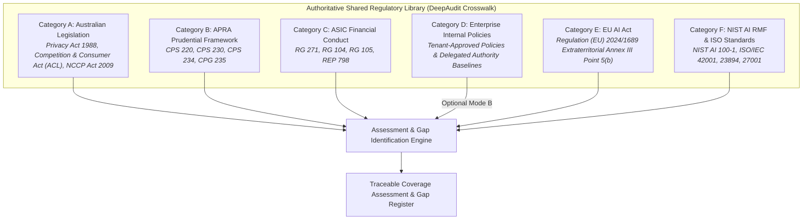

# Australian Financial Services AI Regulatory Library Verification: Six Authorized Source Categories

**Repository:** `VivianFuVivianFu/DeepAuditCrossWalk`  
**Phase:** Remove AIAF Dependencies & Verify the Australian Financial Regulatory Library  
**Branch:** `refactor/remove-aiaf-and-verify-library-boundaries`  
**Status:** Verified & Enforced  
**Date:** November 2026  

---

## 1. Product Purpose & Authoritative Mission

DeepAudit Crosswalk's authoritative mission is to:
> **Evaluate an organisation's AI Governance Strategy or AI Governance / Assurance Questionnaire against applicable regulatory and governance requirements, and identify coverage gaps.**

The assessment requirements must originate strictly from the **Shared Regulatory Library** (statutory enactments, prudential standards, conduct guides, and international benchmarks) and, where explicitly enabled, an approved **Enterprise Internal Baseline**.

### The Critical Architectural Clarification:
**The Artificial Intelligence Assurance Framework (AIAF) questionnaire is not an Australian banking regulatory standard, an authoritative statutory library, or a required product dependency.**

AIAF was an idiosyncratic state-level public sector checklist. It holds no statutory, prudential, or licensing force for Australian commercial banks (ADIs), Australian Financial Services Licence (AFSL) holders, or Australian Credit Licence (ACL) holders. DeepAudit Crosswalk relies solely on the **Six Authorized Source Categories** verified below.

---

## 2. The Six Authorized Source Categories

### 2.1 Category A: Australian Legislation & Statutory Guidance
Binding statutory enactments passed by the Parliament of Australia governing banking institutions, credit providers, and entities handling personal data:
- **Privacy Act 1988 (Cth)**: Schedule 1 Australian Privacy Principles (APPs 1, 3, 5, 6, 8, 10, 11) and the Privacy and Other Legislation Amendment Act 2024 (automated decision-making transparency under APPs 1.7–1.9).
- **Competition and Consumer Act 2010 (Cth) / Australian Consumer Law (ACL)**: Statutory prohibitions against misleading, deceptive, or unconscionable conduct in AI-generated customer advice, automated pricing, and representations.
- **National Consumer Credit Protection Act 2009 (Cth) (NCCP Act)**: Section 47 general credit licensing obligations and Sections 128–131 mandatory responsible lending unsuitability assessments for AI-assisted consumer lending.
- **Office of the Australian Information Commissioner (OAIC) APP Guidelines**: Statutory regulatory guidance interpreting APP obligations for automated processing and privacy governance.

### 2.2 Category B: APRA Prudential Framework
Binding prudential standards and practice guides determined by the Australian Prudential Regulation Authority (APRA) under Section 11AF of the *Banking Act 1959 (Cth)*:
- **Prudential Standard CPS 220 (Risk Management)**: Board-approved Risk Management Framework (RMF), independent risk management function, three-lines-of-defense model, and material risk appetite limits covering automated systems.
- **Prudential Standard CPS 230 (Operational Risk Management)**: Operational risk profiling, internal controls testing, business continuity planning, execution tolerances, and third-party material service provider (MSP) monitoring.
- **Prudential Standard CPS 234 (Information Security)**: Information security capability commensurate with the threat landscape, systematic testing of controls (including prompt injection / red-teaming), and mandatory 72-hour material incident notification to APRA.
- **Prudential Practice Guide CPG 235 (Managing Data Risk)**: Non-binding supervisory guidance on data risk governance, data lineage, data quality validation, and lifecycle controls supporting CPS 220 and CPS 230.

### 2.3 Category C: ASIC Financial Conduct & Regulatory Guidance
Enforceable instruments, regulatory guides, and supervisory review reports published by the Australian Securities and Investments Commission (ASIC):
- **Regulatory Guide 271 (Internal Dispute Resolution)**: Enforceable requirements under ASIC Instrument 2020/98 governing complaint recording, triage, customer communication, and strict 30-day response timeframes for AI-assisted dispute outcomes.
- **Regulatory Guide 104 (AFS Licensing: Meeting the General Obligations)**: Supervisory guidance interpreting Section 912A(1) of the *Corporations Act 2001 (Cth)* on adequate risk management systems, technological resources, and conflict of interest controls.
- **Regulatory Guide 105 (AFS Licensing: Organisational Competence)**: Expectations on maintaining technical knowledge, skills, and Responsible Manager competence for automated financial service tools.
- **ASIC Report 798 (Beware the Gap: Governance Arrangements in the Face of AI Innovation)**: Key supervisory findings and scenario-design benchmarks identifying governance deficits in licensee AI adoption.

### 2.4 Category D: Enterprise Internal Policies (When Explicitly Enabled)
Internal tenant-specific governance policies and standards uploaded by the enterprise and approved through the Enterprise Baseline engine:
- Tenant-approved AI Risk and Ethics Standards.
- Internal Delegated Financial Authority Schedules (`ENT-AI-DELEGATED-APPROVAL`).
- System-specific operational thresholds and pre-execution human approval gates.
*Enforcement Rule:* Enterprise internal requirements are **strictly excluded** during Mode A (Regulatory-Only) assessments and participate only during Mode B (Enterprise-Enhanced) assessments backed by an approved tenant baseline snapshot.

### 2.5 Category E: EU AI Act (Extraterritorial / Cross-Border Nexus)
Regulation (EU) 2024/1689 of the European Parliament and of the Council:
- Extraterritorial application under Article 2(1)(c) for financial firms where AI system outputs are used in the European Union.
- Annex III Point 5(b) High-Risk AI obligations: AI systems intended to be used to evaluate the creditworthiness of natural persons or establish their credit score.
- High-risk governance duties: Article 9 (Risk Management System), Article 10 (Data Governance & Bias Mitigation), Article 11 (Technical Documentation), Article 12 (Automatic Logging & Record-Keeping), Article 14 (Human Oversight), and Article 15 (Accuracy, Robustness & Cybersecurity).

### 2.6 Category F: NIST AI RMF & ISO/IEC International Standards
Authoritative international voluntary frameworks and consensus management standards:
- **NIST AI Risk Management Framework 1.0 (NIST AI 100-1)**: Core functions GOVERN, MAP, MEASURE, and MANAGE, establishing continuous AI lifecycle risk tracking.
- **ISO/IEC 42001:2023**: Artificial Intelligence Management System (AIMS) requirements (Clauses 4–10 and Annex A controls).
- **ISO/IEC 23894:2023**: Guidance on AI risk management processes and threat identification.
- **ISO/IEC 27001:2022**: Information Security Management System (ISMS) controls protecting model infrastructure, training pipelines, and weights.
*Licensing Note:* No copyrighted standard text is stored or redistributed; only bibliographic citations and independently authored control summaries are maintained in the repository.

---

## 3. Comprehensive Regulatory Inventory

The Shared Regulatory Library contains 45 atomic obligations mapped to unified controls across the six categories:

| Source ID | Instrument Title | Regulator / Body | Category | Legal Classification | Active Obligations | Status |
|---|---|---|:---:|:---:|:---:|:---:|
| `AU-PRIVACY-ACT` | Privacy Act 1988 (Cth) & APPs | Commonwealth / OAIC | **A** | Binding Statute | 10 | Current |
| `AU-OAIC-APP-GUIDELINES` | APP Guidelines | OAIC | **A** | Statutory Guidance | 2 | Current |
| `AU-NCCP-ACT` | National Consumer Credit Protection Act 2009 | Commonwealth / ASIC | **A** | Binding Statute | 2 | Current |
| `AU-AI-GUIDANCE-2025` | Guidance for AI Adoption (6 Essential Practices) | DISR / NAIC | **A** | Statutory Guidance | 3 | Current |
| `APRA-CPS220` | CPS 220 Risk Management | APRA | **B** | Prudential Standard | 2 | Current |
| `APRA-CPS230` | CPS 230 Operational Risk Management | APRA | **B** | Prudential Standard | 4 | Current |
| `APRA-CPS234` | CPS 234 Information Security | APRA | **B** | Prudential Standard | 4 | Current |
| `APRA-CPG235` | CPG 235 Managing Data Risk | APRA | **B** | Prudential Guide | 2 | Current |
| `ASIC-RG271` | RG 271 Internal Dispute Resolution | ASIC | **C** | Enforceable Guidance | 2 | Current |
| `ASIC-RG104` | RG 104 Licensing General Obligations | ASIC | **C** | Regulatory Guidance | 2 | Current |
| `ASIC-RG105` | RG 105 Organisational Competence | ASIC | **C** | Regulatory Guidance | 1 | Current |
| `ASIC-REP798` | REP 798 Beware the Gap (AI Governance) | ASIC | **C** | Regulatory Report | 1 | Current |
| `ENTERPRISE-AI-STD` | Enterprise AI & Delegated Authority Standard | Bank Enterprise Baseline | **D** | Enterprise Defined Control | 1 | Current |
| `EU-AI-ACT` | Regulation (EU) 2024/1689 (Artificial Intelligence Act) | EU Parliament / Council | **E** | Extraterritorial Regulation | 3 | Current |
| `NIST-AI-RMF` | NIST AI Risk Management Framework 1.0 | NIST (U.S. Dept of Commerce) | **F** | Voluntary Framework | 3 | Current |
| `ISO-42001` | ISO/IEC 42001:2023 AI Management Systems | ISO / IEC | **F** | Voluntary Standard | 2 | Current |
| `ISO-23894` | ISO/IEC 23894:2023 AI Risk Management | ISO / IEC | **F** | Voluntary Standard | 1 | Current |
| `ISO-27001` | ISO/IEC 27001:2022 Information Security Management | ISO / IEC | **F** | Voluntary Standard | 1 | Current |
| **Total** | | | | | **45** | |

---

## 4. Verification Summary

1. **Complete Category Coverage**: All six categories (A through F) are formally represented with explicit legal authority classifications in `REGULATORY_SOURCE_REGISTER.csv` and `ATOMIC_OBLIGATION_CATALOGUE.json`.
2. **Deterministic Dual-Mode Separation**: Categories A, B, C, E, and F constitute the Shared Regulatory Library for Mode A assessments. Category D participates strictly and exclusively in Mode B assessments when an approved enterprise baseline snapshot is active.
3. **Decoupled from AIAF**: The AIAF questionnaire is confirmed not to exist in the Shared Regulatory Library. Its removal permanently establishes DeepAudit Crosswalk as a general-purpose, institution-grade compliance crosswalk platform.
